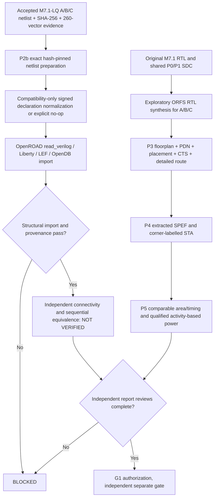

# MSIF-AI — Governed Model-Specific Silicon Prototype

## M7.2 research-branch status — 2 November 2026

The `feature/m72-physical-flow-qualification` branch has **seven scoped research commits** (P0/P1, P2b graph, P3 bounded routed GLS, P4 TT diagnostics, P5 classified area, P5 matched VCD, G1 blocked-release preflight). The latest verified Commit 07 is `3411e86f89095a149f03cd947399eb4cac6c3bb2`; Commit 08 is pending documentation reconciliation. These do **not** qualify M7.2 silicon or authorize a release. P2b formal/reset, P3 ECO, P4 SS/FF/RC, P5 annotated power and G1 approval are **NOT_VERIFIED**.

Authoritative status: [Architecture](docs/Architecture.md#m72-authoritative-research-architecture--reconciled-2-november-2026), [Milestones](docs/Milestones.md#m72-branch-history-and-release-gates--2-november-2026), [Validation](docs/Validation.md#m72-evidence-and-validation--2-november-2026), [G1 handoff](docs/M7.2-G1-Engineering-Handoff.md) and [commit history](docs/M7.2-Future-Commit-and-Tags.md). Historical notes below retain the dates of their original observations.

**Status:** Hackathon research prototype; not fabricated, not physically signed off. Independent companion to Portable Agentic AI Governance **v0.21.1** (snapshot commit `ea95206`).

## Scope and numerical contract

- M0: signed INT4 weights, signed INT8 activations, INT32 output, `y = Wx+b` (16×64 default), exact arithmetic.
- M1: deterministic golden model and all **4096** INT4×INT8 pairs tested.
- M2: programmable, fixed-coefficient and register-initialized ROM-style RTL variants, identical one-cycle valid response. The ROM variant is a behavioral/synthesis exploration, **not** a characterized mask-ROM macro.
- M5: deterministic matrix-to-SystemVerilog generator and content fingerprints.
- M7-lite: optional Yosys technology-independent synthesis; **no PDK-qualified power, area, routed timing or signoff**.
- Governance: manifest integrity verification and optional **actual PAG v0.21.1 Ed25519 signing adapter**, not a simulated signature.

## Quick start (Node1 Ubuntu 24.04)

```bash
./scripts/node1_audit.sh
./scripts/verify.sh
PYTHONPATH=src python3 -m msif.cli build --out build/demo
PYTHONPATH=src python3 -m msif.cli verify --out build/demo
```

## Governed artifact signing (optional)

Install the reviewed PAG snapshot into a separate Python environment or make its `src` importable. Provision an Ed25519 key pair *outside* the repository. Use the real PAG `generate_ed25519_keypair` operation if needed. Never commit private keys.

```bash
PYTHONPATH=src:/path/to/governance/src python3 -m msif.cli sign --out build/demo --private-key /secure/key.pem --public-key /secure/key.pub.pem
PYTHONPATH=src:/path/to/governance/src python3 -m msif.cli verify --out build/demo --pubkey /secure/key.pub.pem
```

No Git push, repository update, release or tapeout is performed by this package. Unsigned manifests are integrity-checked but are **not approved releases**.

## Documentation

Start with [Instruction](docs/Instruction.md), [Architecture](docs/Architecture.md), [Prerequisites](docs/Prerequisites.md), [Deployment](docs/Deployment.md), [Validation](docs/Validation.md), [Milestones](docs/Milestones.md), [Documentation Audit](docs/Documentation-Audit.md), [Governance Crosswalk](docs/Governance-Crosswalk.md), [One-shot Deployment](docs/oneshot-deployment.md).

The source specification is the supplied `Model-Specific-AISilicon-Architecture-and-Engineering(1).md`; it remains authoritative for the full 12-milestone research program, not a claim of completeness here.

## Audit and source specification

See [Repository Review](docs/Repository-Review.md) and the unmodified [MSIF Source Specification](docs/MSIF-Source-Specification.md).


## Node1 qualification correction — 25 October 2026

The initial `verify.sh` accepted successful Python tests while printing `SKIP` for unavailable Verilog simulation and synthesis tools. This did **not** satisfy M2 RTL equivalence or M7-lite synthesis acceptance. The revised script **fails closed** (exit code 2) when `iverilog`/`vvp` or `yosys` is missing, runs actual RTL test vectors against the Python oracle and archives per-variant simulation/synthesis logs under ignored `build/demo/`. The initial Node1 log showed `yosys`, `iverilog`, `verilator`, `openroad`, `klayout`, and `ngspice` missing; their installation is not established by the patch. Only Icarus and Yosys are hard requirements for the strict prototype gate. `scripts/install_node1_tools.sh` is dry-run by default; `--install` is an explicit host modification.

**Validity boundary:** Icarus simulations exercise deterministic boundary/random input vectors but are not exhaustive for 16×64 GEMV; formal equivalence, signed rounding/INT8 saturation, mapped Liberty area/STA, parasitics and physical DRC/LVS are not delivered. Generic Yosys `stat` must not be presented as PDK-based area/power/timing. Initial `programmable` weights are initialized registers, not software-loaded runtime-programmable memory; `rom` is an inferred array, not a qualified silicon ROM macro. Signing is optional for research, mandatory for any governed release.

**Traceability:** [README](README.md) · [Prerequisites](docs/Prerequisites.md) · [Validation](docs/Validation.md) · [Architecture](docs/Architecture.md) · [Milestones](docs/Milestones.md) · [Governance Crosswalk](docs/Governance-Crosswalk.md) · [Deployment](docs/Deployment.md) · [Documentation Audit](docs/Documentation-Audit.md) · [One-shot Deployment](docs/oneshot-deployment.md). Original PAG document links in Governance Crosswalk retain the actual `M2-...` through `M10-...` filenames; no nonexistent aliases are promised.


## Node1 observed qualification — October 25, 2026 (v0.1.1)

The user-supplied Node1 log confirms seven Python unit tests passed, all three RTL variants passed 28 deterministic vectors each, and Yosys 0.33 completed generic synthesis with zero `check` problems. Host tools: Icarus Verilog 12.0, Verilator 5.020 and Yosys 0.33. OpenROAD, KLayout and ngspice were not installed; they are not mandatory for the M7-lite generic synthesis gate.

| Variant | 28-vector Icarus | Yosys generic cells | Memory objects after synthesis |
|---|---|---:|---:|
| Programmable | PASS | 123,837 | 0 |
| Fixed-weight | PASS | 115,662 | 0 |
| ROM-style | PASS | 123,837 | 0 |

The fixed-weight variant has 8,175 (approximately 6.60%) fewer generic cells than the programmable baseline **for this particular fixture and synthesis flow**. The programmable and ROM-style variants map to identical generic cell counts, so the experiment does not yet differentiate a physical ROM or SRAM macro. These counts are *not* area, energy, timing, clock frequency, routed congestion or manufacturing evidence. The 28 full-matrix vectors are not an exhaustive proof.

`python3 scripts/node1_evidence.py --build build/demo` reads actual simulator/Yosys logs, requires PASS and zero Yosys `check` problems, and emits `build/demo/node1_evidence.json` with tool versions and log hashes. It fails if evidence is missing. This is a local evidence summary, **not** an approval or signature.

Baseline-freeze policy: freeze M0, M1 and the limited M2/M5/M7-lite implementation after reproducing the verification on Node1 and inspecting the local report. Keep formal proofs, technology-mapped PPA, real ROM macro, governance signature/approval and full source-model quantization as open gates. Existing milestones M3/M4/M6/M8–M11 are not completed.

## M2.1 formal verification candidate

See [M2.1 Formal Equivalence](docs/M2.1-Formal-Equivalence.md). Run `./scripts/verify_m21.sh` on Node1 for exhaustive scalar RTL simulation (4096 pairs) and a separate Yosys SAT assertion proof. A passing Node1 run is required before claiming this milestone; full GEMV equivalence and PDK timing remain unverified.


> **M2.1 validation correction (2026-10-25):** M2.1 correction: the first M2.1 run produced false-positive PASS evidence due to simulator ERROR messages; rerun corrected `scripts/verify_m21.sh` and inspect `docs/M2.1-Formal-Equivalence.md` before committing.

## M2.2 small-GEMV verification candidate

The bounded 2×4 GEMV arithmetic miter, generated RTL sequential tests, fail-closed Verilator lint, independent simulator checks, and evidence acceptance criteria are specified in [M2.2 — Small GEMV and Sequential Verification](docs/M2.2-Small-GEMV-and-Sequential-Verification.md). On pages located within `docs/`, use the relative link `M2.2-Small-GEMV-and-Sequential-Verification.md`. Run `./scripts/verify_m22.sh` on Node1 only after M2.1 has been merged and revalidated. This milestone is not automatically accepted on source generation alone.


### M2.2 reset-testbench erratum (2026-10-25)
The first Node1 M2.2 simulation stopped at `async reset failed` because the testbench initialized active-low reset to zero without generating a falling edge. The corrected testbench initializes `rst_n=1`, then explicitly drives `rst_n=0` and waits for nonblocking assignments to settle before checking reset outputs. Repeat all three variant simulations and proof/lint gates; earlier M2.2 evidence is not acceptable. This is a testbench correction, not a change to the accepted M2.1 RTL compiler.

## M5.1 — PyTorch tensor import candidate

[M5.1 Tensor Ingestion](docs/M5.1-Quantized-Tensor-Ingestion.md) defines deterministic per-tensor signed INT4 quantization, row-major ordering, SHA-256 source provenance, explicit scale and fail-closed overflow. Execute `./scripts/verify_m51.sh` in addition to earlier milestone gates. This candidate is **not yet Node1-qualified** and does not imply production-model quantization accuracy, PDK PPA, or governance approval.


## M5.1 PyTorch and NumPy dependency management (Node1)

**Authoritative dependency definition:** `pyproject.toml` plus committed `uv.lock`;
`requirements.txt` is a core-only pip compatibility file, not the GPU wheel lock.
Python 3.12 x86_64, NumPy 2.5.4 and GPU-group PyTorch 2.14.0 from the
explicit `pytorch-cu130` index are the tested *candidate selection*. The
project must not claim GPU admission until the locked `.venv` passes the
Blackwell sm_120 native-kernel, no-PTX-JIT, and custom-extension gates.

```bash
uv --version
uv lock                              # resolve and create uv.lock on networked Node1
uv sync --locked --group gpu         # reproducible .venv; refuses stale lock
uv run --locked --group gpu python -c 'import numpy, torch; print(numpy.__version__, torch.__version__, torch.version.cuda)'
./scripts/validate/pytorch/qualify_project_environment.sh
./scripts/verify_m51.sh
```

See `docs/M5.1-PyTorch-Environment-Qualification.md`. The external
`/tmp/msif-pytorch-2.14.0-cu130` qualification and all local evidence are
separate from the project lock. No GPU/CUDA validation was performed by
creating this dependency patch.


## M7.1 synthesis comparison candidate

The next prototype gate is [M7.1 controlled A/B/C synthesis](docs/M7.1-Controlled-Synthesis-Comparison.md) (see `docs/M7.1-Controlled-Synthesis-Comparison.md` from documents). Run `./scripts/verify_m71.sh` after all older milestone regressions. Generic cell counts and optional Liberty-mapped cell counts do not establish timing, routed area, power or release approval. PAG EvidenceLedger and human approval integration remain planned.


## M7.1-L — optional standard-cell Liberty mapping qualification (2026-10-26)

**M7.1-G PASS; M7.1-L exploratory PASS; M7.1-LQ pending.** See [Liberty mapping experimental record](docs/M7.1-Liberty-Mapping-Qualification.md).


### M7.1 synthesis qualification — 26 October 2026

- **M7.1-G: PASS** — controlled generic Yosys synthesis (2×4).
- **M7.1-L: PASS** — exploratory SKY130 HD TT Liberty mapping (2×4).
- **M7.1-LQ: PENDING** — exported mapped-netlist audit and independent equivalence.
- **M7.2: PENDING** — SDC/STA, LEF, placement/routing and physical PPA qualification.
- **G1: PENDING** — governed release authorization and independent receipts.

Yosys 0.33, OpenROAD Flow Scripts revision `64939f3`, and pinned Liberty SHA-256 `ec0e1067a35c8bf20b11e58d1e8ac53326067e4dac84a125cc1b917a3518d0d9` were used. For the 2×4 fixture, Liberty-reported cell-area sums for A/B/C were **6,707.6832 / 6,593.8240 / 6,707.6832 µm²**. These are synthesis-stage standard-cell estimates, not placed/routed area, timing, power, qualified SRAM/ROM or release approval. See the [Liberty execution record](docs/M7.1-Liberty-Mapping-Qualification.md) and [controlled synthesis comparison](docs/M7.1-Controlled-Synthesis-Comparison.md).

## M7.1-LQ Node1 bounded gate-level qualification — 26 October 2026

**PASS for bounded tests only:** A/B/C mapped netlists exported; Liberty cell inventories have zero unknown types; **260 vectors per variant** passed Icarus gate-level simulation (mapped cell counts **746 / 690 / 746**). Source and artifact hashes were audited against the uploaded Node1 evidence. The **34-test Python suite passed**. Full sequential formal equivalence, physical PPA, physical memory macros and G1 release approval remain **NOT VERIFIED**.

See the canonical [LQ verification report](docs/M7.1-LQ-Mapped-Netlist-Verification.md) and [M7.2/G1 engineering handoff](docs/M7.2-G1-Engineering-Handoff.md). The architectural research specification remains unchanged. Source code is a feature-branch candidate until manually reviewed, merged and tagged; do not interpret Node1 verification as a GitHub release.


## M7.2 physical-flow implementation boundary — 26 October 2026

**M7.2 physical-flow candidate:** P0/P1/LQ lineage and fail-closed SKY130 HD platform/SDC preflight are implemented; optional ORFS dry-run/physical execution is opt-in. **No Node1 M7.2 physical PASS, imported-LQ netlist, extracted timing, PPA signoff or G1 approval is yet established.** See [M7.2 qualification](docs/M7.2-Physical-Design-Qualification.md).

M7.2 Node1 dry-run note (28 October 2026): P0/P1 passed, while GNU Make `-n` failed on a missing intermediate floorplan SDC generated by recursive stage recipes. A static no-execution plan replaces this unreliable make dry-run. P2b mapped-netlist import, physical flow and timing/PPA remain pending; see [M7.2 runbook](docs/M7.2-Physical-Design-Qualification.md).

## M7.2 current physical-design status — 28 October 2026

The Node1 programmable A **exploratory** SKY130 HD ORFS physical flow completed through GDS/SPEF with Make exit 0 after signed-netlist normalizer and Tcl promotion fixes. Prior M7.1-LQ 260-vector A/B/C gate verification remains the accepted numerical baseline. The initial floorplan mapped-cell area is 7,818.749 µm², core area 30,749.491 µm² and router final violations 0 **for A only**. See [M7.2 runbook](docs/M7.2-Physical-Design-Qualification.md) and [architecture](docs/Architecture.md) for evidence and Mermaid diagrams.

**P2b exact M7.1-LQ import, P3 physical review for A/B/C, P4 signoff extracted STA, P5 fair PPA, memory macros and G1 remain open.** Independent fail-closed artifact inventory: `python3 scripts/m72_physical_audit.py --flow "$MSIF_ORFS/flow"` (nonzero until all architectures have required files). No final M7.2 release tag or approval yet.


## M7.2 P2b–P5 implementation continuation (28 October 2026)

This section is additive to the accepted P0/P1 baseline and does not authorize a commit, tag, or release.



### Implementation modules and status

- `scripts/m72_exact_lq_import.py`: hash-pin exact accepted `build/m71_liberty/m71_lq/msif_*_mapped.v` into isolated P2b candidates, preserve raw files, permit only reviewed signed-port compatibility transforms (including explicit no-op) and optionally test import into OpenDB; **does not implement post-import formal equivalence or a complete ORFS place-and-route handoff**.
- `scripts/m72/m72_normalize.py`: previously verified programmable declaration transform, now also emits a fail-closed identity/no-op receipt when no signed declarations exist. Prevents valid fixed/ROM structural netlists from being rejected solely due to absence of signed ports.
- `scripts/m72_report_review.py`: collects A/B/C final ODB/GDS/SPEF/SDC, detailed-route report and finish report, hashes artifacts, extracts labelled timing *observations*, and refuses missing evidence. A report-present result is explicitly not signoff.
- `scripts/m72_physical_audit.py`: retains a conservative three-architecture inventory with no signoff from existence alone.

### Node1 execution sequence

```bash
cd ~/dev/pub/ai-sys1/msif-hack/push/msif_hackathon
source .venv/bin/activate
export MSIF_ORFS="$HOME/eda/qualified-pdks/OpenROAD-flow-scripts"
export PYTHONPATH="$PWD/src:$PWD/scripts"
python3 -m unittest discover -s tests -v
PYTHONPATH="$PWD/scripts/m72" python3 -m unittest discover -s scripts/m72 -p 'test_m72_normalize.py' -v
python3 scripts/m72_exact_lq_import.py --orfs "$MSIF_ORFS" --out build/m72/p2b-exact-lq
# Only after reviewing the manifest and no stale output directory:
# python3 scripts/m72_exact_lq_import.py --orfs "$MSIF_ORFS" --out build/m72/p2b-exact-lq-execute --execute
# Independently perform the normalizer ORFS route on fixed and rom; use separate FLOW_VARIANTs.
python3 scripts/m72_report_review.py --flow "$MSIF_ORFS/flow" --out build/m72/p3p5-report-ledger.json
```

### Outstanding hard gates

- **P2b:** OpenDB import with matching accepted hashes is an *import experiment*. Cell-pin/bit-accurate structural preservation, sequential equivalence, and a fully integrated exact-LQ physical implementation remain separate, unimplemented closure gates.
- **P3:** A is routed experimentally; B/C must be routed. Independently review legal placement, PDN connectivity, detailed-route DRC, antenna checks, macro inclusion, and reproducible ODB/GDS against reports.
- **P4:** Timing reports from a single TT corner and relaxed research SDC cannot establish multi-corner signoff. Review all setup/hold paths, unconstrained endpoints, reset recovery/removal, RCX corner provenance and additional PVT views where available.
- **P5:** Report standard-cell (not die/core) area and distinguish core area, utilization, clock and I/O delay assumptions. Power without explicit VCD/SAIF/activity provenance is an estimate only. A/C arrays are not qualified SRAM/ROM macros.
- **G1:** Release approval and Node2 independent receipts remain `NOT_VERIFIED`.


## M7.2 P5 and pending closure audit (2026-10-28)

See [M7.2 P5 comparison and closure gates](docs/M7.2-P5-Comparison-and-Closure-Gates.md) for the corrected optional-DRC ledger behavior, research comparison, exact-netlist equivalence, multi-corner STA, activity-based power, and memory-macro requirements. A/B/C ORFS flows completed, but P2b–P5 signoff and G1 remain **NOT_VERIFIED**. No Git commit or release tag is authorized by this result.
