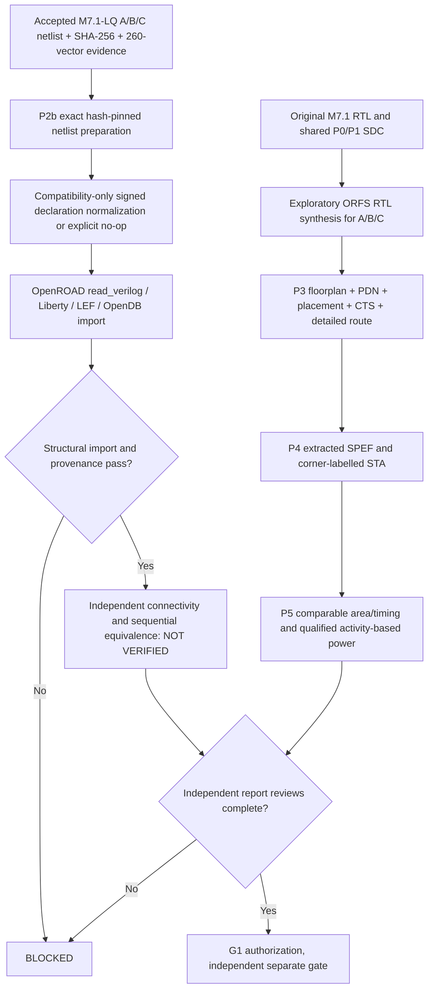

# Governance crosswalk to source snapshot v0.21.1

## M7.2 G1 governance crosswalk — 2 November 2026

The [G1 handoff](M7.2-G1-Engineering-Handoff.md) and [current validation ledger](Validation.md#m72-evidence-and-validation--2-november-2026) distinguish **evidence consistency** from **authorization**. C21 returns `RELEASE_BLOCKED_REVIEW_REQUIRED` and `issues=[]` only for selected historical receipt families, with `release_authorized=false`. The Model-Specific Silicon research branch has seven scoped commits; no independent PAG/G1 reviewer has authorized M7.2 release.

Owners must supply pinned input/output hashes, negative controls, decision rationale and review receipts for P2b full formal and asynchronous reset, P3 ECO, P4 qualified corners and constraints, P5 activity annotation/calibrated power, physical/macro implementation, and final governance disposition. The evidence author must not self-approve a release or equate the presence of a signed artifact with policy approval. Preserve failed, inconclusive and historical research receipts for audit.

Source reference: uploaded governance archive, commit `ea95206`.

| Governance source code | Intended MSIF role | Current implementation |
|---|---|---|
| `src/portable_ai_governance/supply_chain/signing.py` | Ed25519 artifact sign / verify | Adapter directly imports and calls real functions |
| `src/portable_ai_governance/kernel/evidence.py` | HMAC-chained event evidence | Available upstream, not yet invoked in MSIF |
| `src/portable_ai_governance/multi_agent/` | Agent orchestration | Design-only mapping; not integrated |
| `src/portable_ai_governance/tool_agent/` | Bounded tool execution | Design-only mapping; not integrated |
| `src/portable_ai_governance/kernel/approvals.py` | Human authorization | Design-only mapping; not integrated |
| `src/portable_ai_governance/ai_security/` | Model provenance and AI evaluations | Design-only mapping; not integrated |
| `src/portable_ai_governance/compliance_risk/` | Risk posture and control mapping | Design-only mapping; not integrated |
| `src/portable_ai_governance/security_ops/` | Exceptions, monitoring and response | Design-only mapping; not integrated |

## Source documentation mappings

The upstream repository has root `README.md`, root `instruction.md`, `docs/Architecture.md`, `docs/Deployment.md`, `docs/Milestones.md`, `docs/Prerequisites.md`, `docs/Validation.md`, `docs/oneshot-deployment.md`, and milestone-prefixed documents. In particular:

- `docs/M10-Multi-Agent-Workflows.md`
- `docs/M2-Security-Control-Plane.md`
- `docs/M3-Supply-Chain.md`
- `docs/M4-AI-System-Security.md`
- `docs/M5-Compliance-Risk-Automation.md`
- `docs/M6-Bounded-Evidence-Analyst.md`
- `docs/M7-Tool-Using-Agent.md`
- `docs/M8-Approval-Controlled-Actions.md`
- `docs/M9-Security-Operations.md`
- `docs/Documentation-Audit-M21.1.md`

Preserve those real names in cross-repository references. Do not create duplicate aliases in the upstream repository or claim they are present. Inspect provenance, contract, failure behavior and test coverage before integrating additional functions.


## Node1 qualification correction — 25 October 2026

The initial `verify.sh` accepted successful Python tests while printing `SKIP` for unavailable Verilog simulation and synthesis tools. This did **not** satisfy M2 RTL equivalence or M7-lite synthesis acceptance. The revised script **fails closed** (exit code 2) when `iverilog`/`vvp` or `yosys` is missing, runs actual RTL test vectors against the Python oracle and archives per-variant simulation/synthesis logs under ignored `build/demo/`. The initial Node1 log showed `yosys`, `iverilog`, `verilator`, `openroad`, `klayout`, and `ngspice` missing; their installation is not established by the patch. Only Icarus and Yosys are hard requirements for the strict prototype gate. `scripts/install_node1_tools.sh` is dry-run by default; `--install` is an explicit host modification.

**Validity boundary:** Icarus simulations exercise deterministic boundary/random input vectors but are not exhaustive for 16×64 GEMV; formal equivalence, signed rounding/INT8 saturation, mapped Liberty area/STA, parasitics and physical DRC/LVS are not delivered. Generic Yosys `stat` must not be presented as PDK-based area/power/timing. Initial `programmable` weights are initialized registers, not software-loaded runtime-programmable memory; `rom` is an inferred array, not a qualified silicon ROM macro. Signing is optional for research, mandatory for any governed release.

**Traceability:** [README](../README.md) · [Prerequisites](Prerequisites.md) · [Validation](Validation.md) · [Architecture](Architecture.md) · [Milestones](Milestones.md) · [Governance Crosswalk](Governance-Crosswalk.md) · [Deployment](Deployment.md) · [Documentation Audit](Documentation-Audit.md) · [One-shot Deployment](oneshot-deployment.md). Original PAG document links in Governance Crosswalk retain the actual `M2-...` through `M10-...` filenames; no nonexistent aliases are promised.


## Node1 observed qualification — October 25, 2026 (v0.1.1)

The user-supplied Node1 log confirms seven Python unit tests passed, all three RTL variants passed 28 deterministic vectors each, and Yosys 0.33 completed generic synthesis with zero `check` problems. Host tools: Icarus Verilog 12.0, Verilator 5.020 and Yosys 0.33. OpenROAD, KLayout and ngspice were not installed; they are not mandatory for the M7-lite generic synthesis gate.

| Variant | 28-vector Icarus | Yosys generic cells | Memory objects after synthesis |
|---|---|---:|---:|
| Programmable | PASS | 123,837 | 0 |
| Fixed-weight | PASS | 115,662 | 0 |
| ROM-style | PASS | 123,837 | 0 |

The fixed-weight variant has 8,175 (approximately 6.60%) fewer generic cells than the programmable baseline **for this particular fixture and synthesis flow**. The programmable and ROM-style variants map to identical generic cell counts, so the experiment does not yet differentiate a physical ROM or SRAM macro. These counts are *not* area, energy, timing, clock frequency, routed congestion or manufacturing evidence. The 28 full-matrix vectors are not an exhaustive proof.

`python3 scripts/node1_evidence.py --build build/demo` reads actual simulator/Yosys logs, requires PASS and zero Yosys `check` problems, and emits `build/demo/node1_evidence.json` with tool versions and log hashes. It fails if evidence is missing. This is a local evidence summary, **not** an approval or signature.

Baseline-freeze policy: freeze M0, M1 and the limited M2/M5/M7-lite implementation after reproducing the verification on Node1 and inspecting the local report. Keep formal proofs, technology-mapped PPA, real ROM macro, governance signature/approval and full source-model quantization as open gates. Existing milestones M3/M4/M6/M8–M11 are not completed.

## M5.1 — PyTorch tensor import candidate

[M5.1 model provenance](M5.1-Quantized-Tensor-Ingestion.md) defines deterministic per-tensor signed INT4 quantization, row-major ordering, SHA-256 source provenance, explicit scale and fail-closed overflow. Execute `./scripts/verify_m51.sh` in addition to earlier milestone gates. This candidate is **not yet Node1-qualified** and does not imply production-model quantization accuracy, PDK PPA, or governance approval.


## M5.1 locked dependency qualification

See [PyTorch/NumPy environment qualification](M5.1-PyTorch-Environment-Qualification.md). `pyproject.toml` defines NumPy 2.5.4 and the explicit cu130 PyTorch 2.14.0 GPU group; `uv.lock` must be generated by `uv lock` and verified on Node1. Use `uv sync --locked --group gpu` and `./scripts/validate/pytorch/qualify_project_environment.sh` before `./scripts/verify_m51.sh`. `requirements.txt` is a core-only compatibility manifest and cannot certify CUDA. GPU, sm_120, PTX-JIT-disabled execution and compiled CUDA extension acceptance remain Node1-only gates.


## M7.1 synthesis comparison candidate

The next prototype gate is [M7.1 controlled A/B/C synthesis](M7.1-Controlled-Synthesis-Comparison.md) (see `docs/M7.1-Controlled-Synthesis-Comparison.md` from documents). Run `./scripts/verify_m71.sh` after all older milestone regressions. Generic cell counts and optional Liberty-mapped cell counts do not establish timing, routed area, power or release approval. PAG EvidenceLedger and human approval integration remain planned.


## M7.1-L — optional standard-cell Liberty mapping qualification (2026-10-26)

**Governance boundary:** M7.1-G and exploratory M7.1-L PASS do not imply release candidate authorization. Artifact hash checking, an optional signature and synthesis PASS do not substitute for PAG bounded execution, EvidenceLedger receipts, independent reviewer approval and Node2 verification (G1 still PENDING). See [Experimental/approval separation](M7.1-Liberty-Mapping-Qualification.md).

## M7.1-LQ Node1 bounded verification — 26 October 2026

**PASS:** mapped A/B/C standard-cell inventories and 260-vector gate-level regression per architecture on Node1 (746/690/746 mapped cells). See [canonical LQ evidence, incident history and limitations](M7.1-LQ-Mapped-Netlist-Verification.md). Full sequential formal proof, physical PPA and governed release authorization remain **NOT VERIFIED**. Continue with the document-first [M7.2/G1 engineering handoff](M7.2-G1-Engineering-Handoff.md); do not claim those milestones complete or production-qualified.


## M7.2 physical-flow implementation boundary — 26 October 2026

**M7.2 vs G1:** P0/P1 or even ORFS exit code 0 is never a PAG release authorization. Only a future independent evidence ledger/approval receipt can satisfy G1, with separately qualified physical results. [M7.2 qualification limits](M7.2-Physical-Design-Qualification.md).

## Node1 M7.2 execution state and evidence boundary

See [M7.2 physical runbook](M7.2-Physical-Design-Qualification.md) for the 28 October 2026 programmable-only completed exploratory route, unresolved P2b–P5, warnings and independent A/B/C audit. Do not represent the programmable Make exit 0 as release authorization.


## M7.2 P2b–P5 implementation continuation (28 October 2026)

This section is additive to the accepted P0/P1 baseline and does not authorize a commit, tag, or release.



### Implementation modules and status

- `scripts/m72_exact_lq_import.py`: hash-pin exact accepted `build/m71_liberty/m71_lq/msif_*_mapped.v` into isolated P2b candidates, preserve raw files, permit only reviewed signed-port compatibility transforms (including explicit no-op) and optionally test import into OpenDB; **does not implement post-import formal equivalence or a complete ORFS place-and-route handoff**.
- `scripts/m72/m72_normalize.py`: previously verified programmable declaration transform, now also emits a fail-closed identity/no-op receipt when no signed declarations exist. Prevents valid fixed/ROM structural netlists from being rejected solely due to absence of signed ports.
- `scripts/m72_report_review.py`: collects A/B/C final ODB/GDS/SPEF/SDC, detailed-route report and finish report, hashes artifacts, extracts labelled timing *observations*, and refuses missing evidence. A report-present result is explicitly not signoff.
- `scripts/m72_physical_audit.py`: retains a conservative three-architecture inventory with no signoff from existence alone.

### Node1 execution sequence

```bash
cd ~/dev/pub/ai-sys1/msif-hack/push/msif_hackathon
source .venv/bin/activate
export MSIF_ORFS="$HOME/eda/qualified-pdks/OpenROAD-flow-scripts"
export PYTHONPATH="$PWD/src:$PWD/scripts"
python3 -m unittest discover -s tests -v
PYTHONPATH="$PWD/scripts/m72" python3 -m unittest discover -s scripts/m72 -p 'test_m72_normalize.py' -v
python3 scripts/m72_exact_lq_import.py --orfs "$MSIF_ORFS" --out build/m72/p2b-exact-lq
# Only after reviewing the manifest and no stale output directory:
# python3 scripts/m72_exact_lq_import.py --orfs "$MSIF_ORFS" --out build/m72/p2b-exact-lq-execute --execute
# Independently perform the normalizer ORFS route on fixed and rom; use separate FLOW_VARIANTs.
python3 scripts/m72_report_review.py --flow "$MSIF_ORFS/flow" --out build/m72/p3p5-report-ledger.json
```

### Outstanding hard gates

- **P2b:** OpenDB import with matching accepted hashes is an *import experiment*. Cell-pin/bit-accurate structural preservation, sequential equivalence, and a fully integrated exact-LQ physical implementation remain separate, unimplemented closure gates.
- **P3:** A is routed experimentally; B/C must be routed. Independently review legal placement, PDN connectivity, detailed-route DRC, antenna checks, macro inclusion, and reproducible ODB/GDS against reports.
- **P4:** Timing reports from a single TT corner and relaxed research SDC cannot establish multi-corner signoff. Review all setup/hold paths, unconstrained endpoints, reset recovery/removal, RCX corner provenance and additional PVT views where available.
- **P5:** Report standard-cell (not die/core) area and distinguish core area, utilization, clock and I/O delay assumptions. Power without explicit VCD/SAIF/activity provenance is an estimate only. A/C arrays are not qualified SRAM/ROM macros.
- **G1:** Release approval and Node2 independent receipts remain `NOT_VERIFIED`.
