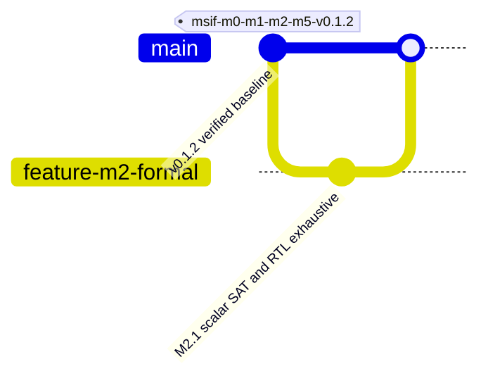

# M2.1 — Exhaustive INT4×INT8 RTL Verification and Formal Equivalence

Status: **implementation candidate pending Node1 run**. This is an additive milestone; M0/M1/M2/M5/M7-lite baseline tag is unchanged.

## Scope and proof contract

For signed four-bit coefficient $w\in[-8,7]$ and signed eight-bit activation $x\in[-128,127]$, prove the two's-complement identity:

$$w = b_0+2b_1+4b_2-8b_3$$

$$wx=b_0x+2b_1x+4b_2x-8b_3x.$$

Use **16-bit sign extension** for each intermediate to avoid Verilog expression-width and sign-extension ambiguity. The maximum magnitude of an individual product is 1024, so the 16-bit result has sufficient headroom. This milestone does **not** formally prove 16×64 GEMV, pipeline timing, memory semantics, or quantization.

## Deliverables and dependency gates

- `scripts/m21_verify.py`: emits isolated scalar-equivalence RTL and exhaustive testbench; requires `iverilog`, `vvp`, `yosys`; writes evidence in ignored `build/m21/`.
- `scripts/verify_m21.sh`: runs all Python tests and strict simulator + formal gates.
- `tests/test_m21.py`: generation-contract unit tests (not a substitute for RTL execution).
- `build/m21/exhaustive.log`: checks **all 4096** scalar input pairs.
- `build/m21/formal.log`: Yosys SAT `-verify -prove-asserts` proof over symbolic coefficient and activation inputs.
- `build/m21/evidence.json`: exact log/file hashes; proof results are `PASS` only on successful actual execution.

Install Yosys and Icarus Verilog using existing `scripts/install_node1_tools.sh --install` if missing. Run:

```bash
./scripts/verify_m21.sh 2>&1 | tee logs/m21_node1.log
python3 -m json.tool build/m21/evidence.json
```

With `set -o pipefail`, verify the script exit code; a missing tool or failed SAT proof is a blocking failure. Do **not** use generated evidence from one machine to claim the target host itself passed.

## Threats to validity

Formal SAT proof is over a generated scalar miter; equivalence of the three *full* GEMV designs remains a separate milestone. `always @* assert(...)` is enclosed in `ifdef FORMAL` and compiled only by the Yosys formal run using `-D FORMAL`. This avoids event/delta-cycle spurious assertions in Icarus; the Icarus testbench separately compares computed output to integer multiplication for every input combination. The proof checks numerical combinational equivalence, not area, power, timing, or silicon quality. The suite deliberately does not sign its own evidence or mark governance approval.

## Mermaid milestone graph



## Next exit gates

1. Expand formal miter to arithmetic tree and both fixed/programmable design variants for a small shape, with matching weights and pipeline latency.
2. Add reset, `in_valid` stall, and transaction ordering assertions for the cycle-accurate interface.
3. Add tool version pinning and signed evidence using Portable Agentic AI Governance before a governed release.
4. Carry source/release documentation in `README.md`, `docs/Validation.md`, `docs/Architecture.md`, and `docs/Milestones.md`.

## M2.1 Node1 correction: false-positive PASS (October 25, 2026)

The earlier runner accepted the final PASS marker even though `exhaustive.log` contained thousands of `ERROR:` messages from an Icarus `always @* assert` firing on intermediate updates. That result **must not** be cited as clean RTL validation. The fixed runner conditions formal assertions on `FORMAL`, forbids simulator ERROR/FATAL/FAIL/WARNING diagnostics, requires exactly one PASS marker, and deletes stale evidence before executing. Formal checks remain active with `read_verilog -D FORMAL -formal -sv` and SAT `-verify -prove-asserts`. Fresh Node1 logs from the correction must be reviewed before committing.

Review using `grep -nE 'ERROR:|FATAL:|FAIL|WARNING:' build/m21/exhaustive.log` (expected no matches), `grep 'SAT proof finished - no model found: SUCCESS!' build/m21/formal.log`, and compare evidence hashes. Run `verilator --lint-only --sv --top-module msif_int4_int8_equiv build/m21/msif_int4_int8_equiv.sv` separately; unresolved warnings are a review blocker. No physical PPA or release approval is implied.
