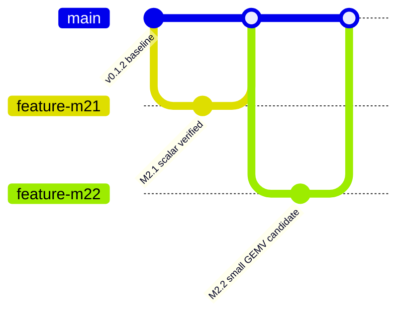

# M2.2 — Bounded GEMV Arithmetic and Sequential Verification

**Status:** implementation candidate; formal, RTL and lint results require execution on Node1. This is not full 16×64 formal equivalence.

## Source baseline and dependency

Start with M2.1 feature commit `8979f45`, after reviewing and merging M2.1 into `main`. Do not use the erroneous published `msif-m2.1-v0.2.0` tag as a verified M2.1 starting point: the attached logs show it was created on `24ca1af`, before merging the feature branch. Create a new correctly targeted validation tag after review; never silently force-move a published tag.

## Numerical contract

Use `fixture(m=2,k=4,seed=2026)` and the authoritative `msif.core.inference` output contract:

$$ y_i = b_i + \sum_{j=0}^{3} w_{ij}x_j,\quad w_{ij}\in[-8,7],\ x_j\in[-128,127]. $$

The result and bias are signed INT32. Combinational formal miter proves, for all possible activation bit patterns **with fixed fixture coefficients**, equivalence of standard coefficient multiplication and a two's-complement signed-bit shift-add implementation. Formal coverage is confined to the 2×4 fixture, not all possible weight matrices or the 16×64 design.

## Sequential contract

Generate each existing RTL variant using the unchanged compiler `src/msif/core.py`. Run the *actual generated modules*, with asynchronous reset, 36 deterministic/reference test vectors per variant, intermittent `in_valid=0` hold checks, and mid-stream reset. Outputs must be registered and match signed INT32 golden results at the sampling point. This is a simulation check, **not a proof of all possible sequential traces**.

## Execution

```bash
export PYTHONPATH="$PWD/src"
./scripts/verify.sh
./scripts/verify_m21.sh
./scripts/verify_m22.sh
python3 -m json.tool build/m22/evidence.json
```

M2.2 requires `python3`, `iverilog`, `vvp`, `yosys`, and `verilator`. The command fails closed on unavailable tools, simulator diagnostics, missing PASS markers, Yosys proof failure or Verilator warnings/errors. Evidence in `build/m22/` is ignored by Git and **is not a signature or governance approval**.

## Exit evidence

- Python suite contains M2.2 tests in addition to preceding tests.
- `build/m22/formal.log`: Yosys SAT `SUCCESS!`.
- `build/m22/sim_{programmable,fixed,rom}.log`: exactly one PASS marker per variant; no ERROR/FATAL/FAIL/WARNING lines.
- `build/m22/formal_lint.log` and `lint_*.log`: no `%Warning` or `%Error`.
- `build/m22/evidence.json`: check SHA256 for all declared files; record tool versions separately in validation notes.
- Previous `verify.sh` and `verify_m21.sh` pass again.
- Manual review and pull request approval before merge/tagging.

## Limitations

No 16×64 matrix formal proof, no arbitrary-weight 2×4 proof, no sequential temporal formal proof, no SRAM/ROM macro qualification, no Liberty/PDK timing, no routed PPA, no governance-controlled release.

## GitHub-native milestone history (proposed)



The diagram represents the desired integration sequence and does not assert that review or merges have happened.


### M2.2 reset-testbench erratum (2026-10-25)
The first Node1 M2.2 simulation stopped at `async reset failed` because the testbench initialized active-low reset to zero without generating a falling edge. The corrected testbench initializes `rst_n=1`, then explicitly drives `rst_n=0` and waits for nonblocking assignments to settle before checking reset outputs. Repeat all three variant simulations and proof/lint gates; earlier M2.2 evidence is not acceptable. This is a testbench correction, not a change to the accepted M2.1 RTL compiler.
