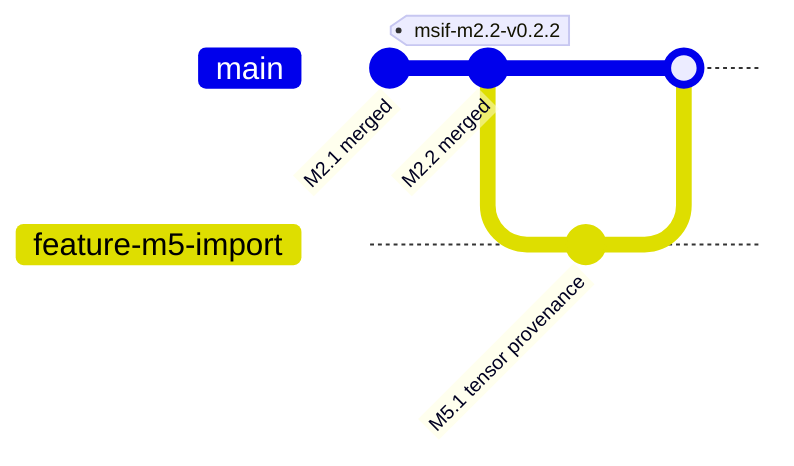

# M5.1 — Reproducible PyTorch tensor ingestion into INT4 MSIF RTL

**Status:** implementation candidate; Node1 EDA end-to-end validation and review pending. Base: `3246b58` (merged M2.2). This is a research import path, not a production ONNX or trained-model signoff.

## Data contract

- Input: `.pt` or `.pth` **weights-only** checkpoint, containing either a bare floating-point 2D tensor or a dictionary selected by explicit `--tensor-key`. `torch.load(..., weights_only=True, map_location='cpu')` is used. Avoid untrusted checkpoints; even restricted loaders should operate on reviewed input in an isolated environment.
- Tensor shape `[M,K]` where `M` is output channels and `K` input features; MSIF supports `1<=M<=256`, `1<=K<=4096`. Row-major `[output][input]` ordering; RTL activation slice `activations[8*j +: 8]` corresponds to feature `j`.
- Quantization: *explicit supplied* positive finite per-tensor symmetric scale `s`, zero-point `0`, `q = round_to_nearest_even(w_float / s)`; reject any `q` outside `[-8,7]`. Never silently clamp. This does **not** derive/calibrate the scale or support per-channel quantization.
- Optional `--bias-json` is a JSON list of `M` signed INT32 bias values in accumulator units (already appropriately scaled); otherwise all-zero bias. The existing MSIF overflow check applies. No automatic floating bias calibration.
- Output uses existing `msif-int4-v1` model and `write_build`; binary source SHA-256, canonical tensor-value SHA-256, tensor selection, shape, quantizer name, scale hexadecimal representation and zero point are preserved in `model.json` provenance. `manifest.json` hashes that model and each generated RTL variant.

$$q_{ij}=\operatorname{roundEven}(W_{ij}/s), \qquad -8\le q_{ij}\le 7.$$

$$y_i=b_i+\sum_j q_{ij}x_j,\qquad x_j\in[-128,127].$$

**Boundary:** this is exact integer inference *after quantization*. It is not proof that quantization preserves original floating inference accuracy; activation scales, per-channel scales, requantization and a full model graph are later tasks.

## Prerequisites

On Node1 create an isolated Python venv if one does not already exist. Install PyTorch using the currently supported wheel source appropriate to Node1 (CPU-only is sufficient for import). Confirm `python3 -c 'import torch;print(torch.__version__)'`. No GPU is required. Existing Icarus/Yosys/Verilator stay as M2.2 prerequisites. Pin versions in a future lockfile before a production claim.

## CLI walkthrough

From repo root on branch `feature/m5-quantized-tensor-import`:

```bash
export PYTHONPATH="$PWD/src"
python3 - <<'PY'
from pathlib import Path
import torch
Path('build/m51').mkdir(parents=True,exist_ok=True)
torch.save({'layer.weight':torch.tensor([[0.,.5,-.5,1.],[-1.,.25,-.25,0.]],dtype=torch.float32)}, 'build/m51/example.pt')
PY
python3 -m msif.cli import-tensor --checkpoint build/m51/example.pt --tensor-key layer.weight --scale 0.25 --out build/m51/example
python3 -m msif.cli verify --out build/m51/example
./scripts/verify_m51.sh
```

For an actual trained tensor: inspect shape, floating dtype, tensor key, quantizer scale, and bias units; reject any out-of-range result. Do **not** choose an ad hoc scale just to conceal clipping. Record provenance and review model accuracy degradation separately.

## Tests, evidence and release gates

`tests/test_m51.py`: ties-to-even, nonfinite and overflow rejection, invalid shape, missing key, deterministic import, known arithmetic, manifest tamper. `scripts/verify_m51.sh`: 23 Python tests (base plus M5.1); builds twice from same fixture; bytewise checks all artifacts; verifies hashes and calls real Icarus simulation of generated RTL with 32 vectors. Fail-closed if Icarus is absent. Evidence stored in ignored `build/m51/evidence.json`; local hashes are not trusted signed approval.

Acceptance requires **all**: `./scripts/verify.sh`, `./scripts/verify_m21.sh`, `./scripts/verify_m22.sh`, `./scripts/verify_m51.sh` return zero; no error diagnostics; evidence inspected; Git diff and dependency review. Any missing PyTorch, Icarus, manifest or source is a blocking failure. Avoid committing `.pt` fixture, build logs, artifacts and secrets.

## Architecture and next steps



Later stages: add compatible ONNX tensor/initializer importer, per-channel quantization, explicit activation quantization & requantization, unbiased source-model inference parity, formal full GEMV equivalence, toolchain reproducibility lock and signed governance receipts. Do not imply real physical ROM or mapped PPA.


## M5.1 locked dependency qualification

See [PyTorch/NumPy environment qualification](M5.1-PyTorch-Environment-Qualification.md). `pyproject.toml` defines NumPy 2.5.4 and the explicit cu130 PyTorch 2.14.0 GPU group; `uv.lock` must be generated by `uv lock` and verified on Node1. Use `uv sync --locked --group gpu` and `./scripts/validate/pytorch/qualify_project_environment.sh` before `./scripts/verify_m51.sh`. `requirements.txt` is a core-only compatibility manifest and cannot certify CUDA. GPU, sm_120, PTX-JIT-disabled execution and compiled CUDA extension acceptance remain Node1-only gates.
