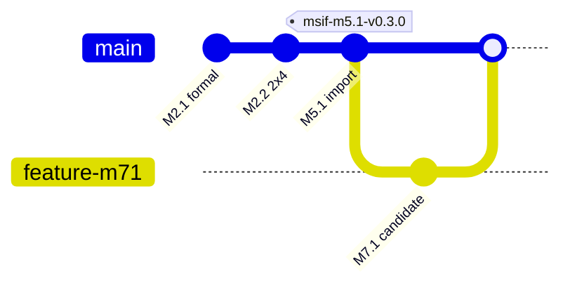

# M7.1 — Controlled A/B/C Synthesis Comparison

Status: **candidate; requires Node1 verification and manual review before Git publication.**

## Architectural provenance and boundaries

Refer to the unchanged `Model-Specific-AISilicon-Architecture-and-Engineering.md` architecture research specification, especially sections **1, 3, 4, 7, 8** and the **12-stage roadmap**. The experimental objective is to compare A (programmable MAC), B (fixed-coefficient MAC), and C (ROM-assisted compute) under one numerical contract, identical matrix, and identical synthesis commands. This is a *generic/optional Liberty-mapped* experiment, **not** an OpenROAD placement-and-route or transistor-level study.

## Method

1. Require M5.1 baseline acceptance; branch from its verified `main` merge and do not change old release tags.
2. Build a deterministic small 2×4 fixture using `msif.cli build`; validate its manifest.
3. Run three synthesis experiments using identical Yosys passes and identical source model. Compare `cells_reported`, log hashes and tool version, not timing or power.
4. Optionally pass an externally reviewed Liberty via `--liberty /absolute/path/to/cells.lib`. The tool records its SHA-256 and applies identical `dfflibmap`/`abc` across variants. The library must be reviewed for license, PVT corner, voltage, timing model, sequential mapping, and compatibility. **A Liberty alone cannot establish routed timing or physical area.**
5. Reject nonzero return codes, diagnostics, missing `check` PASS, missing cell count, missing input integrity, and stale evidence. Do not report PASS for partially executed experiments.
6. Emit `build/m71/m71_evidence.json`. Keep generated artifacts ignored and show the report as local, unsigned evidence only.

## Commands

```bash
./scripts/verify.sh
./scripts/verify_m21.sh
./scripts/verify_m22.sh
./scripts/verify_m51.sh
./scripts/verify_m71.sh
# Optional mapping, only when a qualified Liberty is available:
./scripts/verify_m71.sh --liberty /ABSOLUTE/PATH/standard_cells.lib
python3 -m json.tool build/m71/m71_evidence.json
```

## Important limitations

- Current A and C both use initialized coefficient arrays; neither is a characterized SRAM or mask-ROM macro. Equal cell counts do not indicate equal physical area or energy.
- No OpenROAD, LEF/DEF, floorplan, parasitics, library corner qualification, clock constraints, STA report, or energy metrics are produced.
- Cell-count comparison is limited to the same model, tool, parameters and netlist. Synthesis equivalence does not replace RTL/formal regression.
- No PAG EvidenceLedger, bounded executor or approval state machine has yet been enforced. A signed manifest by itself is **not** an approval.

## Follow-on exit gates

1. M7.2: qualify a single-cell Liberty/LEF/PDK, constraints and STA; run OpenROAD placement, clock tree and routing, capture area/timing/congestion at the same PVT/corner. Record STA and PPA as *measured*, never inferred from generic cell counts.
2. G1: enforce external PAG evidence ledger + bounded command execution + reviewer approval; fail closed on signature/manifest mismatch, unapproved architecture, or missing Node2 receipt. Block untrusted meta-agent self-approval.
3. M1.1/M5.2: quantization/requantization, real graph ingestion and model accuracy parity.

## Git milestone sequence




## M7.1-L — optional standard-cell Liberty mapping qualification (2026-10-26)

After Node1 M7.1 generic synthesis passed (A/C: 1129 generic cells; B: 1621), the optional single-corner SKY130 HD exploratory Liberty mapping has **PASSED on Node1**. Follow [M7.1-L Liberty mapping detailed instructions](M7.1-Liberty-Mapping-Qualification.md) for licensing, PVT inspection, safe library acquisition, separate build output, mapping audits, physical-measurement limitations and M7.2/G1 gates. Do not claim cell area, timing, power or reviewer approval from a generic PASS.


**2026-10-26 Node1 update:** M7.1-G **PASS** and M7.1-L exploratory Liberty mapping **PASS** for the pinned SKY130 HD TT library; M7.1-LQ **PENDING**. The authoritative numerical table, input hashes, licensing review boundary and exclusions are recorded in [Node1 exploratory Liberty execution](M7.1-Liberty-Mapping-Qualification.md#8-node1-exploratory-liberty-execution--26-october-2026).
