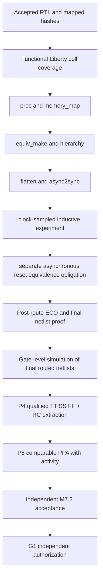

# M7.2 Closure10 — Formal preprocessing, sampled-clock proof, ECO and P4/P5

## Evidence and non-claims

Node1 closure9: 70/70 tests PASS; exact M7.1-LQ hash-pinned A/B/C initial OpenDB graphs match; exact-LQ single-core A/B/C physical flows completed. Original RTL-to-mapped v4 proof **failed**: programmable and ROM at `equiv_make` because the gold module still contains memory arrays; fixed at `equiv_simple` due to unsupported asynchronous FF SAT model. No unbounded equivalence proof has passed. G1 NOT_VERIFIED.

Closure10 adds `memory_map` following `proc` and before the equivalence miter. The clock-sampled experiment additionally uses `async2sync` after flattening, before SAT equivalence. `async2sync` changes the model at asynchronous reset transitions; **a PASS is not a full asynchronous-reset proof**. Independently prove asynchronous assertion/release against a transition-aware model, and review reset assumptions, flip-flop and special-cell semantics. Formal engine run must be executed on Node1. The formal manifest status must remain non-signoff.

## Dependency graph

## Node1 runbook

1. Preserve `build/m72/formal-original-run-v4` and the accepted netlist files. Do not modify ORFS or existing proof artifacts.
2. Install `scripts/m72_formal_equiv.py` and `tests/test_m72_formal_v5.py` from the incremental package. Merge documentation addenda manually to avoid overwriting uncommitted changes.
3. Validate `uv lock --check`, `python3 -m compileall -q src scripts tests`, `PYTHONPATH="$PWD/src:$PWD/scripts" python3 -m unittest discover -s tests -v` (expected 73 tests), and normalize tests.
4. Verify SHA-256 of `build/m71_liberty/m71_lq/evidence.json`-pinned RTL/mapped and SKY130HD TT Liberty. Generate fresh `--out build/m72/formal-original-plan-v5` and inspect scripts. Require `proc; memory_map; opt_clean; equiv_make; hierarchy -check -top msif_equiv; flatten; opt_clean; async2sync; opt_clean; check -assert; equiv_simple; equiv_induct -seq 32; equiv_status -assert`.
5. Execute fresh `--out build/m72/formal-original-run-v5 --execute`. Nonzero means BLOCKED. A zero with completion markers is clock-sampled proof engine evidence only; inspect blackboxes/undefined bits and asynchronous reset separately.
6. Independently run `scripts/m72_physical_lec_inventory.py --flow "$FLOW_DIR" --variant-suffix exact_lq_singlecore_v2 --out build/m72/eco-inventory-v5.json`. Requires A/B/C pre- and post-resize LEC files, final Verilog/ODB/SPEF, all hashes and zero missing paths. This inventory is NOT equivalence.
7. For a post-route experiment, create a fresh `postroute-gates-v5` with hash-checked symlinks to exact-route `6_final_lec.v`; plan using `scripts/m72_formal_equiv.py --gate-dir ... --out ...`, inspect top and library cell support, then execute in a new directory. The current runner's mapped JSON cell-type inventory is of the accepted original source, not sufficient to certify newly introduced post-route cell types. Review post-route cell inventories and ECO operations separately.
8. Execute the accepted M7.1-LQ behavioral simulation using the final `6_final.v` and the Icarus-compatible functional models. This adaptation is not implemented by the attached correction. Require 260 original vectors per architecture plus reset assertion/deassertion between clocks, valid hold and signed extremes. Hash netlists, stimuli and outputs. Do not claim post-layout regression PASS before actual execution.
9. Run `m72_corner_inventory.py --orfs "$MSIF_ORFS" --suffix exact_lq_singlecore_v2 --out build/m72/corner-inventory-v5.json`; inspect TT Liberty and RCX hashes and obtain authenticated SS/FF models and parasitic views. `m72_corner_sta.py` accepts a fully reviewed three-corner manifest only. A TT-only result cannot claim multi-corner timing qualification. Audit setup/hold, recovery/removal, all clocks/exceptions, unconstrained paths, SPEF annotation and electrical violations.
10. P5: compare exact-LQ A/B/C and RTL-resynthesized A/B/C in separate tables; report OpenDB categorized area, DRC/antenna router counts, reviewed timing, switching activity annotations, and calibration. PWR0 only until valid activity and calibration, no macro comparison without characterized macro Liberty/LEF/GDS. G1 stays pending.

## Further engineering acceptance restrictions

- `async2sync` can be a useful SAT adaptation but does not preserve unobserved asynchronous-reset events. Its success is not an unconditional unbounded RTL/netlist proof.
- The existing proof runner infers a positive result from Yosys log markers and return code; audit the full evidence and model coverage independently.
- Existing exported LEC files are snapshots, not successful LEC proofs.
- Do not fabricate SS/FF libraries, power activity or a final release tag.
