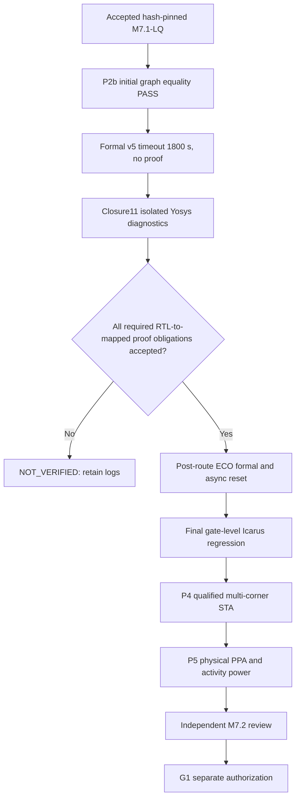

# M7.2 closure11 — evidence-based correction and onward gates

## Verified findings in supplied closure10 upload

- Node1 73 unit tests PASS; accepted Liberty SHA and M7.1-LQ bounded audit PASS.
- `build/m72/formal-original-run-v5/manifest.json` records a **1800-second timeout in programmable A**, before any A result was saved; B/C were not executed. Formal proof is **NOT_VERIFIED**.
- The existing runner captures output with `subprocess.run(..., stdout=PIPE, timeout=1800)` and discards its partial output when `TimeoutExpired` escapes. Running the expensive A case first prevents B/C diagnosis. The attached `m72_formal_probe.py` corrects evidence collection only.
- Previous accepted A/B/C initial graph continuity and exact-LQ route completion remain research evidence, **not** sequential or ECO proof.

## Dependency-gated next steps

1. Run `m72_formal_probe.py` on the already-generated v5 plans in fresh output folder, e.g. `--timeout 180`. Each Yosys run writes its log while the subprocess is executing, has a hard per-design timeout, and preserves its own result. Diagnostic status is never called equivalence.
2. Examine each log's last completed Yosys pass; compare model scope, number of mapped equivalence points, memory-size expansion and SAT progression. Any returned successful exit needs independently reviewed proof transcript, model semantics and reset qualification.
3. Develop a **separate** formal partitioned/structural proof where practical, with explicit clock/reset and coefficient assumptions, *not* arbitrary blackbox cutpoints. Prove each partition's interface and sound composition. Any unresolved induction point is BLOCKED.
4. Independently qualify asynchronous reset assertion between clock edges and output visibility. A sampled `async2sync` abstraction alone is insufficient; review reset functional model and transition-aware tests/formal proof.
5. Inventory exact-route LEC outputs with `m72_physical_lec_inventory.py`; use a fresh filename. Reconcile stages accepted source → `1_synth_lec.v` → `4_before_rsz_lec.v` → `4_after_rsz_lec.v` → `6_final_lec.v`. Inventory is **not** LEC.
6. For final-netlist proof, create a fresh gate-directory and ensure the proof runner binds *actual* final-cell types, not merely the original mapped JSON. Run against final netlist on separate proof manifests. Review inserted CTS/hold/tie/antenna cells and intentional outputs/clock/reset effects.
7. For gate-level regression, adapt M7.1-LQ Icarus runner to the exact `6_final.v` source for A/B/C. Must execute the accepted 260 vectors **against final netlists**, plus additional reset-in-between-clock, valid-hold, sign-extreme and zero/one tests; capture model/input/output hashes, test count and mismatch count. No test against original mapped file counts as postlayout validation.
8. P4: run `m72_corner_inventory.py` for exact-LQ suffix; inspect actual reviewed TT/SS/FF Liberty and RC extraction. Missing SS/FF model or calibrated SPEF corner blocks multi-corner acceptance. `m72_corner_sta.py` execution success alone is `STA_EXECUTED_REVIEW_REQUIRED`: separately review setup/hold, recovery/removal, IO, unconstrained paths, exceptions, clocks, electrical violations.
9. P5: split exploratory RTL-resynthesized physical results from exact-LQ versions. Preserve common PPA workloads, categorize filler/tap/clock/antenna area, evidence of router DRC and parasitic view. No foundry DRC/LVS, PWR1 activity, PWR2 calibration, or macro PPA claims without separate evidence.
10. Final M7.2 gate and G1 remain OPEN until all mandatory proof, ECO, simulation, P4, P5 and independent review criteria are met. No tag/commit/push without user approval.

## Node1 suggested execution

```bash
set -o pipefail
python3 scripts/m72_formal_probe.py \
  --plans build/m72/formal-original-plan-v5 \
  --out build/m72/formal-probe-v5a \
  --timeout 180 \
  2>&1 | tee logs/m72_formal_probe_v5a.log
RC=${PIPESTATUS[0]}
set +o pipefail
printf 'DIAGNOSTIC_EXIT=%s\n' "$RC"
python3 -m json.tool build/m72/formal-probe-v5a/manifest.json
for v in programmable fixed rom; do
  echo "===== $v ====="
  test -s "build/m72/formal-probe-v5a/$v.log" && \
    tail -100 "build/m72/formal-probe-v5a/$v.log"
done
```

Use **new output directories** for every retry; existing run results remain immutable. Do not run a long proof without persistent logs and a per-variant timeout.


