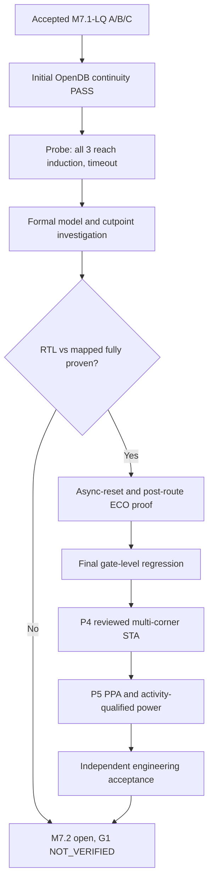

# M7.2 closure11+1 — validated probe diagnosis and continuation

## Grounded results
The supplied `build/m72/formal-probe-v5-closure11a/manifest.json` contains all programmable/fixed/rom entries. All three report `TIMEOUT_INCONCLUSIVE` after 180 seconds. Their respective log SHA-256 values match the manifest. Their tail shows `Proved 0 previously unproven $equiv cells.` and entry into `15. Executing EQUIV_INDUCT pass.` The shell return code 2 is the **designed fail-closed behavior**, not a probe-launch failure. It does **not** prove functional inequivalence or equivalence.

The existing `m72_formal_equiv.py` original experiment is monolithic, uses `memory_map` and a clock-sampled `async2sync` abstraction. A separate asynchronous-reset guarantee is still required. `equiv_simple` observed 65 attempted groups on each design, none proved. The huge combinational/sequential cones demand a staged proof methodology, not merely more timeout budget.

## Safe correction deployment
From repository root on Node1 (`source .venv/bin/activate`):

```bash
set -euo pipefail
export MSIF_ORFS="$HOME/eda/qualified-pdks/OpenROAD-flow-scripts"
export FLOW_DIR="$MSIF_ORFS/flow"
export PYTHONPATH="$PWD/src:$PWD/scripts"
mkdir -p logs ../validation-backups
cp -a scripts/m72_formal_probe.py ../validation-backups/m72_formal_probe_before_c11p1.py
# Extract ZIP in a temporary directory and copy only the new audit file and test.
python3 -m compileall -q src scripts tests
python3 -m unittest discover -s tests -v > logs/m72_c11p1_tests.log 2>&1
```

Do not overwrite historical run directories or original accepted source/netlist evidence.

## Step 3.3 — Audit existing diagnostic logs (no rerun necessary)

```bash
python3 scripts/m72_probe_audit.py \
  --probe build/m72/formal-probe-v5-closure11a \
  --out build/m72/formal-probe-audit-closure11a.json
python3 -m json.tool build/m72/formal-probe-audit-closure11a.json
```

Expected: all three `TIMEOUT_INCONCLUSIVE`, `last_pass=EQUIV_INDUCT`, `equiv_simple_proved_counts=[0]`; overall `DIAGNOSTIC_ONLY_NOT_FORMAL_PROOF`. The audit exits 0 *only if evidence integrity and coverage checks succeed*. This is **not** a Yosys proof PASS.

## Step 3.4 — Formal proof investigation in dependency order

1. Preserve `formal-original-plan-v5/{programmable,fixed,rom}.ys`, all source/model hashes and the original timeout logs.
2. Identify the combinational/registered match points from Yosys `equiv_make` reports; check whether the 65 points correspond to intended output bits, reset/valid signals, and unwanted coincidental cell port names. Check the actual hierarchy and input/output contract first.
3. Validate `read_liberty -ignore_miss_func` actually gave functional, non-blackbox models for each **used** cell, especially `dfrtp_1`, `clkinv_1`, and `lpflow_*`. A hierarchy `-check` alone does not suffice.
4. Compare reset timing, state encoding, IO names, signedness, widths and ready/valid latency across reference and mapped netlists. Preserve counterexamples from bounded attempts rather than assuming the issue is CPU time.
5. Build one **new** partitioned or cutpoint-based proof plan per architecture, avoiding unproven assumptions. Verify composition and all cutpoint relations before calling it unbounded equivalence. Use distinct sample-clock and between-clock asynchronous-reset acceptance gates.
6. Treat any further Yosys script as **experimental until reviewed and run on Node1**. Do not mark P2b formal PASS based on probe, check-assert, bounded simulation or structural import.

## Step 5.1 — Read-only post-route ECO inventory (can run while formal open)

```bash
python3 scripts/m72_physical_lec_inventory.py \
  --flow "$FLOW_DIR" --variant-suffix exact_lq_singlecore_v2 \
  --out build/m72/eco-inventory-c11p1.json
python3 -m json.tool build/m72/eco-inventory-c11p1.json
```

The code explicitly requires all 8 files per A/B/C: `1_2_yosys.v`, `1_synth_lec.v`, `4_before_rsz_lec.v`, `4_after_rsz_lec.v`, `6_final_lec.v`, `6_final.v`, `6_final.odb`, `6_final.spef`. It returns nonzero if missing. `INVENTORY_PRESENT_NOT_EQUIVALENCE` means only complete provenance inventory.

## Step 5.2 — Hash and inspect stage changes; do not assume LEC

```bash
for v in programmable fixed rom; do
  d="$FLOW_DIR/results/sky130hd/msif_${v}/msif_m72_${v}_exact_lq_singlecore_v2"
  for n in 1_synth_lec.v 4_before_rsz_lec.v 4_after_rsz_lec.v 6_final_lec.v 6_final.v; do
    test -s "$d/$n" || { echo "MISSING: $d/$n"; exit 2; }
    sha256sum "$d/$n"
  done
done
```

ECO audit should classify differences in cells and pin-level connectivity and independently prove sequential equivalence at the accepted boundary; a hash inventory or cell-count comparison is not an equivalence proof. The existing generator accepts `--gate-dir`, but its original-mapped used-cell inventory is not a post-route coverage audit; do not use it as automatic signoff without correcting that scope.

## Step 5.3 — Post-route formal and reset gates

When original RTL/mapped proof and used-cell models have been reviewed, create fresh symlinks to *verified* `6_final_lec.v` files, audit the new cell types, construct new gate-vs-gate and RTL-vs-final miter plans, and capture all engine logs. `async2sync` supplies only clock-sampled abstraction; separately verify reset assertion/deassertion between clock edges. Do not run the original monolithic driver as a promoted acceptance gate while original proof is unverified.

## Step 5.4 — Final gate-level regression

Reuse the M7.1-LQ stimuli, but rebuild the actual final `6_final.v` with compatible simulation cell models. Check timing and pin compatibility before running. Test all original 260 vectors per A/B/C plus independent asynchronous reset transitions, valid/invalid cycles, hold behavior, signed INT4 and INT8 extremes. Preserve netlist/testbench/model hash, compilation exit, simulation exit, comparison count and zero mismatches. There is no completed post-route test harness in closure11+1; **NOT_VERIFIED**.

## Step 6 — P4 timing inputs and acceptance

```bash
python3 scripts/m72_corner_inventory.py \
  --orfs "$MSIF_ORFS" --suffix exact_lq_singlecore_v2 \
  --out build/m72/corner-inventory-c11p1.json
python3 -m json.tool build/m72/corner-inventory-c11p1.json
```

This is an inventory only, not STA. Note that the inventory code specifically looks for `6_1_fill.sdc`; verify that this file exists in the real exact-route outputs (otherwise correct the binding with observed physical artifacts rather than inventing a path). Qualify SS/FF libraries, process/voltage/temperature, min/max RC extraction, all clock and IO constraints and final ODB/SPEF hashes before calling `m72_corner_sta.py` with an approved `msif-m72-corners-v1` manifest. `STA_EXECUTED_REVIEW_REQUIRED` requires manual review of setup/hold, recovery/removal, exceptions, unconstrained paths, wire annotation, and electrical checks.

## Step 7 — P5 and M7.2 closure

Keep early RTL-resynthesized research routes separate from exact-LQ A/B/C. Record area by cell class, final DRC/antenna and router completion, qualified timing, activity provenance/SAIF-VCD annotation and power with shared workload. PWR0 (estimates) is not PWR1 (activity-qualified), nor PWR2 (calibrated). Do not claim ROM/SRAM macro energy or area without physical macro data. Keep all unproven gates and G1 `NOT_VERIFIED`. No Git commit/tag/push until manual approval.


