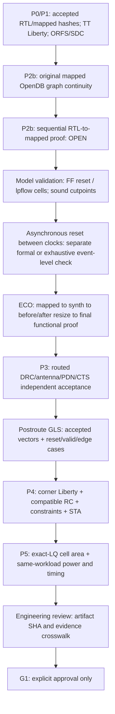

# M7.2 closure12 — source-backed P2b–P5 qualification and release plan

## Evidence reviewed

This report is based on the closure11+2 archive, including `build/m72/formal-probe-v5-closure11a/`, `build/m72/formal-probe-audit-closure11a.json`, `build/m72/eco-inventory-c11p1.json`, `build/m72/corner-inventory-c11p1.json`, `build/m72/exact-route-singlecore-v2/manifest.json`, and the research-only P5 ledgers. Run `scripts/m72_closure12_evidence_audit.py` for a cross-ledger consistency check; return code zero means evidence consistent, **not** signoff.

## Observed gate states

| Gate | Archived finding | Acceptance state |
|---|---|---|
| P0/P1 | Pinned ORFS, TT Liberty and static plan, bounded M7.1-LQ | qualified for research inputs |
| P2b imported structural graph | A/B/C match reference OpenDB graph | initial graph continuity only |
| P2b formal | Three probes timed out at 180 s in EQUIV_INDUCT; 65 attempted, zero proven in EQUIV_SIMPLE | NOT_VERIFIED |
| P3 exact-LQ singlecore routes | A/B/C `make_exit_code=0`, routed ODB hashes recorded | flow complete, independent DRC/signoff open |
| ECO export inventory | All eight files for A/B/C; 1_2_yosys hashes match accepted; final Verilog matches 4_after_rsz_lec | inventory and byte equality, **not** equivalence |
| P4 inputs | Exact-LQ final ODB/SPEF/6_1_fill.sdc found for A/B/C; TT Liberty and rcx_patterns.rules/setRC.tcl found | corner models/calibration/STA acceptance open |
| P5 | research-route comparison ledger exists; final exact-LQ PPA not separately accepted | NOT_VERIFIED |
| G1 | no final approvals | NOT_VERIFIED |

The existing `m72_corner_inventory.py` has **no failure exit for missing corner/physical inputs**; it always reports dependency status and exits zero. Never treat that exit status as a readiness gate. `m72_corner_sta.py` requires a human-reviewed nine-entry manifest, and zero exit only means STA reports were generated for review. The formal generator `m72_formal_equiv.py` is an earlier monolithic experiment and can time out without retaining its partial Yosys log. Use `m72_formal_probe.py` for diagnosis.

## Architecture and dependency order



## Node1 commands — safe read-only first

Run at repository root with `.venv` active; export `MSIF_ORFS`, `FLOW_DIR`, `PYTHONPATH`. Execute existing commands with fresh output names; never overwrite evidence:

```bash
python3 -m compileall -q src scripts tests
python3 -m unittest discover -s tests -v 2>&1 | tee logs/m72_closure12_tests.log
python3 scripts/m72_closure12_evidence_audit.py --out build/m72/closure12-crossledger-v1.json
python3 -m json.tool build/m72/closure12-crossledger-v1.json
python3 -m json.tool build/m72/formal-probe-audit-closure11a.json
python3 -m json.tool build/m72/eco-inventory-c11p1.json
python3 -m json.tool build/m72/corner-inventory-c11p1.json
```

`PIPESTATUS[0]` must be captured immediately after `tee` under Bash when the status matters. The cross-ledger audit verifies archived hashes; as the ORFS `flow/results` tree is **not included in this archive**, verify those on Node1 against the recorded SHA before considering the physical inputs live.

### P2b formal methodology

1. Preserve the three original timeout transcripts; do **not** claim counterexample or proof from them.
2. Audit each used SKY130 functional cell; verify no blackboxes or undef masking; check `dfrtp_1`, `lpflow_*`, clock inversion and top-level reset wiring.
3. Inspect the 65 output comparison groups and the `equiv_simple` failure messages; use a *separate* intermediate-state mapping proof to justify any cutpoints/partitions.
4. Prove sampled sequential equivalence with a reviewed, tractable engine method; independently verify asynchronous reset assertion between clock edges, since `async2sync` changes the proof contract.
5. Maintain per-variant pass/fail/inconclusive records and source/script/cell-model hashes. No automatic promotion to release from any zero exit code.

### P2b → P3 physical ECO

Run `scripts/m72_physical_lec_inventory.py` with `--flow "$FLOW_DIR"` and the exact suffix `exact_lq_singlecore_v2` into a **new** output path. Verify the archive's values against current ORFS files using `sha256sum`; verify stage connections, port widths, tie cells and resized logic. `6_final.v`, `6_final_lec.v`, and `4_after_rsz_lec.v` have identical hashes for all three variants in the archived inventory, but that equality proves neither RTL-vs-mapped nor synth-vs-postresize equivalence. A flow `make` exit of zero likewise does not certify independent DRC or antenna review.

### P3 post-route GLS

Reuse the existing M7.1-LQ testbench only **after adapting its design top and cell model imports to `6_final.v`**; preserve original 260 vectors/variant, add asynchronous reset events, valid/invalid handshakes, signed extremes and hold/latency cases. Require compilation success, zero mismatches, and SHA-pinned testbench/models/netlist/stimulus. The current archive does not demonstrate a completed routed-netlist GLS harness, so retain NOT_VERIFIED.

### P4 STA

`corner-inventory-c11p1.json` contains final `6_final.odb`, `6_final.spef`, and `6_1_fill.sdc` SHA for each variant, **not** missing SDC as previously hypothesized. It contains only the TT Liberty, although `rcx_patterns.rules` and `setRC.tcl` are present. Source qualified SS/FF Liberty and PVT/RC evidence without inventing copies. Confirm extracted parasitics are consistent with the chosen RC conditions. Review timing paths/clock propagation, setup/hold, recovery/removal, IO delays, unconstrained endpoints, electrical checks, and extraction coverage. Do not use the simple corner inventory return code for readiness.

### P5 PPA

Keep exact-LQ A/B/C and historical ORFS resynthesis research runs in separate tables; the current `p5-research-comparison.json` is research-only, with `NOT_VERIFIED` physical-power and multi-corner fields. For exact-LQ collect final cell-class areas and final core/utilization from qualified ODB/Liberty; independently review router DRC/antenna/PDN evidence; compare corner timing under common constraints. For PWR1 run same-workload VCD/SAIF annotated power in each A/B/C and check toggle annotation. For PWR2 add actual calibration. No characterized memory-macro comparison until actual macro instances/views exist.

## Evidence and release checklist

- [ ] P2b formal A/B/C engine result and model/assumption review accepted
- [ ] Async-reset semantics accepted
- [ ] ECO functional equivalence and routed GLS accepted
- [ ] DRC, antenna, PDN and final geometry reviewed
- [ ] Qualified P4 TT/SS/FF corner reports and RC provenance accepted
- [ ] Exact-LQ A/B/C P5 area, timing and activity power review accepted
- [ ] Final SHA manifest and independent G1 handoff accepted
- [ ] User manually authorizes Git stage/commit/push/tag

### Proposed commit and release only after acceptance

**Commit subject:** `feat(msif-m72): qualify exact-LQ P2b-P5 implementation and evidence`

**Commit body:** Preserve accepted M7.1-LQ RTL/mapped lineage; document imported mapped connectivity and stage-level ECO verification; add A/B/C post-route regression, qualified multi-corner timing, comparative PPA with annotated power; publish fail-closed evidence and independent G1 review. **This body is a future acceptance target, not a statement that the current work is complete.**

**Proposed tag:** `msif-m7.2-v0.5.0` (subject to existing tag namespace check and explicit authorization). Safe precommit review: `git diff --check`, `git status --short`, `git diff --stat`, `git tag -l 'msif-m7.2*'`, `git log --oneline -5`. Do not run `git add`, `git commit`, `git tag` or `git push` until all gates are accepted.
