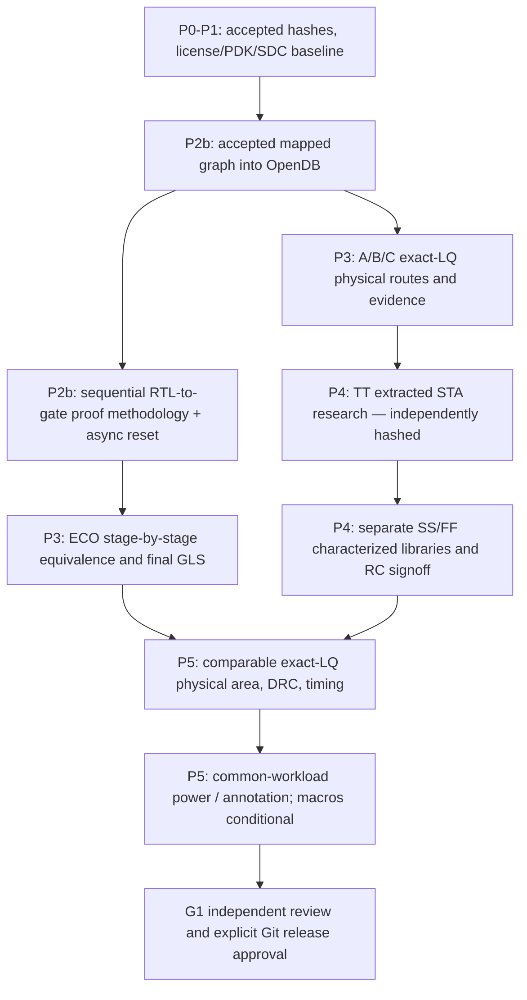

# M7.2 closure13 — TT extracted STA research and remaining acceptance

## What was actually observed

The October 28 Node1 transcript confirms: 80/80 repository tests pass; closure12 cross-ledger `EVIDENCE_CONSISTENT_NOT_SIGNOFF` with zero issues; 24/24 ECO files match archived SHA-256; nine ODB/SDC/SPEF records match hashes. A/B/C formal probes are `TIMEOUT_INCONCLUSIVE` at `EQUIV_INDUCT`, not equivalence proofs. The multi-corner runner returned `BLOCKED` because `build/m72/qualified-corners-v1.json` has never been generated. This file was only a *conditional illustration* in earlier instructions. DO NOT create fabricated SS/FF entries or set `reviewed=true` without characterized data and approval.

## Corrected architectural flow

## Node1: reliable TT research path

1. Activate `.venv`, set `PYTHONPATH=$PWD/src:$PWD/scripts`, `MSIF_ORFS=$HOME/eda/qualified-pdks/OpenROAD-flow-scripts`, and `FLOW_DIR=$MSIF_ORFS/flow`. Preserve existing evidence directories.
2. Confirm `sha256sum -c` for pinned TT Liberty `ec0e1067a35c8bf20b11e58d1e8ac53326067e4dac84a125cc1b917a3518d0d9`. Check ORFS commit `64939f3717ad7c694199ba04cb98924b98022868`.
3. Run `python3 scripts/m72_tt_sta_research.py --inventory build/m72/corner-inventory-c11p1.json --out build/m72/tt-research-inputcheck-v1`. The result must say `TT_INPUTS_VERIFIED_NOT_EXECUTED` and retain `signoff: NOT_VERIFIED`.
4. Only when hash verification succeeds, run `python3 scripts/m72_tt_sta_research.py --inventory build/m72/corner-inventory-c11p1.json --out build/m72/tt-research-run-v1 --execute --timeout 300`; inspect all three `.log` and `manifest.json`. Status `TT_RESEARCH_EXECUTED_REVIEW_REQUIRED` is *not timing closure*. Timeout and OpenROAD errors retain their logs and return nonzero.
5. Manually inspect the clock(s), uncertainty, IO constraints, unconstrained endpoints, recovery/removal, parasitic coverage, WNS/TNS/violations, min/hold paths, capacitance, slew, and any supply/physical configuration issues. `check_setup` output alone is not an STA acceptance certificate. This runner deliberately cannot set signoff to PASS.

## Formal / ECO / simulation gates

- **P2b:** previous A/B/C probes all reached induction with 65 unproven groups and timed out. The next formal deliverable must establish sound RTL-to-mapped state correspondence and decomposition; preserve full async reset behavior as a separate verification obligation. No extra timeout by default.
- **ECO:** archived exact-route `1_2_yosys.v`, `1_synth_lec.v`, `4_before_rsz_lec.v`, `4_after_rsz_lec.v`, `6_final_lec.v`, `6_final.v`, ODB/SPEF all match SHA manifests on Node1. `4_after_rsz_lec.v == 6_final_lec.v == 6_final.v` hashes for each variant. This does not prove transformations between preceding stages.
- **Final GLS:** use `scripts/m71_lq.py` and actual generated `msif_*_gate_tb.sv` to adapt final `6_final.v` into the compile (`iverilog -g2012 -s tb`) and simulation (`vvp`) process; first compare module top, port list, physical-only and newly inserted cells. Keep the original M7.1 260 vectors plus between-clock reset, hold, signed extremes and latency tests. No final GLS PASS until executed and zero mismatches recorded.

## Multi-corner model acquisition and P4 acceptance

Only the TT HD Liberty is currently inventoried. Qualify actual SS and FF files, their source/license, PVT, SHA, voltage/temp, derating and compatible RC methodology. Validate SDC as-applied and SPEF port/net mapping. Then create `msif-m72-corners-v1` manifest per `scripts/m72_corner_sta.py` and set `reviewed=true` only after an independent technical review (not as a bypass). The original 9-case runner has fragile exception handling and only generates research reports; its invocation is conditional and **must not be treated as signoff**.

## P5 and G1

Keep research-resynthesized physical PPA separate from exact accepted-LQ physical PPA. For each A/B/C collect actual categorized OpenDB standard-cell area, core/die area, utilization, hold/CTS/tie/antenna contributions, DRC/antenna evidence, same-corner timing, common frequency and reset/IO assumptions, and VCD/SAIF switching activities with annotation coverage. PWR0 is exploratory; PWR1 is activity-qualified; PWR2 is calibrated. Do not infer SRAM/ROM macro efficiency until characterized macros with LEF/GDS/Liberty/simulation models exist. G1 is NOT_VERIFIED and no commit/tag/push is authorized until manual acceptance.

## Proposed release message (NOT TO EXECUTE YET)

Subject: `feat(msif-m72): qualify exact-LQ P2b–P5 and reproducible physical evidence`

Body: Preserve accepted M7.1 mapped lineage; prove formal state and asynchronous reset correspondence; establish final ECO equivalence and GLS; qualify extracted multi-corner STA; publish common-workload exact-LQ PPA with complete SHA-pinned evidence and independent G1 review.

Proposed tag after all gates and independent authorization: `msif-m7.2-v0.5.0`. Review pending changes using `git diff --check`, `git status --short`, `git diff --stat`, and `git tag -l 'msif-m7.2*'`. Do not automatically stage or publish.
