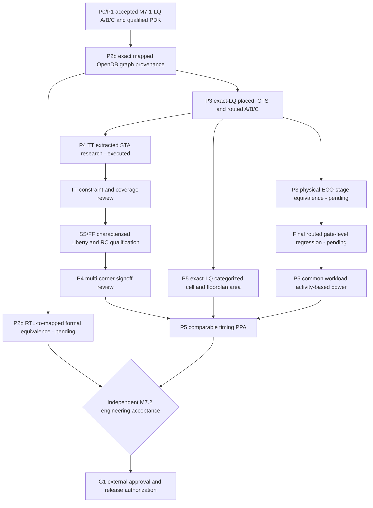

# M7.2 closure14: TT research observations, proof gates and execution plan

## Basis and restrictions

The qualified exact-LQ A/B/C OpenROAD TT experiments completed with process exit code zero. Their output marker is `M72_TT_RESEARCH_EXECUTED_NOT_SIGNOFF`. An independent log/hash review may establish only `TT_LOGS_CONSISTENT_REVIEW_REQUIRED`: it does not prove endpoint coverage, full timing constraints, activity-based power or multi-corner STA. The observed hold slack minima are approximately 0.01 ns for programmable/ROM and 0.02 ns for fixed, from **printed paths only**.

## Dependency architecture

## P2b: formal requirements

Preserve the SHA-pinned RTL, mapped Verilog, SKY130 Liberty and logs. Prior Yosys monolithic `equiv_simple` proved 0/65 groups and `equiv_induct` timed out at a 180-second per-design diagnostic budget. Do not claim equivalence. Develop a proof decomposition that verifies state correspondence, signed arithmetic and memory coefficients; each cutpoint must have an independently justified relation. `async2sync` provides a clock-sampled abstraction, not a complete between-edge async reset proof. Additional formal model validation is required for mapped DFF and lpflow cells.

## P3: routed ECO and GLS requirements

The archived ECO inventory confirms `1_2_yosys.v`, `1_synth_lec.v`, `4_before_rsz_lec.v`, `4_after_rsz_lec.v`, `6_final_lec.v`, `6_final.v`, ODB and SPEF for A/B/C. Final post-resize and routed Verilog hashes match within each design, but earlier ECO transitions remain unproven. Construct a cell-inventory delta for each edge, validate inserted clock/hold/tie cells, prove combinational/state behavior, and simulate the **actual** `6_final.v` with a models inventory derived from final cells. Reuse accepted 260-vector stimulus plus async reset between edges, valid latency and signed extremes. No PASS without actual compiled and run logs.

## P4: TT, SS and FF

Use `scripts/m72_tt_sta_audit.py` against `build/m72/tt-research-run-c13b` to verify captured log hashes and printed paths. Preserve TT `NOT_VERIFIED` signoff. Obtain genuinely characterized SS and FF liberty views and reviewed per-corner RC methodology. Create a nine-entry `msif-m72-corners-v1` manifest **only after** engineering review; then run the existing `m72_corner_sta.py` and inspect setup/hold, recovery/removal, uncertainty, unconstrained endpoints, slew/capacitance, SPEF annotation, reset and timing exceptions. The old `m72_corner_sta.py` may fail without a manifest on exceptions; preserve stderr as evidence and do not overwrite an existing run.

## P5: separated physical tracks

`m72_area_run.py` uses `normalized_v2`, **not** `exact_lq_singlecore_v2`; do not use its output for exact-LQ comparison. For the accepted track read exact-LQ final ODB for each variant, collect categorized area using `m72_final_area.tcl`, and save SHA-bound quantities and geometry units. Preserve earlier research-route comparison separately. Power PWR0 is research only; PWR1 requires equivalent VCD/SAIF workloads and activity coverage, PWR2 requires calibration. A/C cell-based arrays are not characterized SRAM/ROM macros.

## Acceptance and release planning

Status: P0/P1 accepted; P2b graph PASS; formal, async reset, ECO equivalence and routed GLS OPEN; P3 physical artifacts available; P4 TT research executed but review required, SS/FF OPEN; P5 detailed exact-LQ comparison and power OPEN; G1 OPEN. Do not tag or push a claimed M7.2 completion.

Proposed *stage-specific* commit subjects (only after the corresponding stage is genuinely accepted):

1. `verify(msif-m72-p2b): establish reviewed sequential and reset equivalence`
2. `verify(msif-m72-p3): qualify exact-LQ ECO lineage and routed regression`
3. `verify(msif-m72-p4): qualify TT SS FF STA and exception coverage`
4. `feat(msif-m72-p5): publish exact-LQ comparable PPA and provenance`
5. `docs(msif-m72): record M7.2 independent acceptance and G1 handoff`

Only after review of all necessary gates propose annotated tag `msif-m7.2-v0.5.0` with the accepted hash; do not perform Git push as part of the automated qualification scripts.
