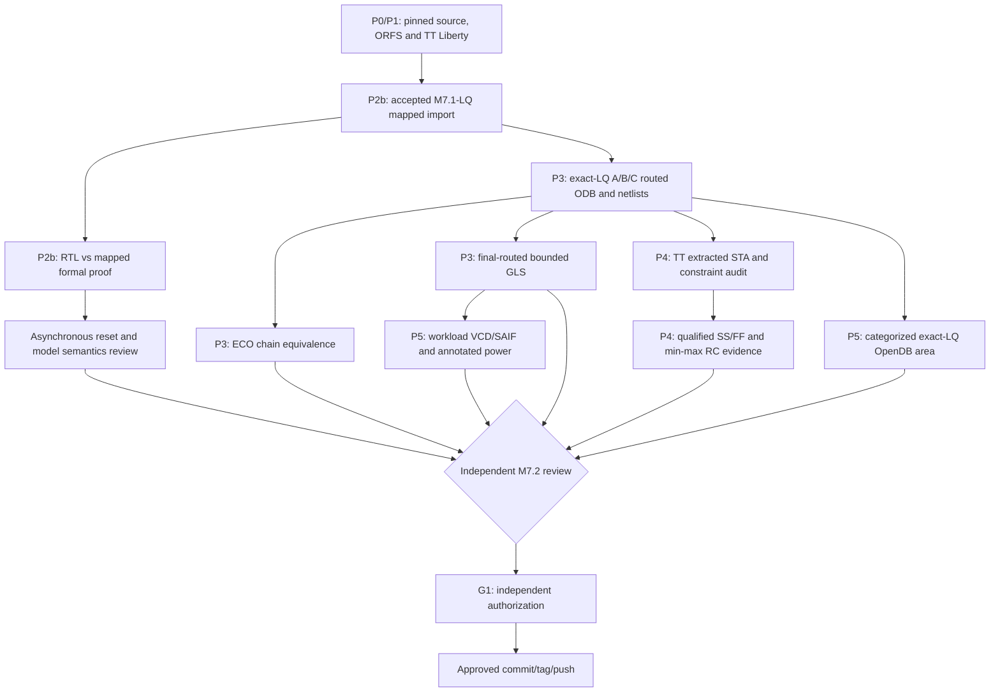

# M7.2 closure15: P2b–P5 implementation and acceptance

**Evidence status (2026-10-29):** 86 Node1 repository tests passed and the closure14 TT audit recorded A/B/C SHA-consistent execution; the supplied terminal transcript ends at a failed **illustrative** `iverilog` invocation with nonexistent filenames. In this source snapshot, adding `scripts/m72_postroute_gls.py` and two tests produces **88/88** passing Python tests. This does not establish routed gate-level simulation PASS: the external exact-route ORFS netlist bytes are not included in the repository archive.

## Architecture and strict dependencies



## P2b — functional proof unresolved

Existing `formal-probe-v5-closure11a` three-way logs reach `EQUIV_INDUCT` and each timed out at 180 s; prior `equiv_simple` proved zero of 65 groups. `async2sync` supplies only clock-sampled abstraction. Do **not** restart a longer equivalent monolithic proof or claim a partitioned proof unless each cutpoint relation and the composition theorem are shown. Review original RTL, mapped Verilog, mapped JSON, pinned Liberty `dfrtp_1` and `lpflow_*` cell semantics and differences in register/state mapping. Store exact proof scripts, transcripts, counterexamples (if any), and review receipts. No P2b formal PASS currently.

## P3 — routed bounded GLS, execute now as a separate gate

The earlier assistant's `qualified_final_cell_models.v`, `6_final.v`, and `qualified_final_gate_tb.sv` were **placeholders**. There are no such repository-root files. The installed M7.1-LQ bench and simulation models are `build/m71_liberty/m71_lq/msif_<variant>_gate_tb.sv` and `msif_<variant>_functional_models.v`. The final routed netlist belongs in `$FLOW_DIR/results/sky130hd/msif_<variant>/msif_m72_<variant>_exact_lq_singlecore_v2/6_final.v`.

Run (fresh directories, do not delete prior evidence):

```bash
cd ~/dev/pub/ai-sys1/msif-hack/push/msif_hackathon
source .venv/bin/activate
export PYTHONPATH="$PWD/src:$PWD/scripts"
export MSIF_ORFS="$HOME/eda/qualified-pdks/OpenROAD-flow-scripts"
export FLOW_DIR="$MSIF_ORFS/flow"
python3 scripts/m72_postroute_gls.py --flow "$FLOW_DIR" --out build/m72/postroute-gls-inputcheck-c15
python3 -m json.tool build/m72/postroute-gls-inputcheck-c15/manifest.json
python3 scripts/m72_postroute_gls.py --flow "$FLOW_DIR" --out build/m72/postroute-gls-run-c15 --execute
python3 -m json.tool build/m72/postroute-gls-run-c15/manifest.json
```

This pilot deliberately uses the original bounded baseline testbench, which already includes 260 comparisons and asynchronous reset assertions, and the original *accepted* functional model. If final physical cells include additional types absent from the baseline models, Icarus compile must fail closed. Use `scripts/m71_cell_models.py` to regenerate a new exact-final cell-model bundle from the actual placed-cell inventory and `SKY130_HD` source **after** verifying the complete final-cell type list and wrapper provenance. Do not add blackbox stubs or edit the netlist. A successful bounded GLS is **not** full equivalence or electrical signoff.

ECO ledger: accepted mapped `→ 1_synth_lec.v → 4_before_rsz_lec.v → 4_after_rsz_lec.v → 6_final.v`. Existing A/B/C inventory and hashes, including final post-resize equality, establish identity only at the recorded matching stages. Functional transformations still require independently reviewed equivalence, tie/CTS/hold repair and mapping audit. Store stage hashes and zero unreviewed functional differences.

## P4 — TT accepted as executed research only; full corner review open

The closure14 audit confirmed 20 printed max-path and 20 printed min-path observations for A/B/C; +88.12/+0.01 ns (A,C), +87.68/+0.02 ns (B) are minima **within the displayed report paths**, not proof of global worst slack. Validate clocks, IO budgets, reset recovery/removal, effective SDC exceptions, SPEF annotation, derates, clock propagation, slew/cap and unconstrained endpoints independently. The existing pinning is TT only. Do not fill `qualified-corners-v1.json` with TT substitutions for SS/FF. Acquire authentic SS/FF libraries and qualified min/max RC, hash each input, construct the nine-entry schema of `scripts/m72_corner_sta.py`, and execute only after `reviewed=true` reflects actual independent review. Script success alone means review required.

## P5 — exact-LQ only, research PPA kept separate

Existing `scripts/m72_area_run.py` hardcodes `normalized_v2` and therefore must not be used as exact-LQ area qualification. Use the same verified `scripts/m72_final_area.tcl` against `..._exact_lq_singlecore_v2/6_final.odb` under a **new** output directory. `m72_final_area.tcl` reports `core_area_um2` and broad classes but not comprehensive signoff-quality functional/clock/hold/filler/tap categorization. The P5 comparison must explicitly distinguish core geometry and summed master cell area; record units and cell category exclusions. Investigate actual OpenDB inventory for cell breakdown. Power PWR0=estimate, PWR1=common-workload VCD/SAIF and annotation coverage, PWR2=calibrated; no memory macro claims until characterized SRAM/ROM implementations and views exist.

## Documentation and review, then milestone commits

Maintain evidence-linked README, Architecture, Physical-Design-Qualification, Validation, Milestones and G1-Handoff descriptions. Never describe OpenROAD exit zero as `STA_PASS`, or a 260-vector test as unbounded equivalence.

Proposed **future** milestone commit subjects (separate from this diagnostic work):

- `verify(msif-m72-p2b): accept mapped RTL equivalence and asynchronous reset semantics` — only after proof review.
- `verify(msif-m72-p3): accept ECO transformations and final routed gate regression` — only after genuine ECO+GLS receipts.
- `verify(msif-m72-p4): qualify extracted TT SS FF STA and constraint coverage` — only after all characterized views and independent checks.
- `feat(msif-m72-p5): publish exact-LQ comparative PPA with workload provenance` — only after area/timing/power evidence.
- `docs(msif-m72-g1): freeze independent M7.2 release approval evidence` — only after authorization.

Suggested release tag `msif-m7.2-v0.5.0` remains **proposal only**. Preserve working-tree modifications; review `git diff --check`, `git status --short`, staged diffs and manual approvals before any `git commit`, `git tag` or `git push`.
