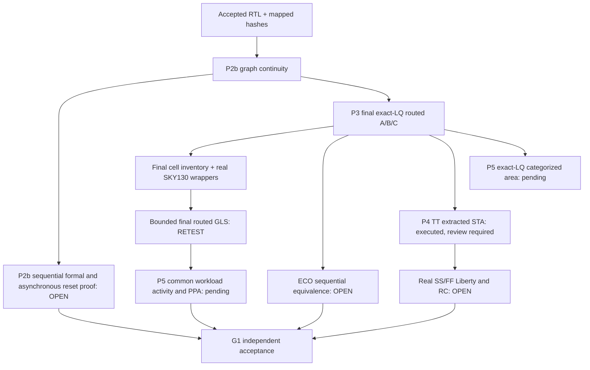

# M7.2 Closure16 — Post-route actual SKY130 models and remaining acceptance

## Provenance and observed failure

Node1 closure15 has 88/88 software tests passing but final routed Icarus compilations fail at elaboration (A: 141 missing instances, B: 186, C: 141). These are missing model *instances*, not unique types. The missing cell types include `clkdlybuf4s50_1`, `dlygate4sd3_1`, clock buffers and functional buffers/inverters. No simulation ran and no design mismatch has been established.

## Repair strategy

Use `scripts/m72_postroute_gls.py --sky130-hd /actual/source/root` with an authentic upstream SKY130 HD standard-cell **Verilog** repository containing `cells/` and `models/`. The runner extracts final netlist cell types and calls the existing `m71_cell_models.assemble()` for wrappers and preprocessor dependencies. Generated model bundles and wrapper SHA hashes live in a fresh evidence directory; accepted M7.1 model files and post-route netlists are untouched. Reuse the unchanged 260-vector baseline; separately implement an expanded reset and postroute timing-oriented regression, not assumed to pass.

## Provenance safety

The `--sky130-hd` source path must be selected from actual installed upstream sources. Do not provide the PDK Liberty path as a replacement; Liberty is not an Icarus Verilog wrapper. Reject missing wrappers and unknown cells. Do not create empty modules or combinational stubs. `--execute` with no `--sky130-hd` preserves old fail-closed behavior.

## Pipeline

## Stage-by-stage remaining proof obligations

### P2b

Formal v5 remains inconclusive after 65 match groups and induction timeout. Investigate state alignment, `dfrtp_1` and isolation cell semantics, arithmetic cones, and independent reset assertion between clock edges. Any partitioned proofs require compositional justification. Do not equate a bounded GLS PASS to proof.

### P3

First execute the corrected final-route GLS with authenticated wrappers. Check both compile and simulation transcripts, zero errors, exact `PASS <variant> 260 vectors` markers, and full model provenance. Then prove accepted mapped→synthesis→pre-resize→post-resize functional equivalence, not merely compare file hashes. Final post-resize/final Verilog matching SHA is useful but insufficient.

### P4

TT logs from A/B/C exited zero and were hash-verified. The reported min hold slack is 0.01/0.02/0.01 ns among 20 displayed paths; not proof of global closure. Audit endpoint coverage, uncertainties, SPEF annotation, min/max setup/hold, recovery/removal, electrical constraints. Acquire real SS/FF Liberty and validated RC before generating nine-entry corner manifest. Never create fake corners.

### P5

Do not reuse `m72_area_run.py` for exact-LQ because its ODB path is `normalized_v2`. Run the previously provided exact-LQ ODB area Tcl in fresh evidence directories, validate class accounting and geometry; then build comparable per-variant physical PPA with common workload VCD/SAIF and annotation. PWR0 research, PWR1 activity-qualified, PWR2 independently calibrated; macro conclusions out-of-scope.

## Git milestone subjects — proposed, not authorized as signoff

- `test(msif-m72-p3): add authentic routed SKY130 cell model coverage`
- `verify(msif-m72-p2b): prove RTL mapped equivalence and reset semantics` — only after successful proof
- `verify(msif-m72-p3): accept postroute ECO and bounded regression` — only after ECO proof and GLS
- `verify(msif-m72-p4): qualify TT SS FF timing and constraint coverage` — only after P4 acceptance
- `feat(msif-m72-p5): publish exact-LQ comparable PPA evidence` — only after P5 acceptance
- `docs(msif-m72-g1): record independent release authorization` — only after G1 approval

Proposed final annotated tag `msif-m7.2-v0.5.0` requires checking existing tags and manual review. No commit, push or tag is performed by this patch.
