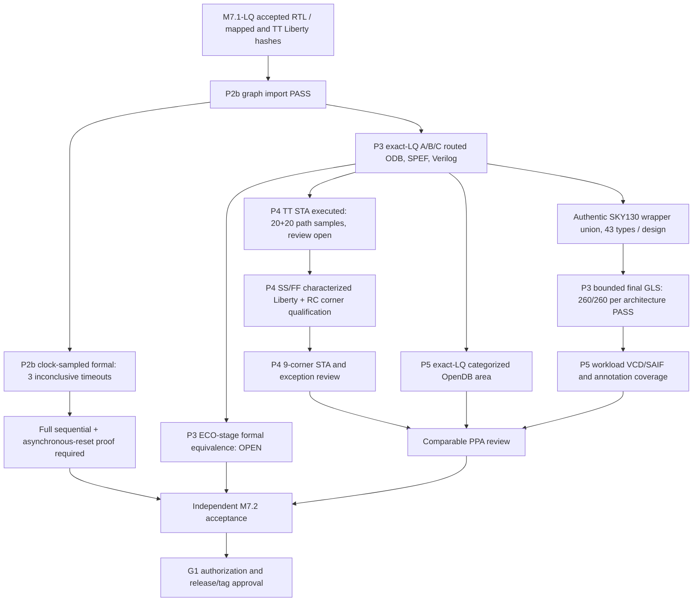
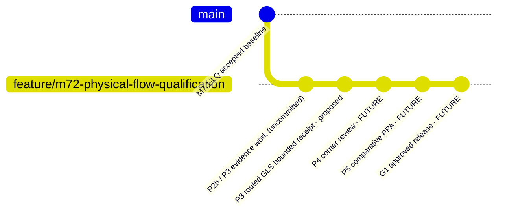

# M7.2 Closure17 — Routed GLS receipt, P4 and P5 continuation

## Exact source and results scope

Input: uploaded closure16-test source archive and 2026-10-29 Node1 logs. Actual Node1 result: 91 Python tests pass, all three final-route designs compile with upstream SKY130HD cell wrappers, and each produces `PASS <variant> 260 vectors`. 43 unique final cell types per architecture are included in generated model bundles. `build/m72/postroute-gls-run-c16/manifest.json` reports `BOUNDED_FINAL_GLS_ALL_PASS_NOT_EQUIVALENCE`. This is **bounded, zero-delay functional simulation**, not a sequential equivalence proof or post-route timing simulation.

Provenance: ROM and programmable share the same functional cell-model hash, but their separate netlist, bench and simulation log hashes are distinct. A/B/C accepted M7.1-LQ RTL/mapped SHA remain unchanged. Three TT OpenROAD experiments executed with positive slack among 20 printed maximum and 20 printed minimum observations; reports are not global timing signoff.

## Architecture and evidence dependency



## Node1 installation / environment

From repository root activate `.venv`, set `PYTHONPATH="$PWD/src:$PWD/scripts"`, `MSIF_ORFS="$HOME/eda/qualified-pdks/OpenROAD-flow-scripts"`, `FLOW_DIR="$MSIF_ORFS/flow"`; source `$MSIF_ORFS/env.sh` when `openroad` is not on PATH. Never run Git reset or overwrite historical build outputs. The scripts added in this closure are `scripts/m72_c17_evidence.py` (integrity receipt) and `scripts/m72_exact_lq_area.py` (area collector); `tests/test_m72_c17.py` adds 3 regressions.

Validate with `python3 -m compileall -q src scripts tests` and `python3 -m unittest discover -s tests -v`. Then execute:

```bash
python3 scripts/m72_c17_evidence.py --gls build/m72/postroute-gls-run-c16 --tt build/m72/tt-research-run-c13b --out build/m72/closure17-gls-tt-evidence.json
python3 scripts/m72_exact_lq_area.py --inventory build/m72/corner-inventory-c11p1.json --out build/m72/closure17-area-inputcheck
python3 scripts/m72_exact_lq_area.py --inventory build/m72/corner-inventory-c11p1.json --out build/m72/closure17-area-execute --execute
```

Scripts reject existing outputs, preserve individual Tcl/log/report/hash evidence, and report `NOT_SIGNOFF` / `REVIEW_REQUIRED`. The archived source cannot execute OpenROAD for actual area values because its external ORFS ODB files are on Node1; no area results are asserted in advance.

## P2b and P3 residual verification

The 180-second probes for programmable/fixed/ROM each reached `EQUIV_INDUCT` after `equiv_simple` proved 0 of 65 groups and timed out. Inspect the Yosys SAT cone, coefficient arrays, gold/gate FF mapping and library semantics; develop sound partitions with provable cutpoints. `async2sync` changes between-clock reset semantics, which need a separately proven contract. Final GLS with authentic functional models is a **bounded simulation PASS** only; no timing back-annotation or full exhaustive ECO assertion is established. Prove accepted mapped → synthesis → before-resize → after-resize, and review inserted CTS/hold/buffer cells. Rerun final GLS with reset-specific scenarios and X-propagation checks before greater coverage claims.

## P4 — TT constraint review; SS/FF qualification

Existing `tt-research-audit-c14.json` verifies TT logs and sampled slack values: A max/min +88.12/+0.01 ns, B +87.68/+0.02 ns, C +88.12/+0.01 ns. *These are observations in reported paths, not global WNS.* Confirm clock period, propagated clock and uncertainty, IO delays and load, reset recovery/removal, unconstrained endpoints, false/multicycle exceptions, SPEF annotation, slew, capacitance and corner-specific min/max RC. The 0.01 ns sampled hold margin is especially fragile. No characterized SS and FF inputs are present in the archived inventory. Verify provenance/hashes/PVT and relevant RC before constructing the nine-entry `msif-m72-corners-v1` manifest; never relabel TT as SS/FF. Execution alone is `STA_EXECUTED_REVIEW_REQUIRED`.

## P5 — Exact-LQ area and activity power

The older `m72_area_run.py` addresses `normalized_v2` research results. The new area collector instead rehashes `corner-inventory-c11p1.json` and requires `exact_lq_singlecore_v2` ODBs; the existing `m72_final_area.tcl` reports geometry and categorized instance areas. Review classification of filler, tap, decap, clock buffers, antenna and *other*, ensure standard-cell area vs core area are not conflated, inspect tie/hold cells, and compare consistent constraints. A/C arrays are synthesized cell logic, not physical SRAM/ROM macros. Power PWR0 is exploratory; PWR1 requires comparable valid-cycle VCD/SAIF stimulus, hierarchical activity matching, annotation percentage and PVT conditions; PWR2 requires independent calibration. Do not claim per-architecture qualified power based on TCL area output or 260-vector regression.

## Git milestone plan (subjects, not preapproved commits)



The gitGraph is conceptual; it does **not** claim those commits already exist. Proposed subjects:

- `test(msif-m72-p3): preserve authentic SKY130 final-route bounded GLS evidence` — after review of receipt and model provenance.
- `verify(msif-m72-p2b): prove RTL to mapped equivalence including asynchronous reset` — only after full formal proof.
- `verify(msif-m72-p3): qualify ECO transformations and final route regressions` — only after ECO proof.
- `test(msif-m72-p4): preserve hash-bound TT STA research and exact-route observations` — research receipt may be committed distinctly from full signoff.
- `verify(msif-m72-p4): qualify TT SS FF extracted STA and timing exceptions` — only after all characterized corners.
- `feat(msif-m72-p5): publish exact-LQ comparative area and activity-based PPA` — only with accepted workload, RC and power evidence.
- `docs(msif-m72-g1): approve independent M7.2 engineering release` — only with approval receipts.

Before any commit: `git status --short`, `git diff --check`, `git diff --stat`, `git log --oneline -5`, `git tag -l 'msif-m7.2*'`. Review actual staged files with `git diff --cached`. No commit, tag or push is executed by these scripts. Proposed final annotated tag **only after approval**: `msif-m7.2-v0.5.0`.

## Final statuses

P0/P1 source SHA/constraints: accepted baseline. P2b graph continuity: PASS. P2b full formal: NOT_VERIFIED. P3 route artifacts: HASH VERIFIED. P3 bounded GLS: 3×260 PASS. P3 ECO formal: NOT_VERIFIED. P4 TT: EXECUTED_REVIEW_REQUIRED. P4 SS/FF: NOT_VERIFIED. P5 exact area: awaiting Node1 collector. P5 calibrated/activity-qualified power: NOT_VERIFIED. G1: NOT_VERIFIED.
