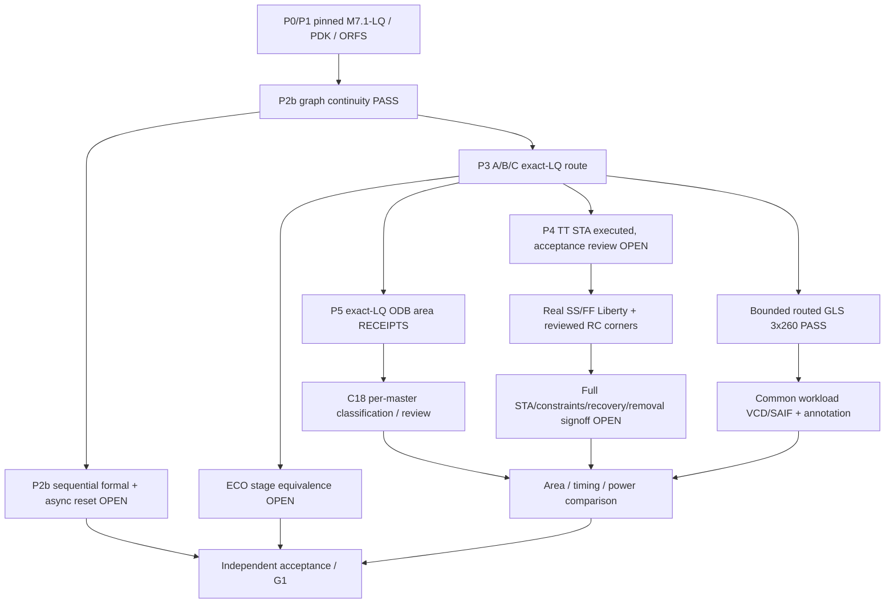
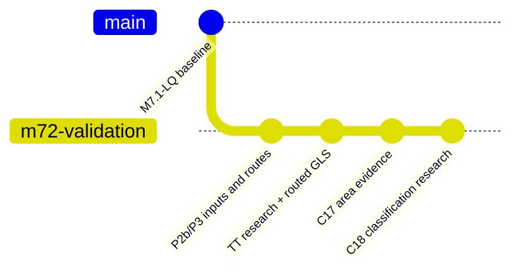

# M7.2 Closure18 — exact-LQ area evidence, P4, P5 and release gates

## Proven inputs and scope

Source: closure17-test archive dated 2026-10-29, Node1 terminal log through `AREA_EXTRACTED_REVIEW_REQUIRED`. The full 94-test closure17 suite passed on Node1. The evidence ledger reports A/B/C final-route zero-delay GLS with 260 vectors per architecture, and TT extracted STA executed with reports requiring review. Closure17 exact-LQ ODB area extraction completed with zero tool errors and SHA-pinned reports. Closure18 introduces a read-only evidence audit and independently rerunnable per-master classification; none of this establishes full formal equivalence, P4 signoff, or P5 switching power.

### Actual archived Closure17 area results (um²)

|Design|Core area|Raw `other`|Named clock buffers|Filler|Tap|
|---|---:|---:|---:|---:|---:|
|Programmable|26206.3840|8026.4480|152.6464|17608.1376|419.1520|
|Fixed|25911.1008|8274.1856|238.9792|16978.7840|419.1520|
|ROM|26206.3840|8026.4480|152.6464|17608.1376|419.1520|

The `other` category is **not** approved functional-only area: `m72_final_area.tcl` categorizes anything not matched by narrow name patterns as other. Filler alone is ~17k um² in each design. Sum of library master areas is not the same as usable core area or utilization. The new `m72_c18_classified_area.tcl` gives a heuristic master listing for manual cell type review and **does not** assert a standardized functional-area number. It leaves `functional_or_unresolved` intentionally unresolved.

## Engineering architecture

## Validation sequence

From repository root: `source .venv/bin/activate`; `export PYTHONPATH="$PWD/src:$PWD/scripts"`; `export MSIF_ORFS="$HOME/eda/qualified-pdks/OpenROAD-flow-scripts"`; `export FLOW_DIR="$MSIF_ORFS/flow"`; `source "$MSIF_ORFS/env.sh"` if OpenROAD not on PATH. Do not overwrite historical evidence, change mapped files or mutate the qualified ORFS tree.

1. `python3 -m unittest discover -s tests -v` (98 tests after C18 additions).
2. `python3 scripts/m72_c18_area_audit.py --area build/m72/closure17-area-execute --inventory build/m72/corner-inventory-c11p1.json --out build/m72/c18-area-audit-v1.json`. Require `AREA_RECEIPTS_INTACT_CLASSIFICATION_PENDING` and no issues. This checks on-disk report, Tcl, OpenROAD transcript hashes, JSON/report agreement, and pinned ODB digest **record**. It does not rehash the external ODB; the next step does.
3. `python3 scripts/m72_c18_classified_run.py --inventory build/m72/corner-inventory-c11p1.json --out build/m72/c18-area-inputcheck-v1`; require `AREA_INPUTS_VERIFIED_NOT_EXECUTED`.
4. `python3 scripts/m72_c18_classified_run.py --inventory build/m72/corner-inventory-c11p1.json --out build/m72/c18-classified-v1 --execute`; require `CLASSIFICATION_REVIEW_REQUIRED`, individual master listing hashes and 3 × OpenROAD exit zero. Review `*.masters.txt` and `*.classified.txt`. Because classification is name-based, **manual master-by-master review remains mandatory**.

## P4: TT and SS/FF closure

The TT report auditor covered 20 printed max paths + 20 min paths per architecture, with minimum displayed hold slack 0.01 ns for programmable/ROM and 0.02 ns for fixed. These are **sampled** paths only. Obtain global WNS/TNS, violations/counts, unconstrained endpoints, propagated clock, IO delays, reset recovery/removal, path exceptions and full SPEF annotation. Preserve detailed Tcl and hashed reports. Acquire real characterized SS and FF Liberty views and review voltage/temperature/process, RC corners, extraction model compatibility and all SDC assumptions; no TT-as-SS/FF substitution. Existing `m72_corner_sta.py` expects a nine-entry reviewed manifest. Do not execute until real corner files are validated. A successful OpenROAD exit alone is not signoff.

## P5: activity and physical PPA

The archived 260-vector testbenches are bounded functional evidence; they did not save VCD/SAIF for power qualification. Add *instrumentation* to a separate non-destructive testbench copy or a supervised simulation wrapper, and maintain the same workload for A/B/C, with identical clock, reset, input probabilities and timing windows. Preserve VCD hash, simulation model provenance, instance mapping, annotated/unannotated pin and net counts, switching coverage, voltage/corner conditions, source power models, and exact power tool reports. No power number is valid unless coverage and clock-tree activity are explicitly reviewed. Separate PWR0 estimation, PWR1 activity-based analysis and PWR2 calibrated validation. Exclude memory-macro PPA claims until real characterized macros are used.

## Remaining P2b/P3 obligations

Clock-sampled Yosys `equiv_induct` times out for A/B/C and `equiv_simple` has zero of 65 groups proved; this is not evidence of equivalence. Prove sound reference/mapped register correspondence and observable outputs, and separately address between-edge async-reset behavior; preserve any cutpoint justification. ECO equivalence must cover accepted mapped → synth → pre-resize → post-resize → final routed. The 3×260 routed GLS PASS is useful but bounded, zero-delay and neither unbounded formal nor SDF simulation.

## Git / G1 review strategy

**Proposed (not executed)** commit subjects once each claim is actually supported:

- `test(msif-m72-p3): preserve bounded routed GLS and model provenance`
- `test(msif-m72-p5): inventory exact-LQ OpenDB area and master classes`
- `verify(msif-m72-p2b): prove mapped equivalence and reset contract` (future gate)
- `verify(msif-m72-p3): qualify ECO stage equivalence` (future gate)
- `verify(msif-m72-p4): qualify extracted multi-corner timing` (future gate)
- `feat(msif-m72-p5): accept common-workload activity-based PPA` (future gate)
- `docs(msif-m72-g1): freeze independent engineering acceptance` (future gate)

Check `git status --short`, `git diff --check`, `git log --oneline -5`, `git tag -l 'msif-m7.2*'`. Do not commit unrelated untracked build output; create an explicit allowlist after source review. Proposed final tag `msif-m7.2-v0.5.0` **only after G1 signoff and manual approval**.

The gitGraph is a **conceptual engineering history**, not a statement that these exact commits were made.
