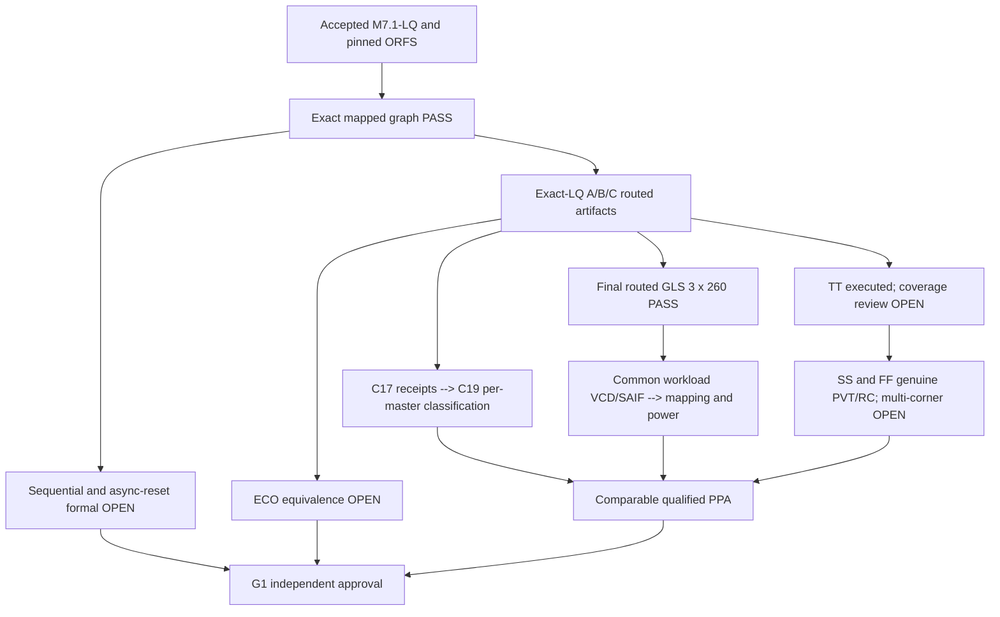
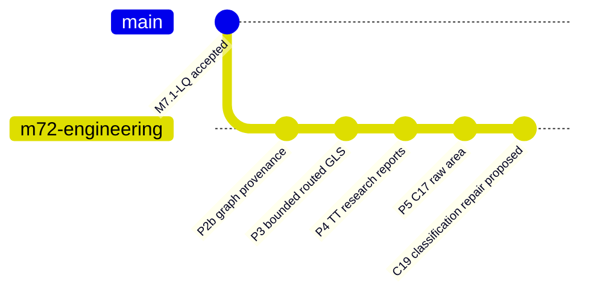

# M7.2 Closure19 — Tcl correction, P4 and P5 verification continuation

## Evidence and confirmed failure
The closure18 archive shows 98 Python tests passed and existing Closure17 area receipts intact. All three actual OpenROAD c18-classified-v1 jobs failed with `extra characters after close-brace` in `m72_c18_classified_area.tcl`. Fix only the expression accumulation; never overwrite archived failed attempts. The existing-output rejection is intentional; use new names rather than `rm -rf` evidence.

## Classified area
The corrected Tcl preserves `classification=NAME_HEURISTIC_REVIEW_REQUIRED` and per-master listings. Re-run with new directory `build/m72/c19-classified-v1`, never reuse `c18-classified-v1`. Check manifest and `*.log`, `*.classified.txt`, `*.masters.txt`. Require three `CLASSIFICATION_REVIEW_REQUIRED` results and review all `functional_or_unresolved` rows. The sum of master areas equaling core area is not valid evidence of 100% utilization. Validate the actual die/core extents and overlapping/physical-only cells separately. Naming-based classes are research-only.

## P4 TT reviewed report gate
Retain TT log SHA records and 20 printed max/min paths. Global worst slack/TNS, unconstrained paths, clocks, reset recovery/removal, propagated clock, exception coverage, parasitic annotation, input/output constraints and electrical checks remain unverified. Record report commands and audit parser acceptance; do not infer zero violations from a zero exit code. All three architectures require independent report coverage and a documented SDC exception review.

## P4 SS/FF gate
Qualify real SS and FF Liberty files and compatible RC assumptions with process/voltage/temperature and hashes. Only after checking a genuine nine-entry TT/SS/FF x 3 architecture manifest should `m72_corner_sta.py` execute. Missing views block multi-corner qualification. Zero exit is not signoff.

## P5 area and power
Preserve exact-LQ routed OpenDB provenance, raw Closure17 area reports, Closure18 failed logs and Closure19 independently corrected reports. Separate logic, clock/CTS, hold buffers/delay, filler, tap, physical-only cells, core/die area and utilization. The `functional_or_unresolved` name category cannot be reported as proved logic area. For power, generate a common cycle-accurate A/B/C input workload; produce VCD/SAIF with measurement-window selection and map activity to actual final netlist names; quantify signal/pin/net annotation coverage. Power from a TT Liberty alone is not calibrated multi-corner power. PWR0 exploratory; PWR1 characterized activity with provenance; PWR2 calibrated. A/C coefficient arrays are standard-cell implementations, not SRAM/ROM macros.

## Open proof and release blockers
P2b formal A/B/C remains timeout-inconclusive; ECO stage equivalence and asynchronous reset are unverified despite 3x260 vectors routed GLS PASS. G1 requires independent receipts and manual approval. No release tag until gates accepted.

## Proposed commit subjects (only when accurately supported)
- `fix(msif-m72-p5): correct classified OpenDB area Tcl and add execution regression`
- `test(msif-m72-p4): preserve TT timing reports and coverage findings`
- `verify(msif-m72-p2b): prove mapped sequential and reset correspondence` — future accepted proof only
- `verify(msif-m72-p3): qualify ECO equivalence across all physical stages` — future accepted proof only
- `verify(msif-m72-p4): qualify authentic TT SS FF timing and constraints` — future corner acceptance only
- `feat(msif-m72-p5): qualify matched-workload physical PPA` — future activity and power acceptance only
- `docs(msif-m72-g1): record independent acceptance` — future explicit approval only

Proposed annotated release tag: `msif-m7.2-v0.5.0` after independent G1 approval, never as a consequence of a research run.
