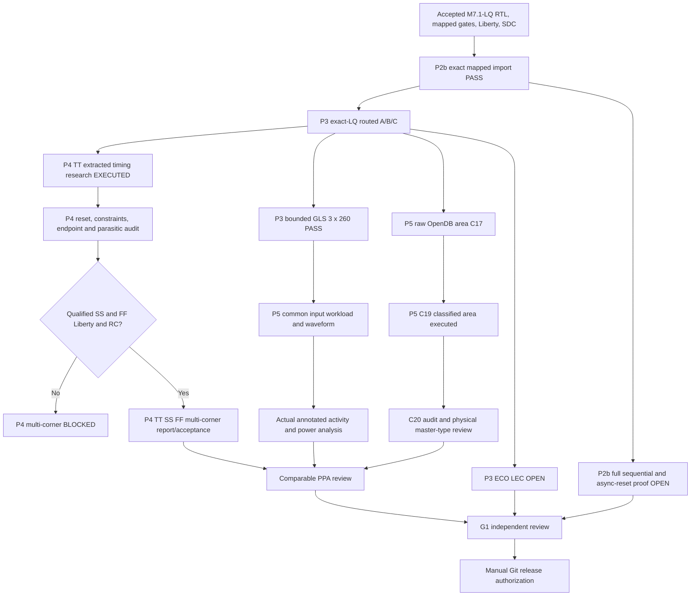
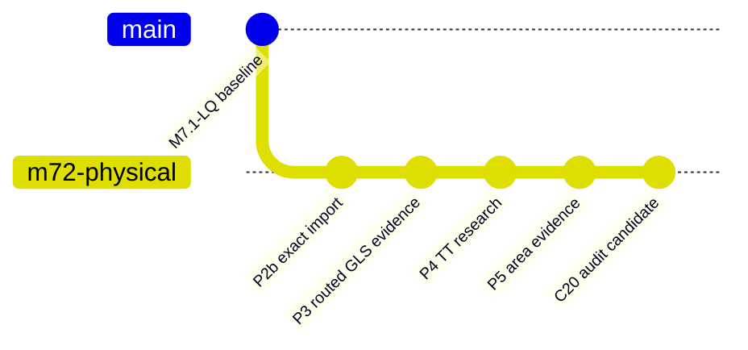

# M7.2 Closure20 — C19 area reconciliation, P4 constraints and P5 power plan

**Evidence scope**: closure19 archived source and Node1 terminal transcript (2026-10-29). This document is an implementation/review checkpoint, **not** G1 signoff. Preserve every previous evidence directory; use fresh destinations.

## 1. Verified state

- 100/100 Node1 tests passed on closure19; the Tcl expression fix ran on real OpenROAD A/B/C and status was `CLASSIFICATION_REVIEW_REQUIRED`, exit 0.
- P3 final routed GLS passed 260 vectors each with actual SKY130HD wrappers, but P2b full sequential/reset formal and P3 ECO-stage equivalence are **NOT_VERIFIED**.
- TT-only STA research ran; printed hold path minimum +0.01 ns A/C, +0.02 ns B, not global multi-corner closure.
- The SDC clock period is 100 ns, uncertainty 1 ns; input/output delay commands are 5 ns. `rst_n` is asynchronous in RTL and is nonetheless input-delayed, requiring reset timing methodology review.
- User's ORFS sky130hd platform search found TT-only Liberty `sky130_fd_sc_hd__tt_025C_1v80.lib`; SS/FF cannot be marked available without verified characterized source.
- C19 master classes are **name heuristics**, not functional/physical-only certified classes.

## 2. Architecture and dependency diagram



## 3. P5 classified area — read-only reconciliation

Use `scripts/m72_c20_audit.py` to validate archived C19 reports against C17 and the SHA-pinned corner inventory. It verifies report/log/Tcl/master SHA-256, instance counts, class area totals, ODB identity and (unless disabled) actual external SDC hash and baseline command coverage. It intentionally never returns a signoff status.

```bash
cd ~/dev/pub/ai-sys1/msif-hack/push/msif_hackathon
source .venv/bin/activate
export PYTHONPATH="$PWD/src:$PWD/scripts"
python3 scripts/m72_c20_audit.py \
  --area build/m72/c19-classified-v1 \
  --old build/m72/closure17-area-execute \
  --inventory build/m72/corner-inventory-c11p1.json \
  --out build/m72/c20-area-sdc-live-v1.json
python3 -m json.tool build/m72/c20-area-sdc-live-v1.json
```

Expected on Node1 only if all external SDC files still match: `AREA_RECONCILED_SDC_REVIEW_REQUIRED`, `issues: []`. If a file changed, the script **must fail**. A local archive/offline validation may use `--no-live-sdc` but is ineligible for physical acceptance.

### C19 measured name-based classes (um^2)

| Category | Programmable | Fixed | ROM |
|---|---:|---:|---:|
| Core bounding-box | 26206.384 | 25911.1008 | 26206.384 |
| `functional_or_unresolved` | 6598.8288 | 6332.3232 | 6598.8288 |
| `clock_tree_named` | 1247.4464 | 1476.4160 | 1247.4464 |
| `delay_gate_named` | 320.3072 | 640.6144 | 320.3072 |
| `buffer_inverter_named` | 12.512 | 63.8112 | 12.512 |
| `filler` | 17608.1376 | 16978.7840 | 17608.1376 |
| `tap` | 419.1520 | 419.1520 | 419.1520 |

**Important:** the sum of cell-master bounding areas is about equal to the core rectangle in these outputs because filler/taps fill sites. This is **not** 100% functional utilization. The C20 audit verifies this equality as a consistency invariant only. For qualified area, explicitly review OpenDB master `getType`, distinguish physical-only from functional cells, and reconcile physical master area against actual die/core geometry and placement occupancy. A and C are identical under this reported name-based classification, not necessarily electrically or power-equivalent.

## 4. P4 TT and SS/FF timing

### 4.1 Constraints, reset and coverage

- Pin all used `6_final.odb`, `6_final.spef`, `6_1_fill.sdc`, TT Liberty hashes.
- Preserve the baseline SDC. Record 100-ns clock, 1-ns uncertainty, 5-ns I/O delays, and reset timing assumptions. Asynchronous reset assertion and deassertion require separate recovery/removal methodology and functional checks. Do not waive paths without an approved reset synchronization strategy.
- Generate actual tool reports for complete setup/hold WNS/TNS, path-group coverage and unconstrained endpoints, recovery/removal, clocks, slew/capacitance, exceptions, SPEF annotation, and routing DRC/antenna receipts. A printout of 20 paths per type cannot substitute for global metrics.
- Maintain a reviewed timing-exception list showing exact start/end points and justification; no automatic exception insertion.

### 4.2 Authentic corners

```bash
export MSIF_ORFS="$HOME/eda/qualified-pdks/OpenROAD-flow-scripts"
find "$MSIF_ORFS/flow/platforms/sky130hd" -type f \
  \( -name '*ss*.lib*' -o -name '*ff*.lib*' -o -name '*tt*.lib*' \) -print | sort
```

Only TT is evidenced in the provided terminal search. Obtain actual qualified SS/FF views and matched RC setup, record SHA-256, process, voltage, temperature, source revision, and applicability. Populate `m72_corner_sta.py`'s 9-entry manifest only after complete attestation. Do not duplicate TT paths under SS/FF labels. P4 full corner qualification remains `NOT_VERIFIED`.

## 5. P5 activity-qualified power — implementation gates

```mermaid
flowchart LR
 A[Frozen stimulus: reset, valid, activations, clock] --> B[A/B/C 6_final.v + authentic SKY130 models]
 B --> C[New VCD/SAIF testbench output]
 C --> D[Waveform parser: signal changes, X/Z, window, SHA]
 D --> E[Instance-name coverage map to routed netlist]
 E --> F[Reviewed PVT Liberty + parasitics]
 F --> G[STA/power tool with activity annotated]
 G --> H[Leakage, internal and switching power]
 H --> I[Operations counted from accepted transactions]
 I --> J[Energy per accepted inference + PWR1 receipt]
```



Implementation order:

1. Copy **not modify** the accepted gate TB into a new *power* harness; fix the measured window and record clock/reset/inputs and `out_valid`. All variants must use equivalent inputs, start/end times and transaction criteria.
2. Enable `$dumpfile`/`$dumpvars` or an equivalent VCD/SAIF output for the *actual* final netlist simulation. Verify an existing 260-vector PASS is still present, but a PASS alone does not qualify switching activity.
3. Check waveform file size, SHA, timescale, nonempty transitions in the measurement window, clocks/inputs/output activity, X/Z fraction and actual accepted transaction count.
4. Map recorded instance/net hierarchy to `6_final.v`, report annotated vs unannotated coverage; explicitly flag missing clock-tree and internal signals.
5. Use a power analysis engine with reviewed Liberty operating point and parasitics, retain all logs and modeling assumptions. No substitute for missing characterized SS/FF or zero-activity defaults.
6. Report separately: total power, leakage, internal and switching; test duration; accepted operations; energy/op = power-integrated energy / accepted operations.
7. PWR0 = exploratory only, PWR1 = activity-driven and reviewed, PWR2 = independently calibrated; none are currently accepted in the uploaded evidence.

**No completed PWR1 measurement or trained macro PPA is claimed.** Model-specific ROM arrays remain synthesized cells, not characterized ROM macros.

## 6. Verification and release gates

Run `python3 -m compileall -q src scripts tests` and `PYTHONPATH=src:scripts python3 -m unittest discover -s tests -v`; require all tests passing. Audit C19 evidence on Node1. Re-run OpenROAD only for genuinely new reports/corners/activity; do not overwrite historical outputs. G1 remains blocked on P2b full proof, P3 ECO proof, complete P4 timing and reviewed P5 PPA.

### Proposed commit subjects, NOT executed

| Phase | Commit subject | Release gate |
|---|---|---|
| C19/C20 area | `test(msif-m72-p5): audit exact-LQ classified area and provenance` | Evidence verified, classification limitations documented |
| P3 GLS | `test(msif-m72-p3): preserve three routed 260-vector regressions` | Bounded evidence reviewed |
| P2b proof | `verify(msif-m72-p2b): prove mapped sequential and asynchronous reset equivalence` | Unbounded/sound proof completed |
| P3 ECO | `verify(msif-m72-p3): qualify ECO-stage functional equivalence` | Stage proofs completed |
| P4 TT | `test(msif-m72-p4): document TT timing and constraint coverage` | Research-only limitations documented |
| P4 corners | `verify(msif-m72-p4): accept qualified TT SS FF timing` | 9 genuine corner results reviewed |
| P5 power | `feat(msif-m72-p5): publish activity-qualified comparable physical PPA` | PWR1 waveform mapping and measurements reviewed |
| G1 | `docs(msif-m72-g1): record independent M7.2 release authorization` | Independent approval |

Proposed final tag `msif-m7.2-v0.5.0`, **not created**. Git review before approval: `git status --short`, `git diff --check`, `git diff --stat`, `git log --oneline -5`, `git tag -l 'msif-m7.2*'`. Never auto-stage unreviewed outputs or push automatically.

### Milestone graph


