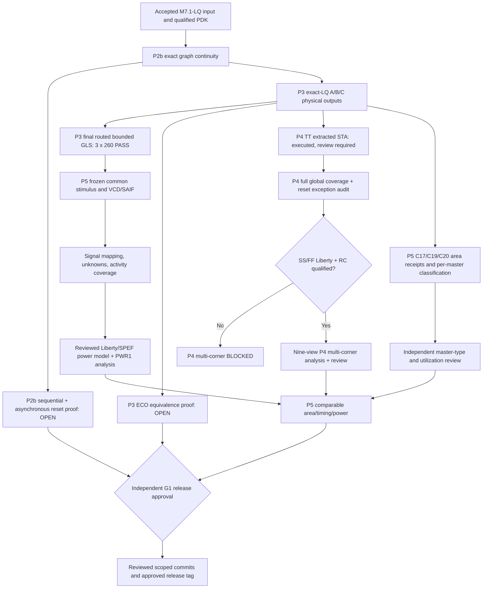
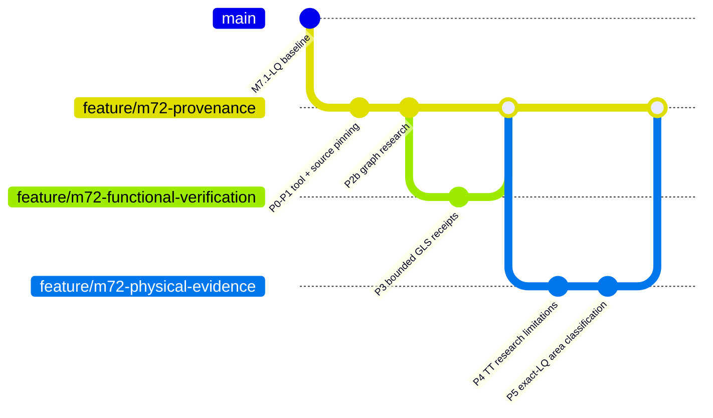

# M7.2 Closure21 — Node1 evidence review, TT/SS/FF, matched PPA, and Git release plan

**Scope:** Based on attached Closure20 repository and Node1 log through `c20-area-sdc-live-v1.json` on 2026-10-29. This is a runnable research/release-preflight addition. It **does not authorize M7.2 release**.

## 1. Readiness and audit results

- 103 Node1 Python tests passed, test RC=0; `openroad`, ORFS `yosys`, and `klayout` resolved after `source "$MSIF_ORFS/env.sh"`. The mistyped `export ORFS_ROOT=...;;` was a Bash syntax error and is not an EDA failure; the subsequent environment setup succeeded.
- `m72_c20_audit.py` on Node1 returned `AREA_RECONCILED_SDC_REVIEW_REQUIRED`, `issues=[]` for A/B/C, not physical signoff.
- The live SDC scan recorded **one clock**, **34 input-delay commands**, **65 output-delay commands**, `rst_n` input delayed, async reset review and global coverage `NOT_VERIFIED`.
- A/B/C routed bounded GLS ran 260 vectors each using authentic SKY130 wrappers. RTL-to-mapped sequential/async formal and ECO stage proofs are still incomplete.
- TT STA was executed, with positive slack among sampled printed paths, not independently audited global worst setup/hold. Qualified SS/FF and RC views were not supplied.
- C19 classified-area receipts succeeded with heuristic master classifications. C20 reconciliation records hashes and master counts, not verified functional area/utilization. PWR1/PWR2 do not have approved power receipts.
- **Git:** snapshot includes many preexisting tracked edits and untracked M7.2 scripts and documents; a blanket `git add .` would mix stages. No M7.2 tag was present in this snapshot. Review locally before each commit; no Git mutation should be automatic.

### Architecture and acceptance gates



## 2. New release-preflight script

`scripts/m72_c21_release_preflight.py` verifies actual C16 GLS simulation logs and hashes, C13b TT logs and hashes, C19 classified-area receipts, and the C20 live-SDC reconciliation. On this archived source it returns `RELEASE_BLOCKED_REVIEW_REQUIRED issues=0`: evidence is consistent; **P2b formal, P3 ECO, P4 TT global, P4 SS/FF RC, P5 activity power, P5 qualified PPA, and G1 remain NOT_VERIFIED**. Fail-closed tests include tampered GLS log and missing evidence. This preflight intentionally does not claim to measure OpenROAD STA, VCD, or power.

```bash
cd ~/dev/pub/ai-sys1/msif-hack/push/msif_hackathon
source .venv/bin/activate
export PYTHONPATH="$PWD/src:$PWD/scripts"
python3 -m compileall -q src scripts tests
python3 -m unittest discover -s tests -v 2>&1 | tee logs/m72_c21_tests.log
python3 scripts/m72_c21_release_preflight.py \
  --out build/m72/c21-release-preflight-node1-v1.json
python3 -m json.tool build/m72/c21-release-preflight-node1-v1.json
```

Use fresh output paths; do not delete archived diagnostics or rewrite the evidence. The preflight exits 0 when known receipts are consistent *even while release remains blocked*, and exits 2 if the receipts are absent, malformed, or hash-mismatched.

## 3. P5 classified-area closure — exact validation requirements

| Category (µm²) | Programmable | Fixed | ROM |
|---|---:|---:|---:|
| Reported core bounding box | 26206.3840 | 25911.1008 | 26206.3840 |
| `functional_or_unresolved` | 6598.8288 | 6332.3232 | 6598.8288 |
| `clock_tree_named` | 1247.4464 | 1476.4160 | 1247.4464 |
| `delay_gate_named` | 320.3072 | 640.6144 | 320.3072 |
| `buffer_inverter_named` | 12.5120 | 63.8112 | 12.5120 |
| filler | 17608.1376 | 16978.7840 | 17608.1376 |
| tap | 419.1520 | 419.1520 | 419.1520 |

**Correction:** the current audit's `sum(master areas) ≈ reported core area` is an *observed geometric reconciliation*, not proof of 100% functional utilization or necessarily a universally valid invariant for future macro flows. Review raw `getCoreArea`, instance master geometries and master types. The name-based `functional_or_unresolved` category contains the RTL functional gates but must not automatically be reported as an accepted functional-only category.

Run independent master review on existing receipts without rerunning OpenROAD:

```bash
for v in programmable fixed rom; do
  echo "=== $v ==="
  awk -F/ '{print $1, $3}' "build/m72/c19-classified-v1/$v.masters.txt" | sort -u
  grep '^functional_or_unresolved/' "build/m72/c19-classified-v1/$v.masters.txt"
done
python3 -m json.tool build/m72/c20-area-sdc-live-v1.json
```

**Acceptance path:** reconcile (i) ODB sha from `corner-inventory-c11p1.json`, C17 and C19, (ii) master counts and categories, (iii) `CORE` vs `CORE_SPACER` and `CORE_WELLTAP`, (iv) instance bbox occupancy vs core/die boundaries, (v) all functional and repair classes, (vi) physical DRC and antenna, (vii) consistency of actual timing and power. Report separate cell functional area, clock and repair area, physical-only cells, core/die area and verified utilization denominator. Never use existing 100% aggregate fill percentage as utilization.

## 4. P4 TT coverage and SS/FF

### TT: preserve physical receipts, run new independent reports

The C20 hash audit counted one 100 ns clock, 1 ns uncertainty, 34 input delays including async `rst_n`, and 65 output delays. A pin command count is not timing reachability; `rst_n` asynchronous assertion and release merit separate formal/reset STA and recovery/removal review.

Use a **new** OpenROAD script/report directory, with exact pinned Liberty/ODB/SDC/SPEF from the `corner-inventory-c11p1.json` manifest. Read files in this order: `read_liberty`, `read_db`, `read_sdc`, `read_spef`. Collect `check_setup`, `report_checks -path_delay max`, `report_checks -path_delay min`, `report_check_types -max_slew -max_cap -max_fanout -violators`, and supported version-specific global WNS/TNS/unconstrained diagnostics. **Check `help <command>` in the exact OpenROAD build before writing the runner**. Export complete logs and SHA records; reject missing or empty reports; never infer global metrics from 10/20 printed paths. Review clock propagation, SPEF annotation, reset recovery/removal, unclocked IO, exceptions, and DRC/antenna.

```bash
source "$HOME/eda/qualified-pdks/OpenROAD-flow-scripts/env.sh"
openroad -version
# Query supported command signatures in your pinned binary before scripting:
printf 'help report_wns\nhelp report_tns\nhelp report_unconstrained\nhelp check_setup\nexit\n' | openroad -no_init -exit > logs/m72_p4_command_capabilities.txt 2>&1 || true
cat logs/m72_p4_command_capabilities.txt
```

This is capability discovery; not a qualified STA run. A robust automated report generator and parser remain engineering work, and command output must be inspected before assertions are written.

### SS/FF: block until verified sources exist

```bash
find "$MSIF_ORFS/flow/platforms/sky130hd" -type f \
  \( -name '*ss*.lib*' -o -name '*ff*.lib*' -o -name '*tt*.lib*' \) -print | sort
find "$HOME/eda/qualified-pdks" -type f \
  \( -name '*ss*.lib*' -o -name '*ff*.lib*' \) -print | sort
```

A candidate file is not qualified. Document Liberty source, version/SHA, process and actual PVT operating conditions, exact RC assumptions and SPEF compatibility. Do not simply recycle a TT SPEF with SS/FF labels or set `reviewed: true` automatically. `scripts/m72_corner_sta.py` requires nine reviewed architecture/corner inputs but still lacks reliable timeout result persistence and quantitative signoff validation; repair this before release, not by suppressing errors.

## 5. P5 activity-qualified power (not yet implemented)

```mermaid
flowchart LR
 A["Frozen identical input transactions and reset schedule"] --> TB["Copy of accepted final-GLS testbench"]
 TB --> SIM["A/B/C 6_final.v with authenticated SKY130 functional models"]
 SIM --> VCD["VCD or SAIF per-variant with timescale and hash"]
 VCD --> QA["Trace QA: window, X/Z, nonzero clock/input/internal toggles"]
 QA --> COVER["Routed hierarchy/instance and pin coverage"]
 COVER --> CORNER["Qualified PVT Liberty + SPEF + SDC"]
 CORNER --> ENGINE["Power engine actual activity annotation"]
 ENGINE --> POWER["Internal + switching + leakage + operations"]
 POWER --> QUAL["Comparable PWR1; PWR2 requires calibration"]
```



**Implementation sequence**:
1. Copy, never edit, `build/m71_liberty/m71_lq/msif_<v>_gate_tb.sv` to a new `build/m72/power-workload-<id>/` research harness. Record accepted original TB hashes and copied source hashes. Inject `$dumpfile`, `$dumpvars` into a new simulation-only testbench copy with a testable transformer; do not alter original accepted TB or `6_final.v`.
2. Use the exact C16 routed-model bundles and exact routed `6_final.v`, retain compile/run logs and original 260-vector PASS. Verify each waveform exists, has a declared timescale, scope(s), actual value transitions, no unacceptable X/Z and finite measurement-window bounds.
3. Freeze identical `clk`, `rst_n`, `in_valid`, `activations` trajectories for all variants. Count `in_valid` accepted on clock edges only under documented ready/enable semantics; compare `out_valid` completions and latency. Do not equate all 260 testbench vectors to 260 accepted operations unless evidence proves so.
4. Build a VCD-to-physical-hierarchy mapping report for exact `6_final.v` and count annotated/unannotated nets/pins; don't silently assume clock-tree or internal toggles are annotated. Save SHA-256 of each VCD/SAIF and mapping ledger.
5. Qualify power engine + SKY130 TT Liberty, extracted SPEF, supply/PVT and time window; collect switching/internal/leakage separately. Report W, time interval (s), accepted ops and `J/accepted_operation = integral(P(t)dt)/accepted_operations`. Ensure comparable stimulus, voltage and clock model.
6. Keep PWR0 exploratory, PWR1 activity-reviewed, PWR2 independently calibrated. None is currently a release-accepted measurement.

**Important:** the current package does not claim to implement a valid VCD generation + activity annotation + power engine. It provides release-gate verification and a detailed execution specification. A/C designs are cell-based coefficient structures, not characterized SRAM/ROM macros.

## 6. Git: real attached working tree, scoped commits and release tag

The attached snapshot has extensive modified tracked docs and untracked closure scripts. No existing `msif-m7.2*` tag was found. Before committing, inspect actual changes and protect preexisting edits:

```bash
cd ~/dev/pub/ai-sys1/msif-hack/push/msif_hackathon
mkdir -p ../validation-backups/pre-m72-release
(git status --porcelain=v1; git diff --stat; git ls-files --others --exclude-standard) > ../validation-backups/pre-m72-release/inventory.txt
git diff --binary > ../validation-backups/pre-m72-release/uncommitted-tracked.patch
git diff --check
git log --oneline --decorate -8
git tag -l 'msif-m7.2*'
git status --short
```

Do **not** stage `.venv/`, `build/`, `logs/`, large external model files or ORFS output trees; verify actual `.gitignore` and evidence retention/manifest strategies. Do not overwrite the existing edited `README.md`/docs. Review the additional Closure21 appendix and merge history links carefully, then inspect `git diff` for each file.

### Proposed milestone history — commits are *plans* only, no commands executed



**Suggested subjects and allowable claims:**

| Scope | Proposed subject | Evidence condition |
|---|---|---|
| P0/P1 baseline | `build(msif-m72): pin exact-LQ physical research inputs and tools` | Frozen provenance reviewed |
| P2b graph inventory | `test(msif-m72-p2b): capture exact mapped graph continuity evidence` | Graph checks; no sequential proof claim |
| P3 GLS | `test(msif-m72-p3): audit three routed 260-vector regressions` | C16/C17 immutable log/hash validation |
| P4 TT research | `test(msif-m72-p4): document extracted TT STA and open reset coverage` | TT receipts and constraints review |
| P5 area | `test(msif-m72-p5): reconcile exact-LQ OpenDB master classes and SDC` | C19/C20/C21 evidence hashes verified |
| P2b proof | `verify(msif-m72-p2b): prove RTL-mapped sequential and async-reset behavior` | **Not authorized** without actual formal proof |
| P3 ECO | `verify(msif-m72-p3): accept exact-LQ ECO stage equivalence` | **Not authorized** without ECO proof |
| P4 signoff | `verify(msif-m72-p4): qualify TT SS FF STA and reset exceptions` | **Not authorized** without genuine corner views and review |
| P5 power | `feat(msif-m72-p5): publish activity-qualified comparable physical PPA` | **Not authorized** without calibrated/common-workload power evidence |
| G1 | `docs(msif-m72-g1): freeze independently approved M7.2 release` | **Not authorized** without reviewer approval |

To stage *only* reviewed research scripts and tests for a particular unit of work, e.g. the Closure21 preflight:

```bash
git add -- scripts/m72_c21_release_preflight.py tests/test_m72_c21_release_preflight.py docs/M7.2-Closure21-Release-Preflight-and-P4-P5-Execution.md
git diff --cached --check
git diff --cached --stat
git diff --cached -- README.md docs/Architecture.md docs/Validation.md docs/Milestones.md
# STOP HERE for manual review; do not commit until authorized.
```

For other milestones, stage explicitly named files with `git add -- <paths>` **after reviewing their entire content and dependencies**, run full tests and checks, and write a commit subject reflecting only the current proven evidence. If you need to split an existing modified document, use interactive staging (`git add -p`) and inspect `git diff --cached` against its surrounding material. For final merge/push, verify branch protections, exact remote, branch head, tag absence and independent approval. Under no circumstances create or push the `msif-m7.2-v0.5.0` tag before P2b full proof, P3 ECO, P4 multi-corner, P5 qualified PPA and G1 approval are all recorded.

### Safe release commands to review later only (do not execute now)

```bash
# Run only after approved G1 receipt and explicit Git authorization:
git status --short
git log --oneline --decorate -12
git tag -l 'msif-m7.2-v0.5.0'
git remote -v
git diff --check
# Any git commit, annotated tag creation, or push requires separate user approval.
```

## 7. Summary gates

| Gate | Current status |
|---|---|
| P0/P1 accepted source provenance | Accepted baseline |
| P2b graph continuity | PASS; functional formal NOT_VERIFIED |
| P3 final routed GLS | PASS 3 x 260; ECO equivalence NOT_VERIFIED |
| P4 TT STA | Executed research, global coverage NOT_VERIFIED |
| P4 SS/FF | NOT_VERIFIED |
| P5 C19 categorized area and C20 SDC audit | SHA-consistent; heuristic and review required |
| P5 PWR1/PWR2 | NOT_VERIFIED |
| G1 release authorization | NOT_VERIFIED; tag withheld |

**No Git staging, commit, tag or push was performed.**
