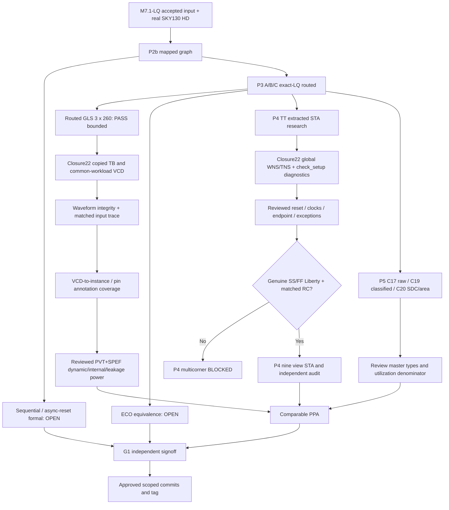
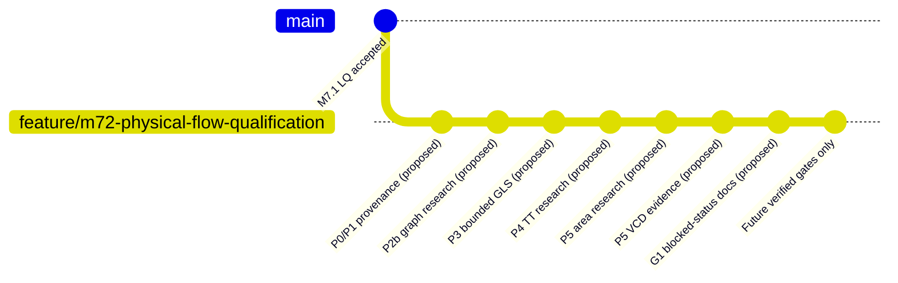

# M7.2 Closure22 — Global TT STA, common-workload VCD, and scoped Git review

**Date:** 2026-10-29. **Source:** uploaded Closure21-test repo and Node1 console log ending with Git review. **No source was pushed, tagged, committed or staged here.** The two Closure22 runners were tested locally but **have not been executed on external Node1 ORFS files**.

## 1. Evidence-led closure status

| Gate | Supported result | Open obligations |
|---|---|---|
| P0/P1 | Accepted M7.1-LQ / SHA-pinned source and PDK | Preserve provenance |
| P2b graph | Continuity evidence | Unbounded sequential / asynchronous reset formal proof |
| P3 routed | Three exact-LQ A/B/C routed, hashes audited | ECO-stage semantic equivalence |
| P3 bounded GLS | A/B/C compile and 260-vector pass with authentic SKY130 models | Not formal equivalence |
| P4 TT | 3 prior extracted TT research runs | Whole-design diagnostics, reset timing, coverage and constraints |
| P4 SS/FF | NONE qualified for this flow | Genuine complete SKY130HD PVT Liberty / calibrated RC and reviewed nine-entry manifest |
| P5 area | C19 per-master research; C20 live SDC and area hash audit | Independent category review and utilization convention |
| P5 power | No qualified VCD/SAIF or power | C22 common input waveform, annotation, SPEF Liberty engine, PWR1 |
| G1 | C21 `RELEASE_BLOCKED_REVIEW_REQUIRED issues=0` | Independent approval and full gates |

**Corrections from Node1 capability scan:** `report_wns` and `report_tns` support `-min`, `-max`; `report_unconstrained` **does not exist** in current OpenROAD. `check_setup -verbose -unconstrained_endpoints` is supported. WNS is **negative-only, clamps positive slack to 0** and is therefore not a raw minimum slack. TT `rst_n` has a `set_input_delay` yet is asynchronously asserted: record, review, do not adjust SDC or assert recovery/removal correctness without evidence. TT report's earlier min-path +0.01/+0.02 ns is a printed sample only.

SS/FF files under OpenROAD's `test/sky130hd` paths are **test fixtures**, not qualified platform PVT inputs. `gf180` SS/FF belong to a different process and may never be substituted. Upstream `*.lib.json` is per-cell characterization material, not an approved complete corner Liberty. Qualified nine-corner analysis is blocked until authentic Liberty and RC are validated and signed off.

## 2. Architecture



## 3. Closure22 TT global diagnostic runner

New `scripts/m72_c22_tt_coverage.py`: reads `corner-inventory-c11p1.json`, verifies TT Liberty and three ODB/SDC/SPEF SHA-256 hashes, makes scripts with the exact validated OpenROAD commands `check_setup -verbose`, `report_wns -max/-min`, `report_tns -max/-min`, max/min `report_checks`, and `report_check_types`. Marker-separated transcripts allow review. Fails closed for missing inputs / timeout / missing markers, preserves manifests and log hashes. An exit code 0 means **research diagnostics executed**, NOT passing STA. Review `check_setup` warnings (including unconstrained endpoints), non-zero WNS/TNS, report-check paths, reset recovery/removal, clock propagation, RC annotation, warnings, electrical rules and exceptions. Do not claim global slack is the printed sample.

```bash
cd ~/dev/pub/ai-sys1/msif-hack/push/msif_hackathon
source .venv/bin/activate
source "$HOME/eda/qualified-pdks/OpenROAD-flow-scripts/env.sh"
export PYTHONPATH="$PWD/src:$PWD/scripts"
python3 scripts/m72_c22_tt_coverage.py --inventory build/m72/corner-inventory-c11p1.json --out build/m72/c22-tt-inputcheck-v1
python3 scripts/m72_c22_tt_coverage.py --inventory build/m72/corner-inventory-c11p1.json --out build/m72/c22-tt-global-v1 --execute
python3 -m json.tool build/m72/c22-tt-global-v1/manifest.json
for v in programmable fixed rom; do cat "build/m72/c22-tt-global-v1/$v.log"; done
```

**Further engineering:** If `check_setup` reports a gap, retain it as a blocker, do not strip constraints or suppress warnings to get PASS. Add a separately reviewed full endpoint/clock/exception count and recovery/removal report after assessing diagnostic output; this runner is intentionally not automatic signoff.

## 4. Closure22 bounded waveform capture and activity qualification

New `scripts/m72_c22_vcd_workload.py`: verifies original M7.1 TB and final-route netlist hashes against the accepted C16 GLS manifest, reuses the hashed authentic C16 routed model bundle, creates an **instrumented copy** of each M7.1 testbench containing `$dumpfile` / `$dumpvars`, re-runs the same 260 vector regression and captures VCD. Does not modify original models, TBs or routed Verilog. Inspects clock/event/time content and compares identical `clk`, `rst_n`, `in_valid`, `activations` recorded input waveforms across A/B/C. Unknown values are counted; these are not yet per-pin annotation or useful-work statistics. All results remain `NOT_POWER`. The VCD may be large: ensure disk space before execute and retain hashes.

```bash
export FLOW_DIR="$HOME/eda/qualified-pdks/OpenROAD-flow-scripts/flow"
python3 scripts/m72_c22_vcd_workload.py --flow "$FLOW_DIR" --out build/m72/c22-vcd-inputcheck-v1
python3 scripts/m72_c22_vcd_workload.py --flow "$FLOW_DIR" --out build/m72/c22-vcd-run-v1 --execute
python3 -m json.tool build/m72/c22-vcd-run-v1/manifest.json
for v in programmable fixed rom; do tail -10 "build/m72/c22-vcd-run-v1/$v.simulate.log"; ls -lh "build/m72/c22-vcd-run-v1/$v.vcd"; done
```

**PWR1 remains NOT_VERIFIED** until a reviewed power analysis program consumes actual activity, maps nets/pins to physical design, reports annotation coverage and analyzes internal/switching/leakage with a reviewed PVT Liberty and SPEF. Ignore VCD initial X/Z records only under a documented measurement window; never remove evidence silently. Reconcile accepted operations in the same window to calculate energy/op. PWR2 needs independent calibration; A/C are standard-cell arrays, not characterized memory macros.

## 5. Reconciliation of area classes and PPA

C19 `functional_or_unresolved`: A/C 6598.8288 µm²; B 6332.3232 µm². Clock-tree A/C 1247.4464 vs B 1476.4160; delay A/C 320.3072 vs B 640.6144; filler A/C 17608.1376 vs B 16978.7840; tap 419.152 each. These are physical ODB observations. The sum of all master areas approximately matches filled core rectangle; this is NOT 100% functional utilization. C20 area/SDC `issues=[]` means receipts consistent, not signoff. Review actual OpenDB master type (`CORE`, `CORE_SPACER`, `CORE_WELLTAP`), buffer and clock repair functional attribution, exact geometry and compatible timing before publishing PPA.

## 6. Git current state: non-mutating review

Captured branch `feature/m72-physical-flow-qualification`, HEAD `8393e24` (M7.1-LQ merge, tagged `msif-m7.1-lq-v0.4.1`, `main` and `origin/main`), with 12 modified tracked paths and approximately 89 untracked entries in the original snapshot. There is no M7.2 tag in the captured snapshot. Source `.gitignore` covers `build/`, `logs/`, `.venv/`, `*.pem`, `*.sig`, `__pycache__`, `*.pyc`, PyTorch artifacts and tmux logs. It does NOT exclude all possible local files or root `*.vvp`/VCD; validate staging scope. The user specifically requested preservation of prior edits and authorization before every commit/push/tag.

**Never stage `build/`, `logs/`, `.venv/`, credentials, host-local absolute paths, huge VCD, PDK or binaries.** To attach evidence to Git, write compact, sanitized, independently checked receipts under a reviewed `evidence/m72/` path; don't force-add ignored build directories. Avoid embedding unverified release signoff or local machine secrets.

```bash
# Read-only:
git status --porcelain=v1 -uall
git diff --check
git diff -- .gitignore README.md docs/
git ls-files --others --exclude-standard | sort
git check-ignore -v build/m72/c22-vcd-run-v1/programmable.vcd || true
git log --graph --decorate --oneline --all -20
git tag -l 'msif-m7.2*'
git remote -v
```

### Proposed commit map — only upon separate explicit authorization

| Sequence | Subject | Scoped evidence | Acceptance status |
|---|---|---|---|
| 1 | `build(msif-m72): inventory pinned exact-LQ OpenROAD inputs` | reviewed P0/P1 scripts, exact LQ import, hashes and docs | review required |
| 2 | `test(msif-m72-p2b): record mapped graph continuity and open formal obligations` | graph compare/checkpoint and tests; do **not** claim full formal | research evidence |
| 3 | `test(msif-m72-p3): qualify bounded routed GLS with authentic SKY130 models` | final GLS scripts, tests, provenance summary, docs | bounded only |
| 4 | `test(msif-m72-p4): preserve TT extracted STA and global coverage diagnostics` | C13/C14 TT runner/audit, C22 TT runner/tests and constraint-review docs | TT research only |
| 5 | `test(msif-m72-p5): reconcile exact-LQ area classifications and provenance` | C17/C18/C19/C20 scripts, Tcl, tests and comparable area notes | classified research |
| 6 | `test(msif-m72-p5): capture matched routed VCD workloads without power claims` | C22 VCD runner/tests/summary, matched trace receipts | after Node1 execution |
| 7 | `test(msif-m72-g1): document release blockers and independent acceptance criteria` | C21 preflight, tests, G1 docs and status | blocked release |
| 8 | `verify(msif-m72-p2b): prove sequential and asynchronous reset equivalence` | actual complete proof receipt | NOT_VERIFIED |
| 9 | `verify(msif-m72-p3): prove ECO-stage functional equivalence` | actual stage proofs | NOT_VERIFIED |
| 10 | `verify(msif-m72-p4): accept TT SS FF and parasitic timing qualification` | qualified corners / comprehensive STA | NOT_VERIFIED |
| 11 | `feat(msif-m72-p5): publish activity-qualified matched PPA` | valid power annotated engine, PPA | NOT_VERIFIED |
| 12 | `docs(msif-m72-g1): record independent M7.2 release authorization` | reviewed signatures | NOT_VERIFIED |

### Draft full commit body template

```
<scope>: <truthful stage-specific summary>

- Design inputs: A=programmable, B=fixed, C=ROM; exact-LQ only
- Change: <named scripts, tests, docs, and precisely why>
- Verification: <exact test command and outcome, actual Node1 receipt path + hash>
- Provenance: <source/PDK/tool version and qualified manifest/hash>
- Scope: <bounded simulation or research; no false equivalence/signoff>
- Open gates: P2b formal, P3 ECO, P4 SS/FF and TT coverage, P5 PWR1, G1 as applicable
- Review: manual approval required before Git mutation
```

**Commit/staging workflow if individually authorized in a future turn:** `git diff -- path`, `git add -p -- path` for tracked docs; explicit `git add -- path` for newly approved scripts/tests; `git diff --cached --check`, `git diff --cached --stat`, `git diff --cached`; review generated evidence and Git ignore before `git commit` with the approved message. Reconfirm remote branch protection and PR policy. No tag until G1 and all mandatory gates accepted. Do not silently push research commits or invent approval.



**This gitGraph is conceptual**; it does not show actual commits in the user's repository after `8393e24` and does not authorize a tag. Proposed final annotated tag `msif-m7.2-v0.5.0` is withheld until full independent G1 approval and explicit user instruction. Under no circumstances stage/tag/push on the strength of a passing research receipt.

## 7. Verification

Closure22 local sandbox Python suite: **110 tests passed** (`PYTHONPATH="$PWD/src:$PWD/scripts" python3 -m unittest discover -s tests`). TT generator unit tests use synthetic SHA fixtures and no OpenROAD. VCD parser unit test uses synthetic waveform and checks toggles and input transitions; missing accepted C16 proof fails closed. **Real OpenROAD STA and new VCD execution on Node1 are not claimed.**
