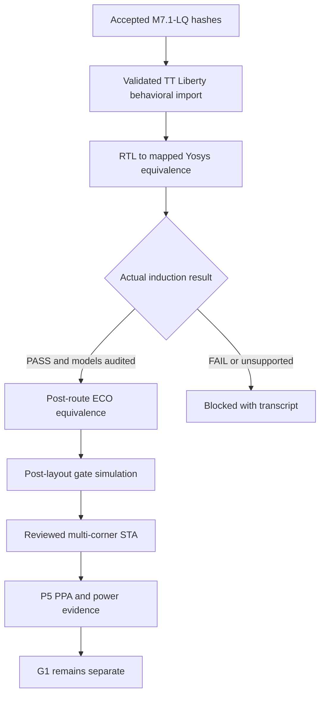

# M7.2 Closure7 — Correct formal model import

## Observed failure

Node1 formal-original-run-v1 was blocked for A/B/C before proof: Yosys rejected `primitive sky130_fd_sc_hd__udp_dff$PR` in the M7.1-LQ *Icarus* functional-model bundle. Existing M7.1 bounded tests are unaffected. **No formal equivalence has been proved by that run.**

## Correction

The new `m72_formal_equiv.py` checks the existing simulation model and mapped RTL hashes against accepted M7.1-LQ evidence; separately it validates the installed SKY130HD TT Liberty SHA against the same evidence and uses `read_liberty` **without** `-lib` to construct Yosys technology models. The `-lib` mode would create library blackboxes rather than valid functional proof semantics. Unsupported combinational functions, sequential behavior, blackboxes or parser failures must block qualification. No accepted M7.1 file is modified. The script retains `equiv_status -assert` after sequential induction. Any tool PASS still requires checking reset semantics, used cells, and undriven/blackbox diagnostics before release.

## M7.2 dependency graph

## Node1 sequence

1. Preserve failed v1 files under build/m72/formal-original-run-v1; verify source hashes.
2. Verify `MSIF_M72_LIBERTY` path refers to SHA-pinned `sky130_fd_sc_hd__tt_025C_1v80.lib`.
3. Run new `formal-original-plan-v2` then inspect scripts; execute `formal-original-run-v2`.
4. Inspect all logs for unsupported Liberty constructs, black boxes, undriven pins, unresolved masters and reset semantics; status remains NOT_VERIFIED until reviewed.
5. Only after source proof, run the existing LEC inventory, post-route formal run and post-layout simulation.
6. P4 requires qualified SS/FF corners and RC provenance; P5 requires activity-qualified power, independent DRC and accepted memory-macro scope.

**Do not perform Git add, commit, push or tag until engineering review.**
