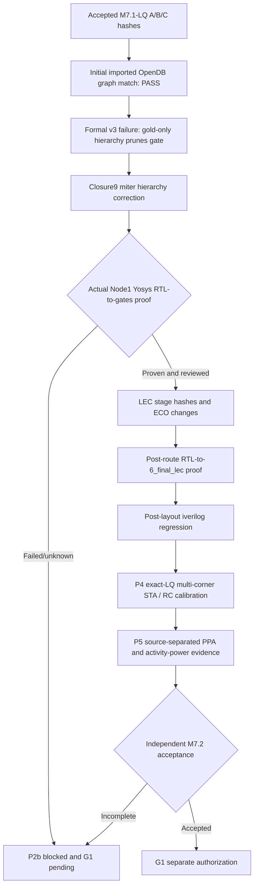

# M7.2 closure9: preserve both designs during Yosys miter construction

## Exact Node1 finding

After the closure8.1 68-test suite passed, formal-v3 A/B/C all exited 1 with `ERROR: Module 'msif_gate' not found!`. The previous script called `hierarchy -check -top msif_gold` before `equiv_make`, and Yosys removed `msif_gate` as unused. Calling the reciprocal hierarchy check cannot recover the deleted design. This is a formal-script orchestration bug, not a demonstrated RTL-to-gates mismatch.

## Course correction

Read the pinned functional Liberty, read/rename both designs, run `proc`, **do not prune either top**, then call `equiv_make msif_gold msif_gate msif_equiv`, check the combined miter with `hierarchy -check -top msif_equiv`, and run `flatten`, `check -assert`, `equiv_simple`, `equiv_induct -seq 32`, `equiv_status -assert`.

No source RTL, accepted netlist, Liberty, or PDK revisions are allowed. The 32-depth induction parameter is not a bounded-vector proof. All actual proof results require review of cell semantics, reset and valid behavior, undefined state, missing modules and blackbox coverage. A tool PASS without those reviews is **ENGINE_PROOF_REVIEW_REQUIRED**, not full M7.2 acceptance.

## Ordered acceptance milestones

## Remaining dependencies

- The accepted source models and an independent cell-semantic review must establish `dfrtp_1`, `lpflow_*` and required combinational behavior. `read_liberty -ignore_miss_func` may ignore unused cells, but missing used cells fail closed.
- `1_synth_lec.v`, `4_before_rsz_lec.v`, `4_after_rsz_lec.v`, `6_final_lec.v`, and `6_final.v` exist for exact-LQ A/B/C single-core v2; they are not equivalence proof artifacts by themselves.
- SKY130HD currently has pinned TT Liberty in the examined platform directory, not reviewed SS/FF views. P4 full multi-corner signoff is NOT_VERIFIED. `rcx_patterns.rules` and setRC Tcl provenance and calibration remain necessary.
- P5 PWR0 is exploratory. PWR1 requires shared activity workloads and annotation evidence; PWR2 requires calibrated power characterization; macro comparison requires characterized Liberty/LEF/GDS/functional models and protocol qualification.
- No final release commit/tag/push and no G1 transition are authorized by this script fix.
