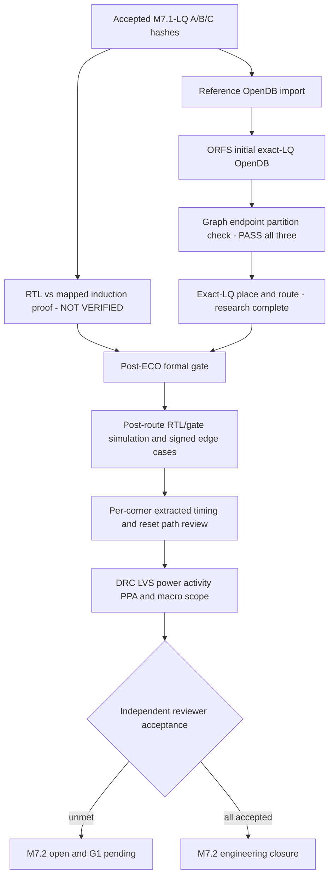

# M7.2 closure6: P2b formal and P4 corner qualification

## Grounded Node1 state (2026-10-28)

The **two independent initial-import OpenDB graphs match** for programmable, fixed and ROM (three `INITIAL_IMPORTED_GRAPH_MATCH_NOT_FORMAL` results). All exact-LQ single-core physical routes completed. This is an import continuity check, not a gold RTL-to-mapped sequential proof. The 260-vector M7.1-LQ simulation is only bounded regression evidence. The PDK inventory includes TT 25°C 1.8V Liberty, not validated SS/FF views. G1 is pending.

## Workflow (independent gates)

### Formal proof execution

`python3 scripts/m72_formal_equiv.py --out build/m72/formal-original-v1 --execute`

Requires executable `yosys` in PATH and complete functional SKY130 models. The implementation generates per-architecture Yosys scripts with `equiv_simple -undef`, `equiv_induct -seq 32` and `equiv_status -assert`; a successful proof must be reviewed for reset/initial-state semantics and any black-box or undefined-state masking. The script never transforms a timeout, compilation failure, or simulator PASS into an unbounded proof. It does not yet independently establish ASIC signoff.

### ECO evidence

`python3 scripts/m72_physical_lec_inventory.py --flow "$FLOW_DIR" --out build/m72/eco-manifest-v1.json`

Inventory presence does not prove ECO equivalence. Review `4_before_rsz_lec.v` versus `4_after_rsz_lec.v`, and `1_synth_lec.v` versus `6_final_lec.v`, using the same formal engine, with correct cell models and top-level sequential behavior. Captured hashes are mandatory before any proof attempt.

### Corner prerequisites

`python3 scripts/m72_corner_inventory.py --orfs "$MSIF_ORFS" --out build/m72/corner-inventory-v1.json`

Do not mark missing slow/fast Liberty views `reviewed=true` merely to satisfy the existing STA runner. Bind exact-route final ODB/SPEF/SDC hashes, actual voltage/temperature metadata and reviewed RC rules; the shared SKY130HS extraction rules need an explicit characterization review.

### Closure scope

P5 standard-cell area and router-level DRC have research evidence. Power only PWR0 until a deterministic common workload with verified annotation coverage exists. Characterized SRAM/ROM macro integration remains a separate scope and may be documented as excluded if no macro claim is made. P4 multi-corner signoff and G1 remain pending.
