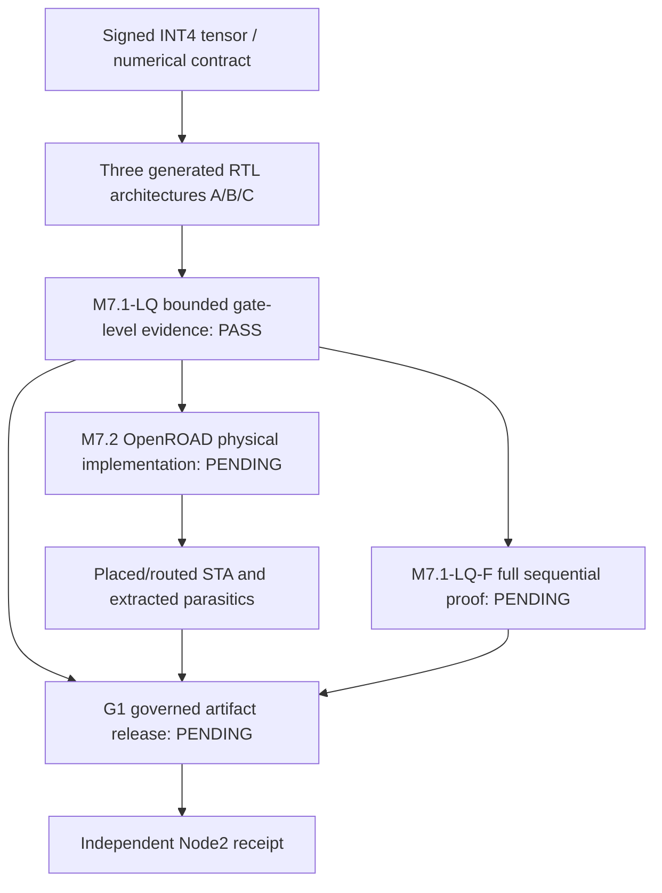
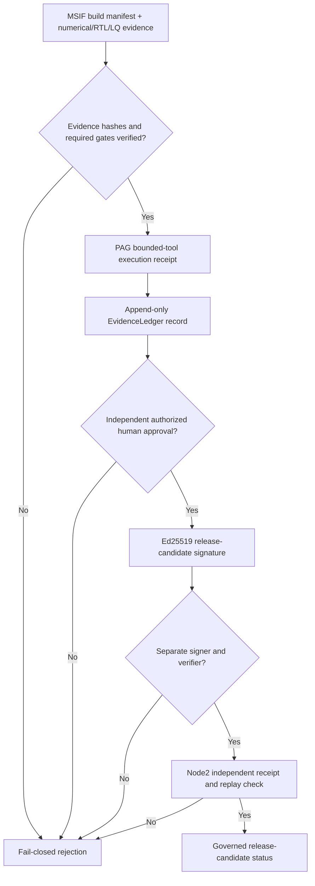
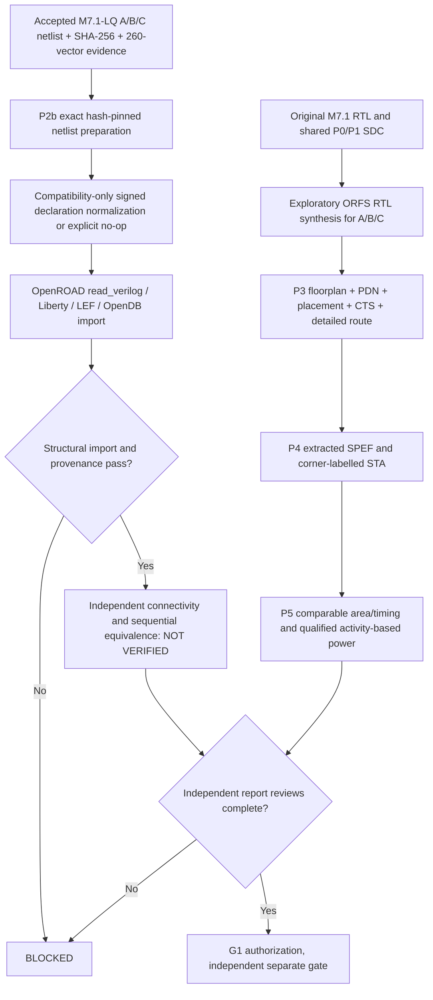

# M7.2 physical design and G1 governed release — engineering handoff

## G1 engineering handoff — authoritative status, 2 November 2026

This dated update **supersedes the original planning-era statement** that all M7.2 milestones were unimplemented. Research commits 01–07 exist (Commit 07 `3411e86f89095a149f03cd947399eb4cac6c3bb2`); the original specification below remains useful as historical requirements. Current [architecture](Architecture.md#m72-authoritative-research-architecture--reconciled-2-november-2026) and [gate matrix](Milestones.md#m72-branch-history-and-release-gates--2-november-2026) are canonical.

G1 C21 status is **`RELEASE_BLOCKED_REVIEW_REQUIRED`**, with **`issues=[]`** for its checked historical C16 GLS, C13b TT, C19 area and C20 SDC receipts, while **`release_authorized=false`**. C21 does not independently review C22 VCD, global TT coverage, power annotation, full formal/ECO, or independent approval.

Required independent closure receipts: full RTL-to-mapped state/async-reset equivalence; accepted mapped→synthesis→pre/post-resize→final ECO proof; STA constraints, reset recovery/removal, comprehensive TT plus genuinely qualified SS/FF and RC; reviewed DRC/LVS and physical master taxonomy; comparable VCD-to-physical-pin coverage and PWR1/PWR2; characterized macro evidence before any SRAM/ROM claims; review ownership, signed evidence and separate explicit authorization. Each missing gate remains `NOT_VERIFIED`. No `msif-m7.2-v0.5.0` tag, signoff or push is approved.

**Original planning status (historical; see 2 November reconciliation above):** Both milestones were planned, **not implemented or qualified**. This is the document-first specification for review after merging and tagging bounded M7.1-LQ. Parent reference: [original MSIF specification](MSIF-Source-Specification.md); evidence: [M7.1-LQ](M7.1-LQ-Mapped-Netlist-Verification.md).

## Research architecture and verification boundaries



M7.2 results must not be treated as approved releases without G1; G1 approvals cannot transform generic mapping into physical signoff. Neither flow changes the signed INT4/INT8/INT32 numerical contract.

## M7.2 staged plan on Node1

| Gate | Implementation work | Evidence required |
|---|---|---|
| P0 — Platform | Pin OpenROAD Flow Scripts revision and OpenROAD executable; verify SKY130 HD TT Liberty, technology/cell LEF, RC files, legal licenses, matching process platform | tool/version/source hashes; platform audit |
| P1 — Constraints | Define SDC clock/reset, input/output delays, clock uncertainty, output loads; enforce identical comparable constraints across A/B/C | versioned SDC, parsed constraint report |
| P2 — Netlist | Import only qualified mapped netlists; confirm top, pin interface, DFF/power pins and zero unresolved cells | imported design/cell inventory, netlist hash |
| P3 — Physical | Floorplan, power-grid assumptions, placement, clock-tree synthesis, global/detailed routing with reproducible configuration | floorplan/placement/CTS/route logs; DRC summary |
| P4 — Timing | Parasitic extraction, min/max path timing, setup/hold checks under explicitly stated PVT corners; quantify unconstrained paths | corner/STA reports and slack/WNS/TNS, RC provenance |
| P5 — Comparison | Record cell area, core area, utilization, wire length, congestion, clocks, and conditional power only with switching/activity assumptions | three architecture evidence bundles with shared settings |

**Macro blocker:** A/C arrays are RTL-inferred constructs, not characterized SRAM/ROM macros. Physical macro comparison requires named memory macros plus compatible LEF/Liberty/timing/power data, placement pinout and test-mode definitions. Do not claim memory-area savings before that qualification.

## G1 proposed trust boundaries



Before implementation, inspect the current PAG source API surface for `EvidenceLedger`, the bounded-tool executor and approval state machine. Pin its baseline and define an MSIF adapter instead of duplicating the policy engine. Require immutable artifact IDs, identities/roles, approval expiration, evidence lineage, command argument allowlists, timeouts, source revision, signature verification, and a Node2 receipt carrying an anti-replay nonce. A synthesizer or meta-agent cannot approve its own candidate. Signatures alone prove integrity/identity, not authorization.

## Sequenced branch/PR strategy

1. Close bounded M7.1-LQ with a manually reviewed PR and tagged **post-merge** `main` validation. Record that full sequential formal proof is still pending.
2. Create `feature/m72-physical-flow-qualification` for P0–P2 prerequisites first; then introduce placement/CTS/routing/STA under explicit research-lab scopes.
3. Create `feature/g1-governed-release-gates` independently for PAG adapters, policy tests and Node2 receipts; only then combine release requirements.
4. Freeze 12-stage roadmap traceability in architecture documentation and avoid any tag implying production silicon qualification.

No OpenROAD run, physical PPA, authorized release or Node2 receipt is evidenced by the M7.1-LQ experiment.


## M7.2 physical-flow implementation boundary — 26 October 2026

The first M7.2 implementation candidate is documented in [M7.2 Physical Design Qualification](M7.2-Physical-Design-Qualification.md). P0/P1 preflight and opt-in ORFS attempt are implemented, while exact mapped-netlist import, physical STA audit, silicon PPA and G1 remain pending.

## Node1 M7.2 execution state and evidence boundary

See [M7.2 physical runbook](M7.2-Physical-Design-Qualification.md) for the 28 October 2026 programmable-only completed exploratory route, unresolved P2b–P5, warnings and independent A/B/C audit. Do not represent the programmable Make exit 0 as release authorization.


## M7.2 P2b–P5 implementation continuation (28 October 2026)

This section is additive to the accepted P0/P1 baseline and does not authorize a commit, tag, or release.



### Implementation modules and status

- `scripts/m72_exact_lq_import.py`: hash-pin exact accepted `build/m71_liberty/m71_lq/msif_*_mapped.v` into isolated P2b candidates, preserve raw files, permit only reviewed signed-port compatibility transforms (including explicit no-op) and optionally test import into OpenDB; **does not implement post-import formal equivalence or a complete ORFS place-and-route handoff**.
- `scripts/m72/m72_normalize.py`: previously verified programmable declaration transform, now also emits a fail-closed identity/no-op receipt when no signed declarations exist. Prevents valid fixed/ROM structural netlists from being rejected solely due to absence of signed ports.
- `scripts/m72_report_review.py`: collects A/B/C final ODB/GDS/SPEF/SDC, detailed-route report and finish report, hashes artifacts, extracts labelled timing *observations*, and refuses missing evidence. A report-present result is explicitly not signoff.
- `scripts/m72_physical_audit.py`: retains a conservative three-architecture inventory with no signoff from existence alone.

### Node1 execution sequence

```bash
cd ~/dev/pub/ai-sys1/msif-hack/push/msif_hackathon
source .venv/bin/activate
export MSIF_ORFS="$HOME/eda/qualified-pdks/OpenROAD-flow-scripts"
export PYTHONPATH="$PWD/src:$PWD/scripts"
python3 -m unittest discover -s tests -v
PYTHONPATH="$PWD/scripts/m72" python3 -m unittest discover -s scripts/m72 -p 'test_m72_normalize.py' -v
python3 scripts/m72_exact_lq_import.py --orfs "$MSIF_ORFS" --out build/m72/p2b-exact-lq
# Only after reviewing the manifest and no stale output directory:
# python3 scripts/m72_exact_lq_import.py --orfs "$MSIF_ORFS" --out build/m72/p2b-exact-lq-execute --execute
# Independently perform the normalizer ORFS route on fixed and rom; use separate FLOW_VARIANTs.
python3 scripts/m72_report_review.py --flow "$MSIF_ORFS/flow" --out build/m72/p3p5-report-ledger.json
```

### Outstanding hard gates

- **P2b:** OpenDB import with matching accepted hashes is an *import experiment*. Cell-pin/bit-accurate structural preservation, sequential equivalence, and a fully integrated exact-LQ physical implementation remain separate, unimplemented closure gates.
- **P3:** A is routed experimentally; B/C must be routed. Independently review legal placement, PDN connectivity, detailed-route DRC, antenna checks, macro inclusion, and reproducible ODB/GDS against reports.
- **P4:** Timing reports from a single TT corner and relaxed research SDC cannot establish multi-corner signoff. Review all setup/hold paths, unconstrained endpoints, reset recovery/removal, RCX corner provenance and additional PVT views where available.
- **P5:** Report standard-cell (not die/core) area and distinguish core area, utilization, clock and I/O delay assumptions. Power without explicit VCD/SAIF/activity provenance is an estimate only. A/C arrays are not qualified SRAM/ROM macros.
- **G1:** Release approval and Node2 independent receipts remain `NOT_VERIFIED`.
