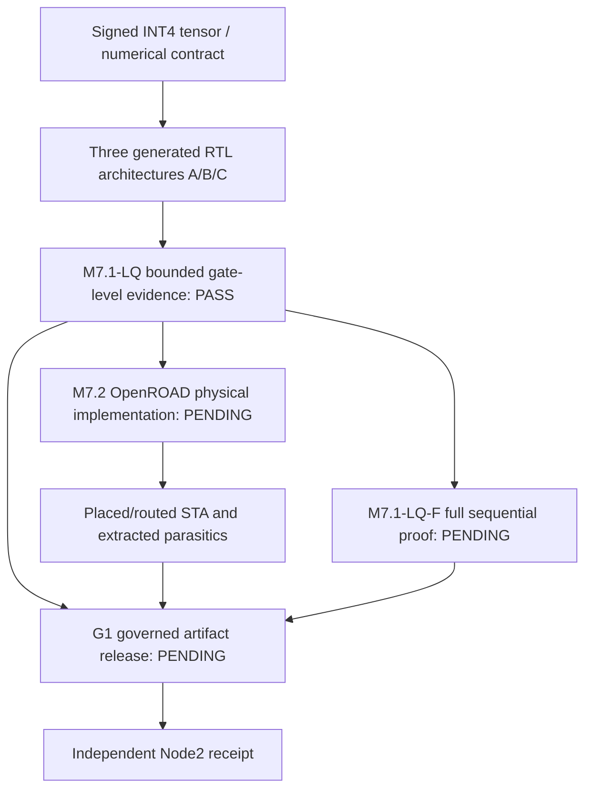
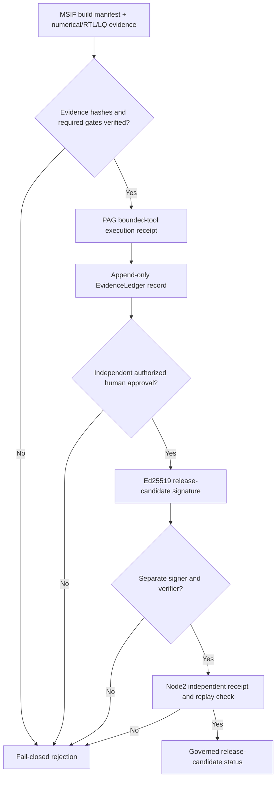

# M7.2 physical design and G1 governed release — engineering handoff

**Status:** Both milestones are planned, **not implemented or qualified**. This is the document-first specification for review after merging and tagging bounded M7.1-LQ. Parent reference: [original MSIF specification](MSIF-Source-Specification.md); evidence: [M7.1-LQ](M7.1-LQ-Mapped-Netlist-Verification.md).

## Research architecture and verification boundaries

M7.2 results must not be treated as approved releases without G1; G1 approvals cannot transform generic mapping into physical signoff. Neither flow changes the signed INT4/INT8/INT32 numerical contract.

## M7.2 staged plan on Node1

| Gate | Implementation work | Evidence required |
|---|---|---|
| P0 — Platform | Pin OpenROAD Flow Scripts revision and OpenROAD executable; verify SKY130 HD TT Liberty, technology/cell LEF, RC files, legal licenses, matching process platform | tool/version/source hashes; platform audit |
| P1 — Constraints | Define SDC clock/reset, input/output delays, clock uncertainty, output loads; enforce identical comparable constraints across A/B/C | versioned SDC, parsed constraint report |
| P2 — Netlist | Import only qualified mapped netlists; confirm top, pin interface, DFF/power pins and zero unresolved cells | imported design/cell inventory, netlist hash |
| P3 — Physical | Floorplan, power-grid assumptions, placement, clock-tree synthesis, global/detailed routing with reproducible configuration | floorplan/placement/CTS/route logs; DRC summary |
| P4 — Timing | Parasitic extraction, min/max path timing, setup/hold checks under explicitly stated PVT corners; quantify unconstrained paths | corner/STA reports and slack/WNS/TNS, RC provenance |
| P5 — Comparison | Record cell area, core area, utilization, wire length, congestion, clocks, and conditional power only with switching/activity assumptions | three architecture evidence bundles with shared settings |

**Macro blocker:** A/C arrays are RTL-inferred constructs, not characterized SRAM/ROM macros. Physical macro comparison requires named memory macros plus compatible LEF/Liberty/timing/power data, placement pinout and test-mode definitions. Do not claim memory-area savings before that qualification.

## G1 proposed trust boundaries

Before implementation, inspect the current PAG source API surface for `EvidenceLedger`, the bounded-tool executor and approval state machine. Pin its baseline and define an MSIF adapter instead of duplicating the policy engine. Require immutable artifact IDs, identities/roles, approval expiration, evidence lineage, command argument allowlists, timeouts, source revision, signature verification, and a Node2 receipt carrying an anti-replay nonce. A synthesizer or meta-agent cannot approve its own candidate. Signatures alone prove integrity/identity, not authorization.

## Sequenced branch/PR strategy

1. Close bounded M7.1-LQ with a manually reviewed PR and tagged **post-merge** `main` validation. Record that full sequential formal proof is still pending.
2. Create `feature/m72-physical-flow-qualification` for P0–P2 prerequisites first; then introduce placement/CTS/routing/STA under explicit research-lab scopes.
3. Create `feature/g1-governed-release-gates` independently for PAG adapters, policy tests and Node2 receipts; only then combine release requirements.
4. Freeze 12-stage roadmap traceability in architecture documentation and avoid any tag implying production silicon qualification.

No OpenROAD run, physical PPA, authorized release or Node2 receipt is evidenced by the M7.1-LQ experiment.
