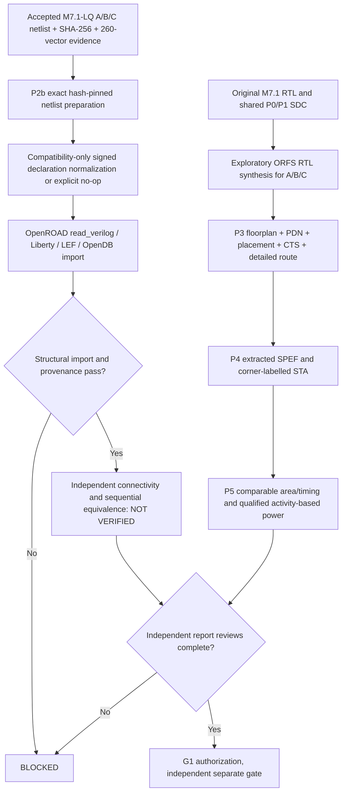

# M7.2 P2b–P5 additive qualification implementation

## Cross-milestone engineering reconciliation — 2 November 2026

The accepted mapped M7.1-LQ lineage is preserved. Commit `02-p2b` demonstrates initial imported graph equality, **not** RTL-to-gates sequential/reset equivalence; Yosys induction probes were inconclusive. `03-p3` preserves actual routed A/B/C final netlists plus authentic SKY130 model-backed 3 × 260 bounded zero-delay GLS, **not** ECO or SDF equivalence. `04-p4` preserves TT extracted STA, hashed log audits and global TT diagnostic reports, but not comprehensive TT endpoint/exception/reset acceptance or genuine SS/FF and calibrated RC. `05-p5-area` preserves OpenDB exact-LQ area, heuristic per-master names and C20 SDC checks; `functional_or_unresolved` remains unqualified and summed masters cannot be equated with usable functional occupancy. `06-p5-vcd` captures identical top-level inputs across A/B/C, without pin annotation or physical power. `07-g1` returns `RELEASE_BLOCKED_REVIEW_REQUIRED`, `issues=[]` on selected historical receipts, `release_authorized=false`.

The historical source of each phase is available in [P2b graph](M7.2-P2b-Graph-Continuity-v2.md), [Closure12 ledger](M7.2-Closure12-Cross-Ledger-Qualification-and-Release-Plan.md), [Closure16 final GLS](M7.2-Closure16-Routed-Model-Correction-and-Closure-Plan.md), [Closure17 GLS/STA](M7.2-Closure17-GLS-STA-Area-Remaining-Gates.md), [Closure20 area](M7.2-Closure20-P4-P5-Engineering-Review.md), [Closure22 VCD](M7.2-Closure22-Global-TT-Activity-and-Git-Review.md), and [Closure21 G1](M7.2-Closure21-Release-Preflight-and-P4-P5-Execution.md). These historical documents may predate the latest Node1 reruns and must be read with [current Validation](Validation.md#m72-evidence-and-validation--2-november-2026) and [Milestones](Milestones.md#m72-branch-history-and-release-gates--2-november-2026).

No qualified SRAM/ROM macro implementation, unbounded sequential formal, complete ECO equivalence, multi-corner physical STA, calibrated dynamic/internal/leakage power, or G1 approval is claimed.

## M7.2 P2b–P5 implementation continuation (28 October 2026)

This section is additive to the accepted P0/P1 baseline and does not authorize a commit, tag, or release.



### Implementation modules and status

- `scripts/m72_exact_lq_import.py`: hash-pin exact accepted `build/m71_liberty/m71_lq/msif_*_mapped.v` into isolated P2b candidates, preserve raw files, permit only reviewed signed-port compatibility transforms (including explicit no-op) and optionally test import into OpenDB; **does not implement post-import formal equivalence or a complete ORFS place-and-route handoff**.
- `scripts/m72/m72_normalize.py`: previously verified programmable declaration transform, now also emits a fail-closed identity/no-op receipt when no signed declarations exist. Prevents valid fixed/ROM structural netlists from being rejected solely due to absence of signed ports.
- `scripts/m72_report_review.py`: collects A/B/C final ODB/GDS/SPEF/SDC, detailed-route report and finish report, hashes artifacts, extracts labelled timing *observations*, and refuses missing evidence. A report-present result is explicitly not signoff.
- `scripts/m72_physical_audit.py`: retains a conservative three-architecture inventory with no signoff from existence alone.

### Node1 execution sequence

```bash
cd ~/dev/pub/ai-sys1/msif-hack/push/msif_hackathon
source .venv/bin/activate
export MSIF_ORFS="$HOME/eda/qualified-pdks/OpenROAD-flow-scripts"
export PYTHONPATH="$PWD/src:$PWD/scripts"
python3 -m unittest discover -s tests -v
PYTHONPATH="$PWD/scripts/m72" python3 -m unittest discover -s scripts/m72 -p 'test_m72_normalize.py' -v
python3 scripts/m72_exact_lq_import.py --orfs "$MSIF_ORFS" --out build/m72/p2b-exact-lq
# Only after reviewing the manifest and no stale output directory:
# python3 scripts/m72_exact_lq_import.py --orfs "$MSIF_ORFS" --out build/m72/p2b-exact-lq-execute --execute
# Independently perform the normalizer ORFS route on fixed and rom; use separate FLOW_VARIANTs.
python3 scripts/m72_report_review.py --flow "$MSIF_ORFS/flow" --out build/m72/p3p5-report-ledger.json
```

### Outstanding hard gates

- **P2b:** OpenDB import with matching accepted hashes is an *import experiment*. Cell-pin/bit-accurate structural preservation, sequential equivalence, and a fully integrated exact-LQ physical implementation remain separate, unimplemented closure gates.
- **P3:** A is routed experimentally; B/C must be routed. Independently review legal placement, PDN connectivity, detailed-route DRC, antenna checks, macro inclusion, and reproducible ODB/GDS against reports.
- **P4:** Timing reports from a single TT corner and relaxed research SDC cannot establish multi-corner signoff. Review all setup/hold paths, unconstrained endpoints, reset recovery/removal, RCX corner provenance and additional PVT views where available.
- **P5:** Report standard-cell (not die/core) area and distinguish core area, utilization, clock and I/O delay assumptions. Power without explicit VCD/SAIF/activity provenance is an estimate only. A/C arrays are not qualified SRAM/ROM macros.
- **G1:** Release approval and Node2 independent receipts remain `NOT_VERIFIED`.


## M7.2 P5 and pending closure audit (2026-10-28)

See [M7.2 P5 comparison and closure gates](M7.2-P5-Comparison-and-Closure-Gates.md) for the corrected optional-DRC ledger behavior, research comparison, exact-netlist equivalence, multi-corner STA, activity-based power, and memory-macro requirements. A/B/C ORFS flows completed, but P2b–P5 signoff and G1 remain **NOT_VERIFIED**. No Git commit or release tag is authorized by this result.
