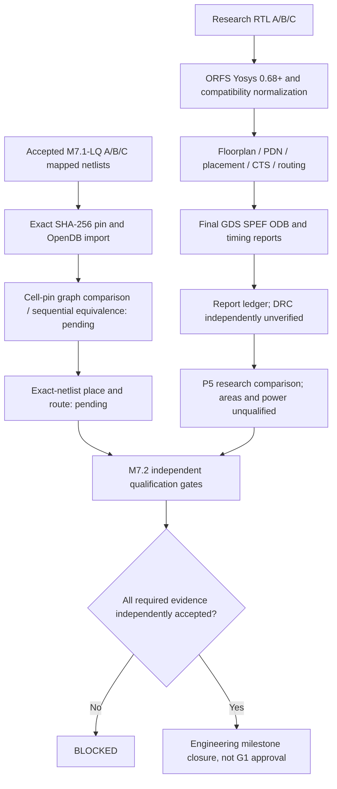

# M7.2 P5 Comparison and outstanding closure gates

**Evidence version:** 28 October 2026. **Scope:** research-grade RTL-resynthesized SKY130 HD ORFS A/B/C. Not tapeout, signoff or governance release.

## Observed Node1 state
- Three ORFS RTL-resynthesized runs returned exit code 0 and have final ODB, GDS, SPEF, SDC and final timing reports.
- The initial report collector required `5_route_drc.rpt`, which the pinned ORFS flow did not emit at that location. This is now an *optional source of DRC evidence*; missing it leaves independent DRC verification `NOT_VERIFIED`, rather than blocking collection of unrelated timing reports or silently passing DRC.
- `wns max 0.00` and `tns max 0.00` are research-corner observations, not multicorners or real-world frequency limits.
- A/B/C exact M7.1-LQ hash-pinned Verilog imports succeeded without normalization (746/690/746 cells). Import-to-ODB alone is **not** a proved cell/pin graph or sequential equivalence claim.

## Reproducible collection
```bash
python3 scripts/m72_report_review.py --flow "$MSIF_ORFS/flow" --out build/m72/p3p5-report-ledger.json
python3 scripts/m72_ppa_compare.py --ledger build/m72/p3p5-report-ledger.json --out build/m72/p5-research-comparison.json
```
Do not interpret exit code zero as physical acceptance. Inputs and hashes are recorded; area/power values are NULL unless independently qualified.

## Architecture


## Mandatory engineering closure work

### P2b — exact mapped equivalence
1. Read accepted M7.1-LQ JSON and compare top-level port directions, bit widths, names, cell types, instance names and each pin-to-net mapping to an OpenDB export with canonical bit naming. Verify placement/CTS permitted changes separately as ECOs, not bit-identical invariance after optimization.
2. Prove sequential reset/enable semantics using a formally bounded or full sequential miter with appropriate cell models, explicit clocks and assumptions. A finite 260-vector test is not a universal proof.
3. Implement place-and-route using a direct mapped-netlist input path (not a second Yosys synthesis). Freeze import netlist and record every subsequent CTS/optimization ECO plus equivalence evidence.

### P3 — routed physical integrity
Verify die/core area, cell-only vs tap/filler/decap area, legalization, PDN continuity, CTS, DRC counts, antenna counts, extraction outputs, LVS and platform-specific DRC where tools/decks permit. A Make exit 0 is insufficient. When a standalone DRC report is missing, inspect route-stage logs and execute an independent report, record the tool and command, and reject unknown counts.

### P4 — multi-corner extracted timing
Pin setup/hold min/max Liberty, operating voltage/temp and extraction rules per corner. Execute STA with matching corner-labeled SPEF and SDC; enumerate clocks, constrained and unconstrained paths, false paths and input/output delays. Explicitly evaluate reset recovery/removal and asynchronous deassertion protocol. Fail closed if a corner or reference view is missing; TT-only research STA is not signoff.

### P5 — comparable PPA
For each A/B/C, report standard-cell area excluding physical-only cells, tap/filler area separately, core/die area, cell/core utilization, route DRC/antenna, setup/hold WNS/TNS per corner and critical path. Do not confuse placement density 0.55 with 55% utilization. Use identical SDC, PVT and workload. Source power from waveform activity (SAIF/VCD), with mapping/coverage, voltage, frequency, operating corner, internal/switching/leakage breakdown; measure or calibrate with appropriate physical instrumentation if claiming calibrated power. Default absent power to NOT_VERIFIED.

### Memory macros
A and C coefficient arrays presently compile into standard-cell logic. To compare real memory architectures require qualified SKY130-compatible SRAM/ROM (or distinct suitable PDK) macro LEF/GDS/Liberty, simulation model, address timing, characterization, power and placement constraints. Integrate a macro-aware functional and physical flow, then compare under the same interface/latency contract. No macro efficiency claim until this is done.

### G1
Only after the mandatory M7.2 engineering evidence is accepted, bind manifest hashes and independent reviewer decisions to a fail-closed governance release workflow. This document is not authorization.
