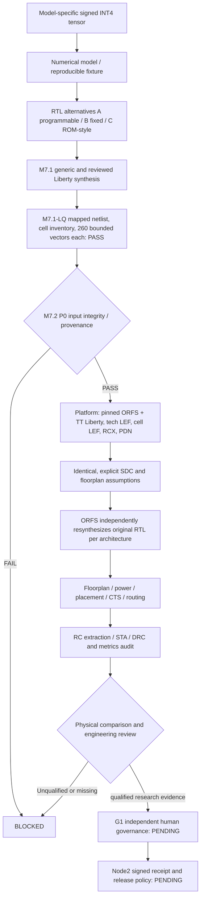
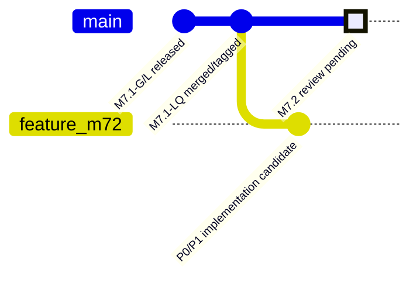
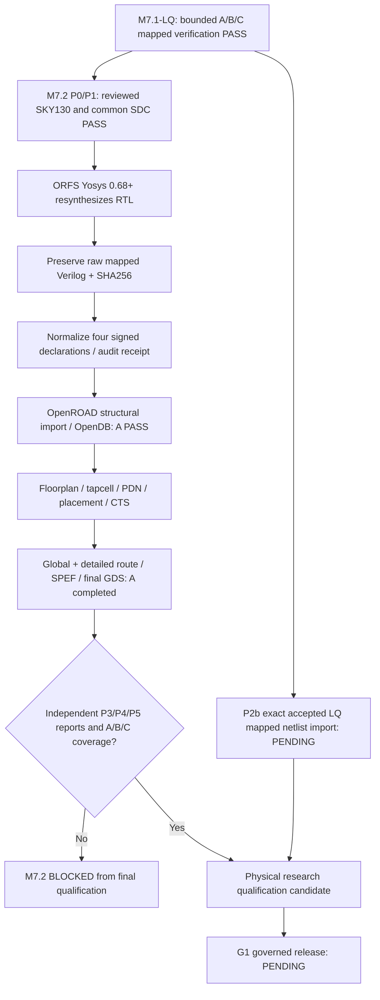
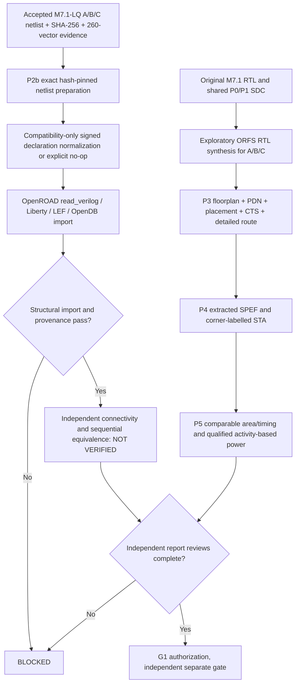

# M7.2 — SKY130 HD physical design: reproducible research qualification

**Status (28 October 2026, updated): P0/P1/static A/B/C plans PASS; programmable A exploratory ORFS RTL-resynthesized flow completes through GDS/SPEF. Exact M7.1-LQ import P2b, multi-architecture P3 audit, P4 qualified STA, P5 comparable PPA, and G1 remain NOT_VERIFIED.** Parent is merged and tagged M7.1-LQ `8393e24` (`msif-m7.1-lq-v0.4.1`). This document specifies P0–P5 and what software in this feature branch actually implements. The original [MSIF source specification](MSIF-Source-Specification.md) remains authoritative.

## 1. Trust boundaries and 12-stage architecture alignment



The prototype is a subset of the original 12-stage MSIF pipeline; model front-end, transformation/quantization, frozen coefficient specialization, proof, macro selection, PDK/DFT, back-end, packaging, and governance have distinct gates. This M7.2 candidate **does not close the entire pipeline**.

## 2. Platform provenance, P0

- Source: [OpenROAD Flow Scripts](https://github.com/The-OpenROAD-Project/OpenROAD-flow-scripts), pinned commit `64939f3717ad7c694199ba04cb98924b98022868` (the existing Node1 M7.1 provenance). Do not change the checkout without reviewing the revision change and creating new evidence.
- `flow/platforms/sky130hd/config.mk` and `flow/Makefile`; SKY130 HD tech LEF, merged standard-cell LEF, Liberty, PDN, tapcell and RCX rules must be present.
- Liberty `sky130_fd_sc_hd__tt_025C_1v80.lib`: SHA-256 `ec0e1067a35c8bf20b11e58d1e8ac53326067e4dac84a125cc1b917a3518d0d9`.
- Review source/license permitted uses and tool installation, `openroad`, `yosys`, `make`, `klayout`, `python3`, `git`, toolchain availability. A PDK's research availability does not establish manufacturing signoff rights.
- The run command demands an explicit `--license-pvt-reviewed` assertion; this is a *human attestation*, not proof of licensing, foundry corner certification or electrical signoff.
- RCX `.rules` present is a readiness prerequisite, **not extracted RC qualification**. Physical signoff requires documented extraction coverage and calibrated tech files.

## 3. SDC and comparison protocol, P1

- `clk` period defaults to **100 ns**, with **5 ns** I/O delay, **1 ns** uncertainty and **0.01 pF** output load; these are deliberately *illustrative engineering inputs*, not measured requirements.
- `rst_n` is an asynchronous reset. Its use as a constrained port is explicitly provisional. Review recovery/removal, deassertion synchronizer policy and false-path exceptions **before timing acceptance**; do not silently false-path it.
- A/B/C share one byte-identical SDC template, `CORE_UTILIZATION=25`, `CORE_ASPECT_RATIO=1`, `CORE_MARGIN=4`, `PLACE_DENSITY=0.55`; record the same corner and constraint identity. Floorplan dims and routing resources must be checked, not inferred from these values.
- Staged `constraint.sdc` is research-generated in `build/m72/{variant}`, not tracked and not a production timing signoff file.

## 4. LQ lineage and netlist import, P2

- `m71_lq_audit.py` is mandatory: previous mapped A/B/C netlists, cell inventories, hashes and 260-vector evidence must pass.
- The present ORFS design configuration deliberately uses the original M7.1-LQ RTL and invokes **ORFS's own synthesis**. This is suitable for an initial RTL-to-GDS **exploratory** flow, but it is NOT an independently qualified import of the earlier LQ mapped netlist.
- A future P2b gate must implement *direct pre-mapped netlist* import with explicit ORFS-compatible handoff, cell pin map, liberty catalog, power pins and clock constraints; then independently compare the imported netlist to the accepted LQ artifact. `mapped_netlist_import=NOT_VERIFIED_ORFS_RESYNTHESIZES_RTL` remains in evidence until that gate exists.

## 5. Optional physical execution, P3–P5

The runner supports `--dry-run` and `--execute` **only after P0/P1/LQ lineage**. `--dry-run` now generates an auditable static execution plan for all three architectures without running GNU Make, because ORFS recursive recipes may execute under `make -n` and demand intermediate SDC files that a dry-run cannot create. Static plan PASS is not an ORFS Make graph qualification and is not physical execution. `--execute` runs a regular ORFS make flow per variant and records each exit code and an SHA-256 of the console log. `FLOW_TOOL_EXIT_0_REPORTS_UNAUDITED` is deliberately **not** P3/P4/P5 PASS. It is an execution receipt pending independent stage artifact and metrics audits.

The next engineering iterations must add and validate:

| Gate | Required implementation | Acceptance |
|---|---|---|
| P2b | Exact LQ standard-cell netlist import and pin/clock equivalence | Imported bytes/hash, no unresolved cells, reset/valid evidence |
| P3 | Floorplan, PDN/tap/filler, legal placement, CTS, global and detailed routing | Verified stage ODB/DEF/GDS, tool logs, DRC/antenna checks, zero unexplained errors |
| P4 | Extract parasitics and STA across reviewed min/nom/max corners | Corner-labelled STA, WNS/TNS, setup and hold, unconstrained endpoints, clock skew, recovery/removal |
| P5 | Compare PPA with equal functional contract and constraints | Standard-cell area vs core/die area, actual utilization, wire length, congestion, delay; conditional power with VCD/SAIF/activity and valid models |

**Do not infer timing from the 100 ns example SDC or library cell area alone.** Cell-area sums, core/die area, route-dependent delay and switching-power estimates are separate quantities.

## 6. Important architecture comparison limits

A and C currently use register-initialized coefficient arrays rather than characterized SRAM/ROM macros. Therefore cell-area or routing differences among A/B/C are **only observations about these three RTL-to-standard-cell implementations**. No inference about a commercial programmable weight SRAM vs mask ROM vs hardcoded multiplier is supported. Macro comparison requires characterized LEF/Liberty/GDS, address/read/write protocols, clocking, DFT and explicit macro inclusion.

## 7. Node1 procedure (run commands in order)

```bash
cd ~/dev/pub/ai-sys1/msif-hack/push/msif_hackathon
source .venv/bin/activate
export PYTHONPATH="$PWD/src"
export MSIF_ORFS="$HOME/eda/qualified-pdks/OpenROAD-flow-scripts"
export MSIF_M72_LICENSE_PVT_REVIEWED=YES # Only after manual review
# Set +e at interactive prompt so a failing gate does not close the shell.
set +e
./scripts/verify_m72.sh > logs/m72_preflight.log 2>&1
M72_P0_RC=$?; echo "M7.2 P0/P1/LQ lineage exit: $M72_P0_RC"
# P0/P1 PASS alone does not mean OpenROAD is installed or physical execution succeeded.
./scripts/verify_m72.sh --dry-run > logs/m72_dryrun.log 2>&1
M72_DRY_RC=$?; echo "M7.2 ORFS dry-run exit: $M72_DRY_RC"
# Explicit opt-in only after dry run, qualified OpenROAD tool installation and resource review.
./scripts/verify_m72.sh --execute > logs/m72_execute.log 2>&1
M72_EXEC_RC=$?; echo "M7.2 exploratory ORFS exit: $M72_EXEC_RC"
```

Inspect `build/m72/preflight.json`, `build/m72/flow-attempt.json`, and variant-specific `orfs-*.log`. A failure is BLOCKED, never ignored. Do not edit `flow/platforms/sky130hd/config.mk` for this task or stage generated `build/`/`logs/` files.

## 8. Manual acceptance checklist and release boundaries

- [ ] Confirm PDK release/license, precise process PVT and GDS/LEF/RC timing assumptions
- [ ] `git rev-parse HEAD` inside ORFS matches recorded platform commit
- [ ] `m71_lq_audit.py` returns three PASS bounded runs
- [ ] SDC generated identically for A/B/C and constraints reviewed by an STA engineer
- [ ] Static no-execution flow plan generated for all A/B/C on Node1 (not a Make graph or physical qualification)
- [ ] ORFS physical run completion for all three variants on Node1
- [ ] Explicit stage artifacts, routing, STA, physical DRC/antenna and extraction reports independently audited
- [ ] Memory macros handled honestly as missing; power only with documented activity/models
- [ ] Full sequential formal equivalence separate; G1 approval and Node2 receipt NOT VERIFIED

## 9. Milestone history (do not invent pending merges)



The final gitGraph node is a planned review marker in the illustration, **not** a claim that the repository already contains an M7.2 commit. No M7.2 tag should be created before Node1 physical-flow gates are accepted.

## 10. References

- [OpenROAD Flow tutorial](https://openroad-flow-scripts.readthedocs.io/en/latest/tutorials/FlowTutorial.html)
- [OpenROAD Flow Variables](https://github.com/The-OpenROAD-Project/OpenROAD-flow-scripts/blob/master/docs/user/FlowVariables.md)
- [OpenROAD SKY130 HD platform](https://github.com/The-OpenROAD-Project/OpenROAD-flow-scripts/blob/master/flow/platforms/sky130hd/config.mk)
- [M7.2/G1 engineering handoff](M7.2-G1-Engineering-Handoff.md)
- [M7.1-LQ validated bounded gate regression](M7.1-LQ-Mapped-Netlist-Verification.md)
- [Governance crosswalk](Governance-Crosswalk.md)

## 8. Node1 28 October dry-run incident and correction

The original `make -n` attempt stopped at `No rule to make target .../2_1_floorplan.sdc`, needed by `.../2_floorplan.sdc`, because recursive Make stages are executed even with `-n` while dependent stage artifacts are not produced. It checked the programmable variant only; fixed and ROM were never attempted. The corrected dry-run is **static planning**: it validates the generated config/SDC presence, records hashes and the intended ORFS make invocation in each `orfs-plan.json`, and performs no Make subprocess. P0/P1 passed, but real design synthesis, floorplan, placement, CTS, routing, extraction, and STA are still pending. Only `--execute` performs a genuine ORFS run.

**P0 evidence caution:** The preflight's RCX rule provenance resolves to `sky130hs/rcx_patterns.rules` through the pinned platform configuration rather than the nominal `sky130hd` path; review this cross-platform reference and extraction calibration before claiming RC accuracy. Tool versions in the log were OpenROAD `26Q4-518-gbc739caf43` and ORFS Yosys `0.68+`, distinct from historical M7.1 Yosys `0.33`. The current flow resynthesizes RTL and does not import LQ-mapped Verilog.


## M7.2 Node1 execution audit — 28 October 2026 (latest attached log)

**Observed:** `msif_m72_programmable_normalized_v2` returned Make exit 0. P0/P1 and the three static plans passed earlier. ORFS Yosys 0.68+ synthesized 647 SKY130 cells; generated structural Verilog needed four declaration-only `signed` removals. Original SHA-256 `8c6c05df2cdd3987e32546e0d502c397e9b658f2501d9afb357179524e1e8084`, normalized SHA-256 `b32ee0cbf4e9004c4d3a0a5934dd7d18decd30f3569f467aa36da5f937fd3bd4`. The first import failed with `STA-0171`; direct normalized import passed. An integrated Tcl hook first failed without `file rename -force --`; the corrected hook preserved the raw file and produced a valid receipt and `1_synth.odb`.

**Programmable experimental flow:** `1_synth.odb`, floorplan, 396 tapcells, PDN, placement, CTS, global and detailed routing, final SPEF and GDS generated. Floorplan cell area 7,818.749 µm²; core area 30,749.491 µm², initial effective utilization ~25.4%. Router concluded with **zero reported detailed-route violations**, and the console reports zero antenna violations. Extraction processed 2,523 RC segments; GDS export reported matching LEF/GDS cells and no orphans. Logs report setup slack under the **assumed 100 ns** clock; this is not signoff frequency. Power/IR estimates are conditional and have no validated activity-based power qualification.

**Still open:** the log covers *only* A (programmable), not B (fixed) or C (ROM). This ORFS path *resynthesizes RTL*, not the 746/690/746-cell exact M7.1-LQ netlists: **P2b is NOT VERIFIED**. P3 needs A/B/C DRC, antenna, connectivity, CTS and physical report audit; P4 needs reviewed extraction corner, setup and hold, clock/reset recovery/removal, unconstrained-path accounting and calibration; P5 needs fair A/B/C comparisons, qualified stimulus/activity and a separate memory-macro gate. G1 approval and Node2 verification remain pending. Do not call the successful A flow a completed M7.2 release.

### Observed warning disposition

- `DRT-0349` LEF58 enclosure/CUTCLASS warnings: verify handling in the pinned tool/PDK and DRC scope; a zero-router-violation count is not a complete foundry DRC signoff.
- `RSZ-0104` single-pin nets: analyze cause and whether non-functional dangling connections were eliminated as expected.
- `EST-0027` early estimated parasitics/wire-load models: exclude from routed extracted-STA claims.
- SKY130HS/HD shared `rcx_patterns.rules` path: explicitly review pinned platform configuration and extraction calibration rather than guessing file equivalence.
- `No macros found`: A/C coefficient arrays are not characterized SRAM/ROM physical macros.
- `PWR` and IR reports: report tool estimates only, with activity/corner assumptions and power-grid model documented.

### Next Node1 acceptance

Run `python3 scripts/m72_physical_audit.py --flow "$MSIF_ORFS/flow"`. It **intentionally returns nonzero while fixed/ROM are absent**; inspect `build/m72/physical-evidence-audit.json` for generated artifacts and missing gates. After reviewing the programmable route, run B and C with **unique** normalized flow variants, identical SDC and ORFS provenance, then independently audit final reports. Keep a distinct P2b experiment for import of the *exact* accepted LQ netlists. This report collector never promotes file existence to physical signoff.


## M7.2 verified exploratory path versus pending exact-LQ path (28 October 2026)



The `A` completion does not imply fixed or ROM physical completion. The research ORFS mapper differs from M7.1-LQ; standard-cell area, core area, utilization, extracted STA and power must be reported with separate units and assumptions. See [M7.2 physical runbook](M7.2-Physical-Design-Qualification.md).


## M7.2 P2b–P5 implementation continuation (28 October 2026)

This section is additive to the accepted P0/P1 baseline and does not authorize a commit, tag, or release.



### Implementation modules and status

- `scripts/m72_exact_lq_import.py`: hash-pin exact accepted `build/m71_liberty/m71_lq/msif_*_mapped.v` into isolated P2b candidates, preserve raw files, permit only reviewed signed-port compatibility transforms (including explicit no-op) and optionally test import into OpenDB; **does not implement post-import formal equivalence or a complete ORFS place-and-route handoff**.
- `scripts/m72/m72_normalize.py`: previously verified programmable declaration transform, now also emits a fail-closed identity/no-op receipt when no signed declarations exist. Prevents valid fixed/ROM structural netlists from being rejected solely due to absence of signed ports.
- `scripts/m72_report_review.py`: collects A/B/C final ODB/GDS/SPEF/SDC, detailed-route report and finish report, hashes artifacts, extracts labelled timing *observations*, and refuses missing evidence. A report-present result is explicitly not signoff.
- `scripts/m72_physical_audit.py`: retains a conservative three-architecture inventory with no signoff from existence alone.

### Node1 execution sequence

```bash
cd ~/dev/pub/ai-sys1/msif-hack/push/msif_hackathon
source .venv/bin/activate
export MSIF_ORFS="$HOME/eda/qualified-pdks/OpenROAD-flow-scripts"
export PYTHONPATH="$PWD/src:$PWD/scripts"
python3 -m unittest discover -s tests -v
PYTHONPATH="$PWD/scripts/m72" python3 -m unittest discover -s scripts/m72 -p 'test_m72_normalize.py' -v
python3 scripts/m72_exact_lq_import.py --orfs "$MSIF_ORFS" --out build/m72/p2b-exact-lq
# Only after reviewing the manifest and no stale output directory:
# python3 scripts/m72_exact_lq_import.py --orfs "$MSIF_ORFS" --out build/m72/p2b-exact-lq-execute --execute
# Independently perform the normalizer ORFS route on fixed and rom; use separate FLOW_VARIANTs.
python3 scripts/m72_report_review.py --flow "$MSIF_ORFS/flow" --out build/m72/p3p5-report-ledger.json
```

### Outstanding hard gates

- **P2b:** OpenDB import with matching accepted hashes is an *import experiment*. Cell-pin/bit-accurate structural preservation, sequential equivalence, and a fully integrated exact-LQ physical implementation remain separate, unimplemented closure gates.
- **P3:** A is routed experimentally; B/C must be routed. Independently review legal placement, PDN connectivity, detailed-route DRC, antenna checks, macro inclusion, and reproducible ODB/GDS against reports.
- **P4:** Timing reports from a single TT corner and relaxed research SDC cannot establish multi-corner signoff. Review all setup/hold paths, unconstrained endpoints, reset recovery/removal, RCX corner provenance and additional PVT views where available.
- **P5:** Report standard-cell (not die/core) area and distinguish core area, utilization, clock and I/O delay assumptions. Power without explicit VCD/SAIF/activity provenance is an estimate only. A/C arrays are not qualified SRAM/ROM macros.
- **G1:** Release approval and Node2 independent receipts remain `NOT_VERIFIED`.


## M7.2 P5 and pending closure audit (2026-10-28)

See [M7.2 P5 comparison and closure gates](M7.2-P5-Comparison-and-Closure-Gates.md) for the corrected optional-DRC ledger behavior, research comparison, exact-netlist equivalence, multi-corner STA, activity-based power, and memory-macro requirements. A/B/C ORFS flows completed, but P2b–P5 signoff and G1 remain **NOT_VERIFIED**. No Git commit or release tag is authorized by this result.
