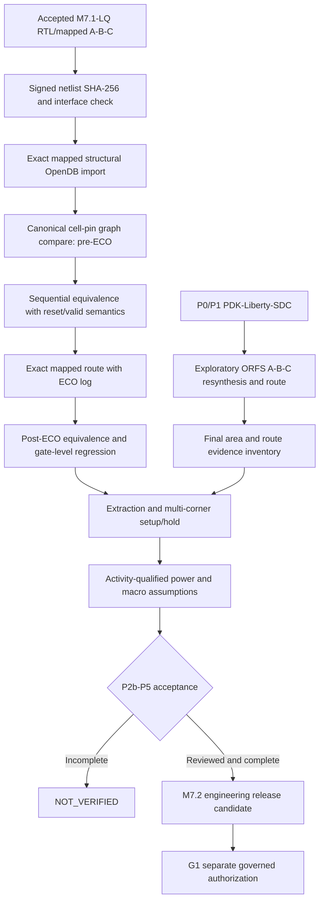

# M7.2 full closure execution: exact mapped implementation, STA, power and macro gates

**Scope:** additive Node1 engineering qualification. This document is not a release signoff. M7.1-LQ mapped netlists are the source of truth for P2b, *not* ORFS RTL resynthesis. P0/P1 previously accepted; G1 strictly separate.

## Evidence and trust boundaries

- P0/P1: pinned ORFS source, SKY130 HD, reviewed TT Liberty SHA, 100ns common SDC, prior M7.1-LQ bounded tests. Maintain the original hashes.
- P2b preparation: all three exact M7.1-LQ netlists imported unmodified to OpenDB with hashes and 746/690/746 cell counts; this is an **import experiment**, not graph equivalence or physical continuity.
- P3: all three independent ORFS **resynthesis** executions produced final ODB/GDS/SPEF. These are not routed M7.1-LQ netlists.
- P4: TT 25°C 1.8V research clock only; no slow/fast view qualified. Recovery/removal paths appear in A output, but reset deassertion assumptions remain unreviewed.
- P5: current power is PWR0 only; standard-cell coefficient arrays have not been replaced with characterized memory macros.

## Architecture



## 1. Node1 current measurements — qualified interpretation

The provided logs show final stage textual `Design area` approximately **9484 µm² for A/C** and **13818 µm² for B**, with core sizes **30749.491 µm² A/C** and **44124.819 µm² B**. These numbers are rounded final-stage reported occupied area, **not** classified logic-only area; the 31% final reported utilization is rounded. Use `scripts/m72_area_run.py` for a source-hashed final-ODB class inventory, verify individual master classifications manually. Specifically inspect `other` for clock, tie, logic and unrecognized cells; do not call it logic-only.

The pinned `5_2_route.json` has the *final* `detailedroute__route__drc_errors`, not just `...iter:0` intermediate violations. For all variants the user log shows final zero; B had an intermediate antenna repair (3 to 0), which is consistent with final zero. This is **router DRC**, not an independent foundry DRC/LVS.

## 2. Execute evidence collectors

```bash
export MSIF_ORFS="$HOME/eda/qualified-pdks/OpenROAD-flow-scripts"
export FLOW_DIR="$MSIF_ORFS/flow"
export PYTHONPATH="$PWD/src:$PWD/scripts"
python3 scripts/m72_report_review.py --flow "$FLOW_DIR" --out build/m72/p3p5-report-ledger-v3.json
python3 scripts/m72_ppa_compare.py --ledger build/m72/p3p5-report-ledger-v3.json --out build/m72/p5-research-comparison-v3.json
python3 scripts/m72_closure_evidence.py --flow "$FLOW_DIR" --out build/m72/m72-closure-evidence.json
python3 scripts/m72_area_run.py --flow "$FLOW_DIR" --out build/m72/final-area-v1
```

Require nonzero failures to stop; a zero evidence-collector exit **does not** grant signoff. Cross-check `area-ledger.json` with `6_report.json`, examine all `category.*`, hash `6_final.odb` and record tool versions. `scripts/m72_area_run.py` uses OpenROAD's Tcl OpenDB database and does not alter input ODBs.

## 3. P2b exact mapped graph and sequential equivalence implementation requirement

The current `scripts/m72_exact_lq_import.py` proves hash-pinned source and OpenROAD structural import. To qualify graph continuity, export canonical records from both **accepted Verilog** and **imported pre-ECO OpenDB**: `{instance-name, library-cell-type, (pin, canonical-net)}` with top-level port direction, bus indices, bit order, constant nets and flop reset polarity. Compare multisets and reject any unmodeled alias, pin swap, unresolved master or missing/extra instance. Do not accept matching counts alone. OpenDB's normalized net naming may differ; map it via port connectivity, topology or a provably bijective net renaming (not blind string equality).

Prove sequential equivalence via a formal engine with the original RTL/mapped flop models and explicit initial/reset protocol. Preserve valid/result pipeline latency, asynchronous assertion and controlled deassertion. Use an independently checked signed INT4×INT8→INT32 test oracle and reject unknown/X assumptions. A 260-vector bounded regression is *not* the proof. Include negative tests with a deliberately swapped cell pin, reset polarity change and one-bit modified constant.

The **direct exact-netlist physical route** must not launch the currently used `VERILOG_FILES` RTL resynthesis config. Establish a supported netlist-input mode from the pinned ORFS revision or a project-owned OpenROAD driver starting from accepted ODB. Maintain `6_final.odb` lineage, record physical-only ECOs (buffers, tie cells, CTS, hold fix, sizing), and prove allowed transformations separately; raw cell graphs are not expected to stay byte identical after legal ECOs. Post-layout check uses mapped cell models, same tested reset and handshake, and SDF when a validated timing annotation is available. Until these are implemented and Node1 evidence exists: `P2b=NOT_VERIFIED`.

## 4. P4 multi-corner STA requirements

For every corner record signed manifest entries: `{name, purpose, library_path, liberty_sha256, voltage, temperature, extraction_rules_sha256, rc_corner, sdc_sha256, odb_sha256, spef_sha256}`. Verify Liberty `operating_conditions`, units, cell inventory, PVT and process provenance. Use separate maximum/minimum views for setup/hold; do **not** change a filename and claim an SS/FF corner. Source matching parasitics. Audit `report_checks -path_delay max`, `-path_delay min`, `report_check_types`, `check_setup`, unconstrained endpoints, generated clocks, exceptions and reset recovery/removal, and review external reset synchronizer/protocol. Do not false-path `rst_n` without a justified model. The SKY130HS-shared RCX patterns used by the SKY130HD setup require documented PDK-calibration validation. If a corner or calibration is missing, mark `NOT_VERIFIED`; a TT-only research result never qualifies as multi-corner signoff.

## 5. P5 PWR0/PWR1/PWR2 qualification

PWR0 = default-activity Liberty estimate (current evidence). PWR1 requires **one reproducible common workload** per A/B/C, reset + valid + signed/extreme values, clock period, VCD/SAIF waveform and hash, and activity coverage (fraction of meaningful sequential/combinational nets annotated). Verify hierarchy and pin mapping after physical ECOs; distinguish internal, net switching and leakage. `P = alpha C V^2 f` is an approximation; measured or characterized internal energy must be counted separately. PWR2 requires independently reviewed calibrated technology RC/power and validation evidence; PWR1 must not be called calibrated. Record SAIF/VCD SHA, tool command and report SHA. No invented activity factors, voltage or temperature values.

## 6. Characterized memory macro gate

A/C coefficient array implementations are standard-cell designs. A valid SRAM/ROM comparison requires legal macro availability, PVT Liberty, physical LEF, GDS, bit-mapping, behavioral timing model, power pins/PDN requirements, memory compiler provenance, test protocols and layout/extraction. Identical capacity/bit width/ports/read latency and equivalent functional behavior must be proven before physical PPA comparison. If qualified macros are not available, **exclude macro claim from this release scope** explicitly; do not falsely report it as a closed gate.

## 7. Final closure and Git policy

The milestone needs independent review of exact-netlist equivalence, routed exact-netlist results, final router + physical-rule checks, timing corners, area class inventory, controlled workload power, and macro scope decision. Produce a reviewed acceptance manifest with artifact hashes, reviewer, date and explicit PASS/NOT_VERIFIED per gate. Until it is accepted, do not stage, push, commit or tag based on this runbook. Only after user approval make a research-scope feature commit; reserve `msif-m7.2-v0.5.0` for full agreed M7.2 closure on reviewed `main`. Existing M7.1-LQ tag is immutable. G1 remains a separate milestone.
