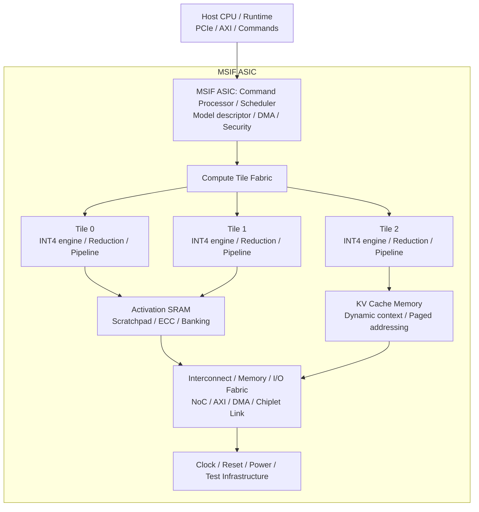
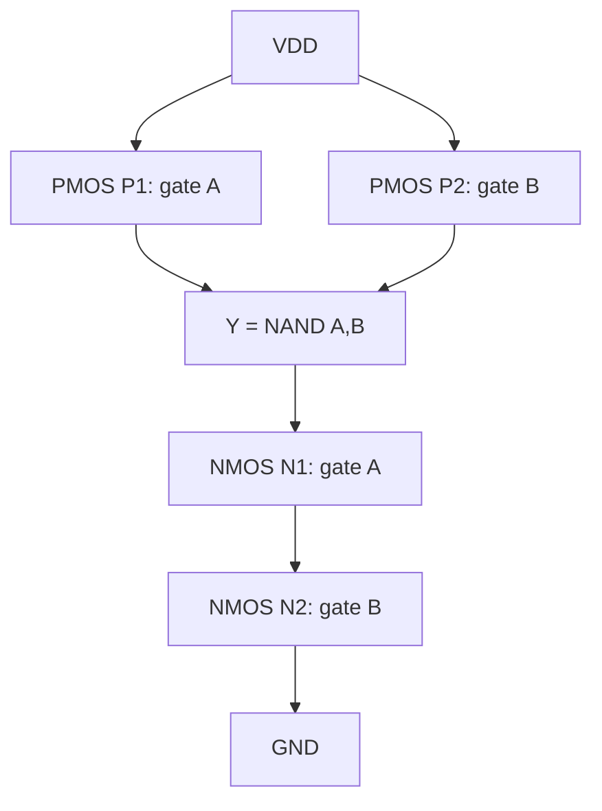
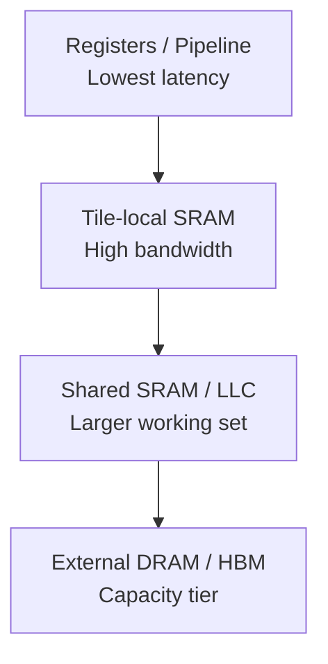
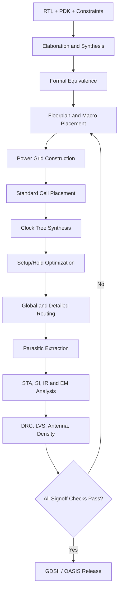
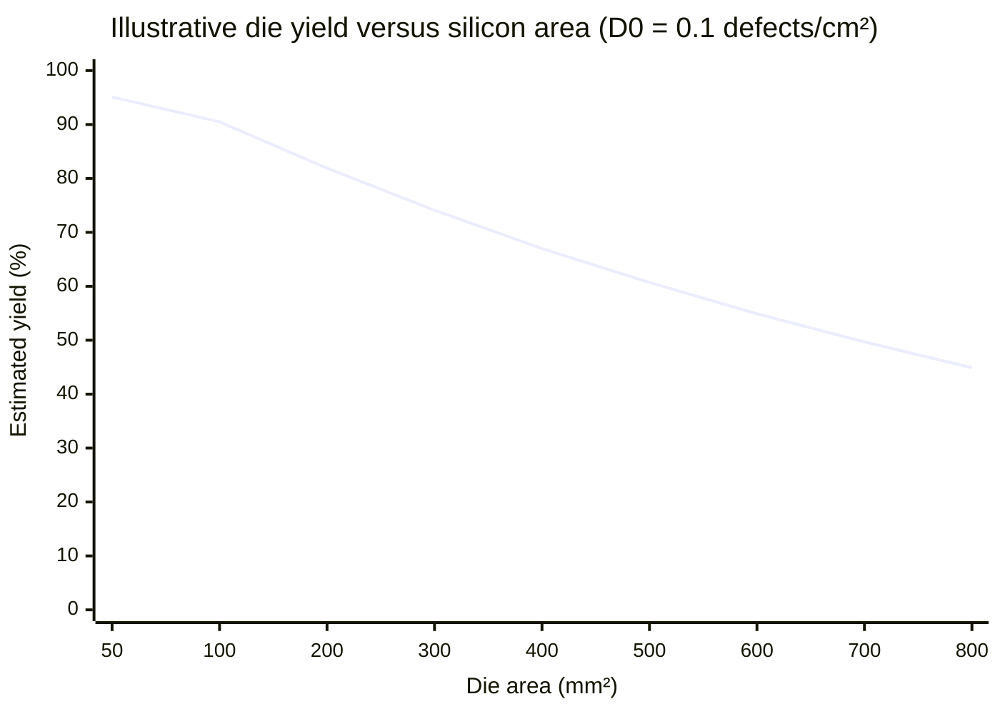
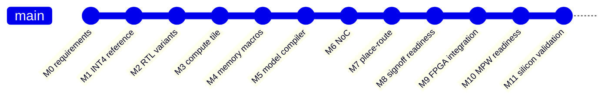

# Model-Specific AI Silicon: Complete Architecture and Engineering Investigation

> **Architecture specification and research plan • Revision 1.0 • 22 October 2026**
>
> **Document scope:** Sections 1–15, from “Model-Specific AI Silicon: Complete Architecture and Engineering Investigation” through “15. Recommended first implementation boundary.”

This investigation addresses the design of an AI inference processor in which **four-bit neural-network weights are embedded in or closely coupled to dedicated digital computation hardware**.

We will treat it as a new semiconductor architecture, independent of Taalas's implementation and intellectual property.

The target is to progress from a mathematical model and individual transistor circuits to:

- Synthesizable RTL and parameterized compute fabrics.
- Standard-cell, ROM, SRAM and custom-macro implementations.
- SystemVerilog verification, formal proofs and design-for-test.
- Floorplanning, placement, clock-tree synthesis, routing and signoff.
- Scalable transformer execution, KV-cache organization and chiplet fabrics.
- Silicon fabrication, wafer probe, characterization and manufacturing yield.
- Model-to-mask compilation, silicon versioning and economic feasibility.

Most importantly, we need an experimental method that distinguishes a genuine hardware advantage from an optimization that looks attractive mathematically but disappears after routing, memory integration or silicon validation.

## 1. Our proposed architecture: Model-Specialized Inference Fabric (MSIF)

I recommend designing three competing implementations under one common numerical and verification contract.

| Architecture | Name | Design concept |
|---|---|---|
| Architecture A | **Programmable MAC** | INT4 weights fetched from SRAM or ROM into reusable multiply-accumulate units. |
| Architecture B | **Fixed-coefficient MAC** | Weights embedded in arithmetic logic, allowing constant propagation and multiplier optimization. |
| Architecture C | **ROM-assisted Compute** | Weights encoded in a compact ROM or custom lookup structure adjacent to reduction logic. |

All three must produce the same mathematical output under identical numeric rules.

That gives us a controlled comparison of area, frequency, power, energy per operation, routing congestion and manufacturability.

### 1.1 System architecture

**Proposed MSIF SoC functional architecture.** This is a conceptual architecture; exact bandwidths, buffer depths, interface standards, clock domains and physical partitioning are design variables to be measured.



### 1.2 Initial reference configuration

We should define an achievable first prototype rather than begin with an entire billion-parameter LLM.

| Parameter | Initial target |
|---|---|
| Mathematical kernel | $y=Wx+b$ |
| Weight precision | Signed INT4 |
| Activation precision | Signed INT8 |
| Accumulator | Signed INT32 |
| Output rounding | Defined round-to-nearest-even |
| Saturation | Saturating INT8 output |
| Initial matrix | 16 × 64 |
| Compute granularity | Parameterized tile |
| Initial target frequency | 100 MHz FPGA, illustrative |
| ASIC frequency | Determined by synthesis and STA |
| RTL | SystemVerilog |
| Verification | Python + cocotb + SystemVerilog assertions |
| Initial ASIC PDK | Open research PDK, selected after qualification |
| Physical comparison | Equal constraints and equal I/O contracts |

The 100 MHz figure is a prototype goal, not an achieved result. At this stage, there is no measured area, power, timing or silicon performance.

---

# 2. Mathematics foundation: Exact fixed-weight inference arithmetic

The fundamental operation is matrix-vector multiplication:

$$\mathbf y=\mathbf W\mathbf x+\mathbf b$$

where:

$$\mathbf W\in\mathbb Z^{M\times K},\qquad \mathbf x\in\mathbb Z^K,\qquad \mathbf y\in\mathbb Z^M$$

Each output element is:

$$y_i=b_i+\sum_{j=0}^{K-1}w_{ij}x_j$$

The hardware must implement this equation with explicit finite-width semantics.

## 2.1 Signed four-bit representation

With two's complement:

$$w\in[-8,7]$$

and signed eight-bit activations:

$$x\in[-128,127]$$

We can express a four-bit weight using binary bits $b_0,\ldots,b_3$:

$$w=b_0+2b_1+4b_2-8b_3$$

Therefore:

$$wx=b_0x+2b_1x+4b_2x-8b_3x$$

This equation is critical.

It lets us replace arbitrary multiplication by selected shifted copies of the input and an addition/subtraction network.

For example, for $w=-5$:

$$-5x=-4x-x$$

For $w=7$:

$$7x=8x-x$$

For $w=0$, the entire multiplication is eliminated.

For $w=1$, it becomes a wire with appropriate sign extension.

For $w=-1$, it becomes negation.

The precise gate-level result depends on the technology library, synthesis optimizer, arithmetic encoding, pipelining and required timing.

### 2.2 Exact width derivation

The largest possible absolute product is:

$$|-8\times-128|=1024$$

A signed 12-bit product is sufficient for all INT4 × INT8 products.

For a dot product with $K$ terms, a conservative bound is:

$$|y_i-b_i|\le1024K$$

A safe signed accumulator width is:

$$B_{\mathrm{acc}}=1+\left\lceil\log_2(1024K+1)\right\rceil$$

For $K=64$:

$$B_{\mathrm{acc}}=18$$

For $K=4096$:

$$B_{\mathrm{acc}}=24$$

For initial design simplicity, INT32 accumulation provides substantial headroom.

We must still analyze bias ranges, rescaling, accumulation order and any intermediate truncation.

### 2.3 Quantization mathematics

For a real-valued quantity $r$:

$$r\approx s(q-z)$$

where $s$ is the scale, $z$ the zero-point and $q$ the stored integer.

Symmetric weight quantization commonly sets $z_w=0$.

For a matrix product:

$$y_i^{real}\approx s_xs_{w,i}\sum_jq_{w,ij}q_{x,j}+b_i$$

Per-channel scaling allows each output channel to use a separate $s_{w,i}$.

We should investigate:

1. Per-tensor symmetric INT4.
2. Per-output-channel symmetric INT4.
3. Group-wise INT4 with explicit scale storage.
4. Signed-digit and canonical signed-digit arithmetic.
5. Mixed-precision outlier handling.
6. Binary, ternary and lookup-table alternatives.

A fixed-weight accelerator does not necessarily benefit from every quantization method equally. Reducing arithmetic complexity can increase the cost of scale handling, routing or control.

### 2.4 Accumulation error and floating-point comparison

For integer arithmetic with no overflow, addition is exact and associative.

For floating-point reference computation, rounding introduces error. A common bound for a sequential sum of $K$ products involves:

$$\gamma_K=\frac{Ku}{1-Ku}$$

where $u$ is the unit roundoff and $Ku<1$.

The accumulation error can be bounded, under the standard floating-point model, by:

$$|\widehat y-y|\le\gamma_K\sum_j|w_jx_j|$$

Our verification must therefore distinguish:

- Exact bitwise equivalence between integer implementations.
- Quantization error relative to the floating-point model.
- Approximation error in nonlinear functions.
- Error introduced by final output conversion.

A fast circuit that produces the wrong quantized result is not an optimization.

### 2.5 Linear algebra beyond GEMV

The larger system must support:

| Operation | Mathematical form | Hardware concern |
|---|---|---|
| GEMV | $y=Wx$ | Weight/activation routing |
| GEMM | $C=AB$ | Tiling and data reuse |
| Dot product | $s=\sum_i a_ib_i$ | Adder tree |
| Matrix transpose | $A^T$ | Memory layout |
| RMS normalization | $x/\sqrt{\operatorname{mean}(x^2)+\epsilon}$ | Reduction, reciprocal square root |
| Softmax | $e^{x_i}/\sum_j e^{x_j}$ | Exponential approximation |
| Attention | $\operatorname{softmax}(QK^T/\sqrt d)V$ | Dynamic computation |
| RoPE | Block-diagonal 2D rotations | Dynamic position-dependent math |
| Low-rank adapter | $ABx$ | Programmable small matrices |
| Layer fusion | $f(Wx+b)$ | Numerical equivalence |
| Tensor decomposition | $W\approx UV^T$ | Compression/accuracy trade-off |

The investigation must optimize the **complete inference graph**, not only the weight multiplication kernel.

---

# 3. Transistor-level implementation

We should evaluate the implementation at four levels:

1. Boolean logic.
2. CMOS transistor networks.
3. Standard-cell logic.
4. Custom macros.

These levels must be kept distinct. A single mathematical operation does not necessarily map to a single transistor.

## 3.1 A constant-weight multiply as a Boolean circuit

Consider a signed INT4 weight of $w=3$ and an INT8 activation $x$.

$$y=3x=x+(x\ll1)$$

We have eliminated a general variable-coefficient multiplier.

However, an adder remains.

For a binary full-adder stage:

$$S=A\oplus B\oplus C_{\mathrm{in}}$$

$$C_{\mathrm{out}}=AB+AC_{\mathrm{in}}+BC_{\mathrm{in}}$$

The silicon implementation may use XOR, NAND, AOI/OAI or dedicated full-adder standard cells.

A conventional static CMOS two-input NAND contains four transistors: two PMOS devices forming the pull-up network and two NMOS devices forming the pull-down network.

**Static CMOS NAND2 transistor structure (conceptual):** parallel PMOS pull-up network between VDD and Y, and series NMOS pull-down network between Y and GND. A and B each drive their corresponding PMOS/NMOS gates. This is a logical device topology, not a layout or transistor-sizing specification.



For the full-adder, different transistor-level topologies trade area, delay, voltage tolerance, internal switching and drive strength.

We must investigate:

- Static complementary CMOS.
- Transmission-gate arithmetic.
- Mirror adders.
- Carry-save compressor structures.
- Ripple-carry versus carry-lookahead.
- Prefix adders: Kogge–Stone, Brent–Kung and Han–Carlson.
- Multioperand arithmetic compression.
- Low-leakage cell alternatives.
- Multi-threshold-voltage libraries.

A custom arithmetic cell must also pass circuit-level verification across process, voltage, temperature and mismatch corners.

## 3.2 Standard-cell versus custom-cell design

| Approach | Advantages | Disadvantages |
|---|---|---|
| Synthesized standard cells | Fast development, reusable libraries, conventional EDA flows | Not always optimal for fixed weights |
| Custom constant-coefficient cells | Potential transistor-level optimization | Requires characterization and physical IP development |
| ROM-based lookup | Compresses fixed functions in favorable cases | Decoder, address, and output mux delay |
| Distributed ROM-and-logic | Local data and computation | Placement regularity and routing complexity |
| Pure combinational weight fabric | Eliminates explicit weight reads | Can incur large fanout and routing cost |

A fundamental point: optimizing transistor count in one arithmetic cell does not prove that the overall chip area decreases.

$$A_{\mathrm{chip}}=A_{\mathrm{logic}}+A_{\mathrm{memory}}+A_{\mathrm{routing}}+A_{\mathrm{clock}}+A_{\mathrm{power}}+A_{\mathrm{I/O}}+A_{\mathrm{test}}+A_{\mathrm{whitespace}}$$

Even if fixed-coefficient arithmetic reduces $A_{\mathrm{logic}}$, wiring and buffer area may increase.

## 3.3 Delay and power equations

For a CMOS gate, a first-order delay model is:

$$t_{pd}\approx0.69R_{\mathrm{eq}}C_L$$

with effective resistance $R_{\mathrm{eq}}$ and load capacitance $C_L$.

Dynamic switching power is approximated by:

$$P_{\mathrm{dyn}}=\alpha CV^2f$$

where:

- $\alpha$: effective activity factor.
- $C$: switched capacitance.
- $V$: supply voltage.
- $f$: operating frequency.

Leakage contributes:

$$P_{\mathrm{total}}=P_{\mathrm{dyn}}+P_{\mathrm{leakage}}+P_{\mathrm{short-circuit}}$$

For model-specialized silicon, the objective is not simply to minimize transistor count. We need to minimize total switched capacitance, leakage, and memory/interconnect power while satisfying timing.

The energy per inference operation can be expressed as:

$$E_{\mathrm{op}}=\frac{P_{\mathrm{total}}}{R_{\mathrm{operations}}}$$

This metric must use a precisely defined operation count and workload.

---

# 4. Weight representation and multiplier microarchitecture

We should investigate multiple fixed-weight encodings rather than assume binary two's complement is always best.

## 4.1 Binary shift-add implementation

Given:

$$w=\sum_{k=0}^{B-2}2^kb_k-2^{B-1}b_{B-1}$$

we can implement:

$$wx=\sum_{k=0}^{B-2}b_k(x\ll k)-b_{B-1}(x\ll(B-1))$$

For INT4, only four coefficient bits are involved.

This gives a direct route from trained neural-network weights to arithmetic logic.

However, literal shift-add generation can be inferior to allowing a capable synthesis optimizer to perform its own arithmetic factoring. Both must be measured.

## 4.2 Canonical signed-digit representation

A weight may also be encoded as:

$$w=\sum_kd_k2^k,\quad d_k\in\{-1,0,1\}$$

Canonical signed-digit encodings have no adjacent nonzero digits, reducing the number of arithmetic terms for many constants.

For example:

$$7=8-1$$

rather than:

$$7=4+2+1$$

The first form uses a subtraction instead of two additions.

At the circuit level, whether this helps depends on adder synthesis, sharing and pipeline placement.

## 4.3 Shared partial products and factoring

A significant opportunity arises when multiple output channels use the same activation.

Suppose:

$$y_0=3x,\qquad y_1=5x,\qquad y_2=7x$$

We can build reusable terms:

$$t_2=2x,\quad t_4=4x,\quad t_8=8x$$

then:

$$y_0=t_2+x$$

$$y_1=t_4+x$$

$$y_2=t_8-x$$

This is a *multiple-constant multiplication* problem.

For a neural layer containing many weights, the optimization objective becomes minimizing a shared directed acyclic graph of addition, subtraction and shift operations.

The benefit is subject to a critical physical constraint: excessive sharing increases fanout and wire length.

Thus, the best algebraic solution may not be the best routed solution.

We should optimize:

$$J=\lambda_AA+\lambda_DD+\lambda_PP+\lambda_WW_{\mathrm{routing}}$$

subject to correctness and timing constraints.

This is a multiobjective architecture optimization problem, not merely coefficient simplification.

## 4.4 A concrete RTL implementation

The following is a synthesizable SystemVerilog reference kernel with coefficients represented as elaboration-time constants.

```systemverilog
module fixed_gemv_4x8 #(
    parameter int K = 64,
    parameter int ACC_W = 32,
    parameter logic [K*4-1:0] WEIGHTS = '0
) (
    input  logic                    clk,
    input  logic                    rst_n,
    input  logic                    in_valid,
    input  logic signed [K*8-1:0]   activations,
    output logic                    out_valid,
    output logic signed [ACC_W-1:0] result
);

    logic signed [ACC_W-1:0] sum_comb;

    always_comb begin
        sum_comb = '0;

        for (int j = 0; j < K; j++) begin : MAC
            // Sign extension is mandatory.
            logic signed [3:0] w;
            logic signed [7:0] x;
            logic signed [11:0] p;

            w = $signed(WEIGHTS[j*4 +: 4]);
            x = $signed(activations[j*8 +: 8]);

            p = w * x;
            sum_comb = sum_comb + ACC_W'(p);
        end
    end

    always_ff @(posedge clk or negedge rst_n) begin
        if (!rst_n) begin
            result    <= '0;
            out_valid <= 1'b0;
        end else begin
            out_valid <= in_valid;

            if (in_valid)
                result <= sum_comb;
        end
    end

endmodule
```

This implements a single $K$-element dot product with fixed packed weights.

It is deliberately simple to establish bit-exact functional behavior and permit synthesis experiments.

**It is not timing-optimized RTL.** The sequential accumulation expressed in the combinational process can create a long dependency chain. The next optimization should introduce a balanced reduction tree or carry-save compression, with defined pipeline stages.

We should also compare the multiplication operator against manually generated constant arithmetic; using constant parameters does not guarantee a particular synthesized gate structure.

### 4.5 Balanced adder tree

For $K$ products:

$$s^{(0)}_j=w_jx_j$$

At each reduction level:

$$s^{(l+1)}_j=s^{(l)}_{2j}+s^{(l)}_{2j+1}$$

For a power-of-two $K$, this requires:

$$L=\log_2K$$

reduction stages.

For $K=64$, there are six binary reduction levels.

With pipeline registers, this may permit a higher clock frequency than one long combinational accumulation chain, while increasing register area and latency.

We must compare:

- Serial accumulation.
- Balanced adder tree.
- Carry-save compressor tree.
- Systolic accumulation.
- Time-multiplexed MAC.
- Fully spatially unrolled compute.

The architecture exploration must generate post-route numbers for all implementations.

---

# 5. SRAM, ROM and memory-compute organization

Memory architecture is likely to be one of the decisive aspects of the complete design.

## 5.1 Storage capacity

For a matrix with $M$ rows and $K$ columns and four-bit weights:

$$S_W=4MK\text{ bits}$$

For a hypothetical 8-billion-parameter model:

$$S_W=32\times10^9\text{ bits}$$

or approximately 4 GB of raw weight representation.

Storing those bits in ordinary six-transistor SRAM would require an enormous number of bitcell transistors, before accounting for peripherals and other compute logic.

This motivates mask ROM, fixed logic, external nonvolatile storage, and hybrid organizations.

But a raw bitcell density comparison is insufficient. Complete memory area also includes decoders, sense amplifiers, word-line drivers, column muxes, ECC, power distribution and routing.

## 5.2 SRAM circuit architecture

A conventional 6T SRAM bitcell includes:

- Two cross-coupled inverters.
- Two access transistors.
- Word line.
- Complementary bit lines.

Its hold state is established by the cross-coupled inverters.

A conventional SRAM macro additionally requires row decoding, column selection, precharge circuits, sensing, write drivers and control logic.

Important design properties include read static noise margin, write margin, minimum operating voltage, access time, leakage, bitline capacitance and variation sensitivity.

For our architecture, SRAM should primarily hold dynamic data such as activations, KV state, adapters and scratchpad buffers.

## 5.3 ROM architectures to compare

| ROM implementation | Technical characteristics |
|---|---|
| Standard-cell case-ROM | Easy RTL generation, potentially inefficient physical density |
| Synthesized combinational constant logic | May optimize small fixed functions aggressively |
| Mask ROM macro | High bit density, requires foundry-compatible macro development |
| ROM with local arithmetic | Shorter weight transport, added arithmetic integration complexity |
| Hierarchical distributed ROM | Locality and scalability, more peripheral duplication |
| Programmable NVM | Retains reprogramming potential, process and endurance constraints |

A silicon-quality ROM macro needs characterized timing and power, a Liberty view, LEF/GDS physical views, gate/transistor netlists, and complete verification collateral.

OpenRAM provides an open-source framework for generating SRAM layouts, netlists and associated timing/power and physical models. Its applicability depends on the chosen PDK and supported memory architecture. [OpenRAM project](https://openram.org/).

## 5.4 Memory-banking mathematics

If a compute tile consumes $R$ activation words per cycle and each memory bank provides $p$ read ports, then a simple lower bound on the required number of banks is:

$$N_{\mathrm{banks}}\ge\left\lceil\frac Rp\right\rceil$$

This assumes a conflict-free addressing arrangement.

If each word contains $D$ bits and the clock is $f$, the peak read bandwidth is:

$$BW=N_{\mathrm{banks}}pDf$$

For example, 16 banks, one 128-bit read per bank per cycle, at 500 MHz yield:

$$BW=128\text{ GB/s}$$

This is theoretical aggregate internal bandwidth before bank conflicts, arbitration, stalls, ECC overhead and physical timing effects.

Memory capacity and bandwidth must be independently provisioned.

## 5.5 KV-cache and context-memory hierarchy

For a transformer with $L$ layers, $H_{KV}$ KV heads, head dimension $d$, context length $T$, bytes per element $b$, and $N$ concurrent sequences:

$$M_{KV}=2LH_{KV}dTbN$$

The factor of two accounts for keys and values.

For a Llama-3.1-8B-like configuration using FP16 KV values, each token requires:

$$2(32)(8)(128)(2)=131072\text{ bytes}$$

or 128 KiB across all layers.

Therefore, 8,192 cached tokens require 1 GiB of KV data for one sequence.

Supporting 32 simultaneous sequences at that context length would require 32 GiB before allocator fragmentation and metadata.

This has a major architectural consequence: eliminating external memory for fixed weights does not automatically eliminate the need for high-capacity dynamic memory.

### Recommended hierarchy



A practical accelerator may use a fast SRAM tier and a larger off-chip memory tier for context. The final choice must derive from target concurrency, context length, token latency and workload locality.

### KV-cache requirements

The controller should support block-based allocation, sequence-to-page mappings, beam or branch sharing with reference counts, eviction, bounded allocation, isolation between tenants, and error detection.

Memory pressure policies must be deterministic and measurable.

For long contexts, we should evaluate KV quantization, grouped-query attention, multi-query attention, sliding windows, prefix caching, offloading and paging.

These optimizations change different parts of the problem: capacity, bandwidth, computational complexity and output quality.

---

# 6. Compute fabric, NoC and scalable topology

At scale, the compute fabric becomes a distributed system on silicon.

## 6.1 Compute tile architecture

Each tile should expose a precise contract:

| Interface | Contents |
|---|---|
| Activation ingress | Valid/ready, activation data, sequence ID |
| Output egress | Result data, destination, completion ID |
| Configuration | Model identifier, layer, quantization metadata |
| SRAM interface | Address, data, byte enables, ECC status |
| NoC interface | Packet framing, credits, routing and ordering |
| Debug interface | Counters, trace and fault status |
| Clock/reset | Defined clock domain, reset sequencing |
| Power | Isolation, retention and clock-gating controls |
| DFT | Scan, MBIST, test modes, test clocks |

A fully unrolled architecture offers massive parallelism but can be expensive in wires and power.

A time-multiplexed architecture uses fewer operators but must load more operands per operation.

The appropriate trade-off depends on whether the limiting resource is arithmetic, memory, wire bandwidth, energy or manufacturable silicon area.

## 6.2 Roofline analysis

The compute roofline is:

$$P_{\mathrm{attainable}}\le\min(P_{\mathrm{peak}},BW\times AI)$$

where $AI$ is arithmetic intensity in operations per byte.

For a fixed-weight fabric, we should redefine arithmetic intensity carefully because hardwired weights are not fetched over a runtime memory interface.

External bandwidth may no longer be dominated by weights, while activation traffic, KV traffic, inter-tile movement and output exchange become more important.

Thus we need both:

- **Algorithmic arithmetic intensity**, counting all model operands.
- **Physical interface arithmetic intensity**, counting bytes that cross particular memory and interconnect boundaries.

Those metrics must not be mixed.

## 6.3 NoC topology evaluation

Candidate topologies include:

- Shared bus for the first small prototype.
- Crossbar for modest numbers of tiles.
- Two-dimensional mesh.
- Concentrated mesh.
- Hierarchical clusters with local crossbars.
- Ring-based communication.
- Dedicated point-to-point activation pipelines.

For a 2D mesh, the idealized average hop count grows with mesh dimensions. Under uniform traffic on a square $n\times n$ mesh, average Manhattan distance is approximately:

$$\bar H=\frac{2(n^2-1)}{3n}$$

This formula assumes uniformly selected independent source and destination nodes, including zero-distance pairs.

Actual latency depends on injection load, congestion, flow control, link width, arbitration and pipeline registers.

## 6.4 NoC performance specification

For every interconnect link, specify:

$$BW_{\mathrm{raw}}=\frac{Wf}{8}$$

where $W$ is data bits transferred per cycle.

The usable bandwidth is lower because of protocol headers, idle cycles, backpressure and error-control overhead.

A representative packet should include destination tile, source tile, model/version ID, sequence or transaction ID, payload type, payload length, priority or virtual channel, and integrity protection where required.

Credit-based flow control is preferable to unbounded buffering.

We must prove that the routing and credit protocol is free of deadlock under its supported traffic patterns.

Formal verification should check invariants such as credit conservation and absence of buffer overrun.

## 6.5 Multi-chip architecture

For larger models, we need to compare:

**Pipeline parallelism:** different chips execute successive groups of transformer layers.

**Tensor parallelism:** a large matrix multiplication is split across chips.

**Expert parallelism:** mixture-of-experts computation is distributed according to expert selection.

For row-partitioned matrix multiplication:

$$W=\begin{bmatrix}W_0\\W_1\\\vdots\\W_{p-1}\end{bmatrix},\quad y_i=W_ix$$

Each chip computes a disjoint output subset. The input activation may need to be broadcast or replicated.

For column partitioning:

$$W=[W_0\ W_1\ \ldots\ W_{p-1}]$$

$$y=\sum_{i=0}^{p-1}W_ix_i$$

This requires reduction of partial outputs.

The choice directly affects inter-chip bandwidth and latency.

### Inter-chip communication model

Let the activation message have $S$ bytes, available payload bandwidth $B$, and fixed communication latency $\alpha$:

$$T_{\mathrm{comm}}\approx\alpha+\frac SB$$

For multiple communication stages:

$$T_{\mathrm{total}}=T_{\mathrm{compute}}+T_{\mathrm{comm}}+T_{\mathrm{sync}}-T_{\mathrm{overlap}}$$

A chiplet interface should be evaluated at both PHY and protocol levels.

The UCIe Consortium's published UCIe 3.0 specification supports 48 and 64 GT/s data rates, but actual usable bandwidth is a function of package channel organization, lane counts, encoding and protocol. [UCIe Consortium](https://www.uciexpress.org/).

For board-level multi-ASIC systems, suitable alternatives may include PCIe, Ethernet or proprietary high-speed links.

A chiplet design also requires packaging feasibility, known-good-die strategy, die-to-die repair, clocking architecture, thermal analysis and interposer or substrate design.

---

# 7. RTL architecture and implementation requirements

A scalable implementation should use a hierarchy that mirrors the hardware architecture.

```text
msif/
├── model/
│   ├── quantization/
│   ├── tensor_ir/
│   └── reference/
├── compiler/
│   ├── weight_encoding/
│   ├── datapath_generation/
│   └── physical_partitioning/
├── rtl/
│   ├── common/
│   ├── arithmetic/
│   │   ├── int4_multiplier.sv
│   │   ├── fixed_coefficient_mac.sv
│   │   ├── compressor_tree.sv
│   │   └── requantizer.sv
│   ├── memory/
│   │   ├── rom_wrapper.sv
│   │   ├── sram_wrapper.sv
│   │   ├── ecc.sv
│   │   └── kv_cache_controller.sv
│   ├── tile/
│   │   ├── compute_tile.sv
│   │   ├── activation_router.sv
│   │   └── tile_scheduler.sv
│   ├── noc/
│   ├── dma/
│   ├── host/
│   ├── clock_reset/
│   ├── power/
│   ├── dft/
│   └── top/
├── verification/
│   ├── cocotb/
│   ├── uvm/
│   ├── assertions/
│   └── formal/
├── physical/
│   ├── synthesis/
│   ├── floorplan/
│   ├── placement/
│   ├── cts/
│   ├── routing/
│   └── signoff/
├── pdk/
├── firmware/
├── software/
├── silicon_validation/
└── economics/
```

## 7.1 RTL coding rules

The RTL design standard should require:

- Explicit signed types, casts and widths.
- Defined overflow, rounding and saturation.
- Parameterized dimensions with elaboration assertions.
- No unintended latches.
- Synchronous protocol state changes.
- Valid/ready handshake correctness.
- Explicit reset semantics.
- No unknown or high-impedance behavior in functional datapaths.
- Clock-domain crossing through qualified synchronization structures.
- Reset-domain crossing analysis.
- No fabric-generated clocks unless deliberately constrained.
- Consistent register-enable and clock-gating methodology.
- Clear synthesis and simulation behavior.

Use elaboration-time parameters for the constant-weight experiment, but provide a separate memory-backed version with identical transaction behavior.

## 7.2 Required RTL variants

We should implement at least the following:

| Variant | Purpose |
|---|---|
| V0 | Generic programmable multiplier baseline |
| V1 | Hardcoded coefficient multiplication |
| V2 | Canonical signed-digit multiplier |
| V3 | Shared multiple-constant multiplication |
| V4 | LUT/ROM-assisted operation |
| V5 | Carry-save tree |
| V6 | Fully pipelined reduction |
| V7 | Time-multiplexed datapath |
| V8 | Spatially unrolled matrix fabric |
| V9 | SRAM-backed weights |
| V10 | Custom macro integration |

The same tests and numeric reference model must be used for every variant.

## 7.3 Verification architecture

At the arithmetic level:

$$y_{\mathrm{RTL}}=y_{\mathrm{reference}}$$

for all supported input and coefficient combinations, after applying identical fixed-point semantics.

At the system level, transaction IDs, output ordering and interface handshakes must also match.

For a four-bit coefficient and eight-bit activation, there are only:

$$16\times256=4096$$

possible coefficient/activation pairs.

Therefore, an individual INT4 × INT8 multiplier can be exhaustively tested over its entire input domain.

For the complete dot product, exhaustive testing becomes impractical as $K$ grows, so we add constrained-random verification, formal properties and mathematical reference checking.

### Required verification layers

| Level | Validation |
|---|---|
| Arithmetic cell | Exhaustive simulation and formal equivalence |
| Reduction tree | Randomized, boundary and overflow tests |
| Compute tile | Cycle-accurate transactions |
| SRAM/ROM | Addressing, timing, collision, ECC and initialization |
| NoC | Backpressure, packet integrity, congestion, deadlock |
| DMA | Bounds, alignment, ordering and coherency |
| Clock/reset | CDC/RDC and reset-sequence verification |
| Power | Isolation, retention and power-state sequencing |
| SoC | Firmware and application-level integration |
| Gate-level | SDF timing simulation for selected scenarios |
| Silicon | ATPG, MBIST, BIST, characterization and workload tests |

A minimum verification suite should explicitly exercise all legal coefficients, zero vectors, maximum positive/negative inputs, simultaneous stalls, reset during transactions, repeated model invocations, and fault injection.

---

# 8. Physical design from RTL to GDSII

This is where arithmetic architecture choices become measurable silicon properties.

The standard RTL-to-layout sequence is:



The open-source OpenROAD flow already provides a useful foundation for synthesis-to-layout research, including placement, clock-tree synthesis, routing and parasitic extraction. Commercial foundry signoff typically requires additional qualified tools and foundry-specific checks. [OpenROAD](https://openroad.readthedocs.io/).

## 8.1 PDK requirements

A realistic process design kit must provide:

| Collateral | Purpose |
|---|---|
| Technology LEF | Routing layers, via and manufacturing geometry |
| Standard-cell LEF | Cell footprints and pins |
| Liberty timing libraries | Delay, power and constraints |
| Standard-cell GDS | Physical layouts |
| Extraction rules | Parasitic resistance/capacitance |
| DRC deck | Design rule verification |
| LVS deck | Layout-to-schematic comparison |
| Antenna rules | Plasma-damage prevention |
| EM/IR rules | Power-grid qualification |
| SRAM/ROM views | Macro integration |
| Device models | SPICE characterization |
| Corner libraries | PVT analysis |
| Metal density/fill rules | Manufacturability |

OpenROAD documents these platform bring-up prerequisites, including Liberty, LEF, GDS and routing technology descriptions. [OpenROAD documentation](https://openroad.readthedocs.io/).

## 8.2 Floorplanning

Floorplanning should preserve locality between activations, compute arrays, reduction trees and local SRAM.

A tile should not require an activation to travel across a large fraction of the die simply because its coefficient logic was placed elsewhere.

Key parameters include core utilization, tile aspect ratio, macro halos, routing channels, pin distribution, metal-layer allocation, congestion and power-grid topology.

We should test multiple floorplans:

1. Compute-centric tiles with memory at their edges.
2. Memory-centric tiles surrounded by arithmetic.
3. Interleaved memory and arithmetic rows.
4. Hierarchical compute clusters.
5. Long, narrow dataflow pipelines.

The ideal arrangement depends on actual routes and parasitic delay, not block-diagram neatness.

## 8.3 Timing closure mathematics

For a register-to-register path:

$$T_{\mathrm{clk}}\ge T_{\mathrm{cq,max}}+T_{\mathrm{logic,max}}+T_{\mathrm{wire,max}}+T_{\mathrm{setup}}+T_{\mathrm{uncertainty}}+T_{\mathrm{skew,adverse}}$$

The actual setup calculation must use the launch/capture clock relationship and sign convention of the timing analyzer.

Setup slack is:

$$S_{\mathrm{setup}}=T_{\mathrm{required}}-T_{\mathrm{arrival}}$$

Positive slack indicates that the analyzed path meets its setup requirement.

For hold timing, the earliest arriving data must remain stable long enough after the capture clock edge. Hold fixes frequently insert delay buffers or modify cell choices and routing.

These fixes can increase area, dynamic power and congestion.

### Example illustrative timing budget

Suppose a 1 GHz clock period:

$$T_{\mathrm{clk}}=1\text{ ns}$$

We allocate:

| Component | Illustrative allocation |
|---|---:|
| Clock-to-Q | 80 ps |
| Combinational logic | 500 ps |
| Interconnect | 200 ps |
| Setup | 70 ps |
| Uncertainty and adverse skew | 100 ps |
| Total | 950 ps |
| Remaining margin | 50 ps |

These are hypothetical numbers, not PDK-derived timing values.

The purpose is to demonstrate that the fixed-weight multiplier may save arithmetic delay but lose that advantage if it requires much more wiring or fanout buffering.

## 8.4 Routing at scale

For every compute fabric, track:

- Total routed wire length.
- Signal metal area.
- Congestion overflow.
- Buffer and repeater count.
- High-fanout nets.
- Via counts.
- Slew and capacitance violations.
- Setup and hold slack.
- Cross-tile traffic.
- Power-grid obstruction.
- IR drop and electromigration.
- Antenna violations.
- Clock-tree length and insertion delay.

A model-specialized fabric may contain billions of repeated physical structures. Even a tiny routing inefficiency per weight can become significant at that scale.

This motivates local clustering, structured arrays, hierarchical place-and-route, pipelining and physical-aware hardware compilation.

## 8.5 Power integrity

The power-delivery network must support peak simultaneous switching.

The voltage at an active circuit is reduced by resistive and inductive effects:

$$V_{\mathrm{effective}}=V_{\mathrm{supply}}-\Delta V_{\mathrm{IR}}-\Delta V_{\mathrm{transient}}$$

Current density must remain within process-qualified electromigration limits.

Power validation requires static and dynamic IR-drop analysis, transient voltage droop, decap planning, on-chip regulators if applicable, package parasitics and board-level supply behavior.

The total power budget must include clocks, memories, link PHYs and control logic—not only arithmetic operations.

## 8.6 Clocking and low-power design

Required investigation areas include clock-tree partitioning, clock gating, DVFS feasibility, multi-Vt cells, leakage reduction, memory retention, state isolation and power sequencing.

Power intent should be represented separately from functional RTL, using a supported power-intent methodology such as IEEE 1801 UPF where appropriate. [IEEE 1801](https://standards.ieee.org/standard/1801-2018.html).

For a predominantly combinational fixed-weight fabric, aggressive pipelining can add substantial clock power.

An optimal design must balance combinational delay, flip-flop count, switching power and throughput.

---

# 9. DFT, reliability and silicon validation

A model-specialized ASIC is still a manufactured digital integrated circuit. Fixed weights do not remove the need for testability.

## 9.1 Design for test

The minimum DFT architecture should include:

| Mechanism | Purpose |
|---|---|
| Scan insertion | Structural testing of sequential logic |
| ATPG | Generate manufacturing fault patterns |
| MBIST | Test embedded SRAM |
| ROM signature test | Validate programmed ROM contents |
| Logic BIST | Exercise arithmetic logic |
| Boundary scan | Package and board-level access |
| JTAG/TAP | Test access and control |
| ECC/parity | Detect runtime memory corruption |
| CRC/signatures | Validate loaded data and model identity |
| Fault telemetry | Runtime diagnostics |
| Test clock controllers | Safe at-speed testing |

For fixed-weight model silicon, ROM correctness is especially important.

An incorrect programmed bit may change a neural-network parameter permanently.

We should define a complete model fingerprint:

$$H_{\mathrm{model}}=\operatorname{SHA256}(\text{model identity}\Vert\text{quantization metadata}\Vert\text{ordered weight payload}\Vert\text{operator configuration})$$

The hash identifies the intended model content, while practical ROM integrity testing may use segmented signatures, address walks, hardware CRC and scan-accessible test interfaces.

A hash alone does not demonstrate that every physical ROM cell is correctly fabricated and accessible.

## 9.2 Manufacturing-test sequence

The complete sequence should cover wafer probe, known-good-die classification, packaging, package-level test, board bring-up, voltage/frequency characterization, thermal testing, reliability screening and application-level inference verification.

Wafer-level and packaged-device tests should include stuck-at and transition faults, SRAM march tests, ROM integrity, interface loopback, scan chain integrity and at-speed timing tests.

Final-system qualification should include known-answer vector execution, output-quality regression, continuous inference under thermal load, long-context stress and fault recovery.

## 9.3 Reliability modeling

Important lifetime concerns include:

- Bias temperature instability.
- Hot-carrier degradation.
- Electromigration.
- Time-dependent dielectric breakdown.
- Thermal cycling and package fatigue.
- SRAM soft errors.
- Voltage droop and clock instability.
- Package/interconnect defects.
- Retention and reset behavior.

Fixed-weight logic may reduce some memory movement, but it is not immune to aging, manufacturing variation or runtime faults.

## 9.4 Yield modeling

A simple Poisson defect-yield approximation is:

$$Y_{\mathrm{die}}=e^{-D_0A}$$

where $D_0$ is defect density per unit area and $A$ is die area in the matching units.

For an illustrative defect density of $0.1$ defects/cm²:

| Die area | Poisson yield |
|---|---:|
| 100 mm² | 90.5% |
| 300 mm² | 74.1% |
| 600 mm² | 54.9% |
| 800 mm² | 44.9% |



Actual yield depends on defect clustering, foundry maturity, redundancy, repairability, parametric variation and other manufacturing factors.

For model-specific devices, redundancy and sparing may be unusually valuable. A redundant compute region could allow a defective tile to be bypassed, provided the architecture and model mapping support remapping.

That flexibility must be designed in before fabrication.

---

# 10. Economics of repeatedly fabricating model-specific silicon

The economic problem differs from a general-purpose accelerator because a customized model can require a new silicon version.

We need to model nonrecurring engineering cost, mask cost, fabrication, packaging, testing, yield, deployment volume, energy and the useful life of each model.

## 10.1 Nonrecurring engineering costs

Let:

$$C_{\mathrm{NRE}}=C_{\mathrm{design}}+C_{\mathrm{verification}}+C_{\mathrm{masks}}+C_{\mathrm{IP}}+C_{\mathrm{qualification}}$$

Some infrastructure costs can be amortized across multiple models if they share the same silicon platform.

Model-specific masks and qualification costs generally recur when the physical implementation changes.

A platform intended for frequent model revisions should minimize those recurring costs.

## 10.2 Good-die manufacturing cost

A simplified approximation is:

$$C_{\mathrm{good\ die}}=\frac{C_{\mathrm{wafer}}}{N_{\mathrm{gross\ dies}}Y_{\mathrm{die}}}+C_{\mathrm{test}}$$

Packaging, assembly yield and final test must then be included to obtain the finished-device cost.

For chiplets, package yield and known-good-die selection become critical.

A more comprehensive unit-cost model is:

$$C_{\mathrm{unit}}=\frac{C_{\mathrm{NRE}}}{N_{\mathrm{shipped}}}+C_{\mathrm{fab}}+C_{\mathrm{package}}+C_{\mathrm{test}}+C_{\mathrm{board}}+C_{\mathrm{warranty}}$$

The economics worsen rapidly when a model becomes obsolete before enough devices have shipped.

## 10.3 Break-even analysis

Let the fixed-model accelerator have:

- $F$: extra upfront cost relative to a programmable alternative.
- $\Delta c$: cost saved per million useful output tokens.
- $V$: lifetime volume in millions of useful tokens.

Then the simplified break-even volume is:

$$V_{\mathrm{BE}}=\frac{F}{\Delta c}$$

This assumes $\Delta c>0$, equal output quality and service capability, and that recurring costs are already represented consistently.

For illustration, if the extra fixed cost is $10 million and the net saving is $0.20 per million tokens:

$$V_{\mathrm{BE}}=50\,000\,000$$

million tokens, or $5\times10^{13}$ tokens.

These inputs are hypothetical. We should not adopt them as a business forecast.

## 10.4 Model replacement frequency

Suppose a model family is replaced every $\tau$ months and requires a model-specific engineering cost $F_m$.

The annualized recurring customization cost is approximately:

$$C_{\mathrm{custom/year}}=F_m\frac{12}{\tau}$$

For a two-month model cycle, six customization programs could be required annually if every model revision demands new masks.

For a twelve-month model cycle, only one may be needed.

This means the commercial opportunity depends not only on silicon efficiency but also on **model stability**.

A model with enormous inference volume and stable weights can justify specialization much more readily than a rapidly changing experimental model.

## 10.5 Total cost per useful token

A useful production metric is:

$$C_{\mathrm{million\ useful\ tokens}}=10^6\frac{C_{\mathrm{total\ ownership}}}{N_{\mathrm{useful\ output\ tokens}}}$$

where useful tokens are generated under a defined service-level and quality requirement.

Total cost of ownership should include:

- Hardware procurement and amortization.
- Deployment, racks and networking.
- Electricity and cooling.
- Maintenance and operational labor.
- Capacity reservation and utilization.
- Failed hardware and spare inventory.
- Model revisions and replacement programs.
- Software/compiler maintenance.
- Quality regressions and migration costs.

Token throughput must be measured at realistic concurrent load and latency targets, rather than only using an unconstrained peak benchmark.

## 10.6 Decision criteria

The specialization decision should compare at least four candidates:

| Candidate | Base-model flexibility | Recurring customization cost | Principal advantage |
|---|---|---|---|
| GPU | High | Low silicon customization | Rapid model iteration |
| Programmable inference ASIC | Moderate/high | Mostly software compilation | Efficient reusable silicon |
| Mask-ROM model ASIC | Very low | New fabrication per major change | Potential density and energy advantage |
| Hybrid fixed/programmable ASIC | Moderate | Depends on fixed/programmable partition | Balanced efficiency and adaptability |

A hybrid architecture may prove economically superior even if a completely fixed design wins on raw energy per MAC.

---

# 11. Further mathematics required for the full investigation

Beyond matrix multiplication, the architecture program needs mathematical models for accuracy, data movement, scheduling, circuit optimization and physical feasibility.

| Mathematical area | Equations and methods | Engineering application |
|---|---|---|
| Linear algebra | Matrix multiplication, eigenvalues, singular value decomposition | Model mapping, compression, low-rank adaptation |
| Numerical analysis | Quantization, error propagation, interval bounds | Bit-width and accuracy verification |
| Boolean algebra | Karnaugh reduction, algebraic factoring, Shannon expansion | Fixed-coefficient arithmetic and ROM logic |
| Graph theory | DAG partitioning, graph cuts, routing and scheduling | Compute compiler and physical partitioning |
| Parallel algorithms | Prefix sums, reductions, systolic arrays | Adder trees and GEMM execution |
| Information theory | Entropy, sparse and compressed encoding | Weight-storage optimization |
| Queueing theory | Arrival rates, service rates, Little's law | Concurrent inference scheduling |
| Circuit theory | RC delay, capacitance, leakage and noise margins | Transistor and interconnect design |
| Probability/statistics | Defect distributions, Monte Carlo, error rates | Yield and variation analysis |
| Optimization | Mixed-integer optimization, Pareto frontiers | Architecture search and PPA |
| Reliability theory | Fault coverage, failure rates, lifetime models | DFT, redundancy and qualification |
| Economics | Break-even, amortization, discounted cash flow | Manufacturing strategy |

Three additional areas deserve particular attention.

## 11.1 Singular value decomposition and low-rank compression

A matrix can be decomposed as:

$$W=U\Sigma V^T$$

An approximate rank-$r$ representation is:

$$W_r=U_r\Sigma_rV_r^T$$

Its spectral norm approximation error satisfies:

$$\|W-W_r\|_2=\sigma_{r+1}$$

for the optimal truncated SVD.

The original dense layer requires approximately $MK$ multiplication operations per vector.

The factorized layer requires approximately:

$$r(K+M)$$

Therefore, a rough arithmetic reduction is possible when:

$$r(K+M)<MK$$

But an SVD approximation may change the model's behavior, and extra intermediate storage and memory traffic can offset arithmetic savings.

Our compiler should be able to evaluate such factorizations before generating hardware.

## 11.2 Transformer attention complexity

For a sequence of length $T$ and head dimension $d$, computing attention scores across a full sequence requires:

$$O(T^2d)$$

arithmetic.

During autoregressive decoding with a KV cache, the attention work for one newly generated token scales approximately as:

$$O(Td)$$

per attention head, along with cache reads.

Thus fixed-weight projection acceleration alone may not solve long-context inference bottlenecks.

The architecture should model attention compute, KV bandwidth, memory capacity and communication separately.

## 11.3 Queueing and service performance

For a stable service with average arrival rate $\lambda$, mean response time $W$, and average number of requests in the system $L$, Little's law gives:

$$L=\lambda W$$

This is useful for evaluating concurrency and service-level objectives.

A silicon engine can have excellent single-request compute time but poor application latency if its memory controller, host interface or scheduler becomes congested.

Accordingly, performance testing must include p50/p95/p99 latency, time-to-first-token, inter-token latency, throughput under concurrency, energy and accuracy.

---

# 12. Development plan: From mathematical proof to validated silicon

I recommend a gated 12-milestone program rather than treating this as one monolithic ASIC design.

| Milestone | Implementation | Mandatory exit evidence |
|---|---|---|
| M0 | Requirements, numerical specification, PDK/tool feasibility | Signed architecture specification and requirements traceability |
| M1 | INT4 arithmetic and Python reference model | Exhaustive multiplier verification |
| M2 | Constant-coefficient RTL variants | Formal equivalence and synthesis comparison |
| M3 | Adder tree, pipeline and compute tile | Cycle-accurate tests and measured FPGA throughput |
| M4 | SRAM/ROM architecture and macro wrappers | Memory tests and capacity/bandwidth model |
| M5 | Compiler from tensor weights to RTL | Reproducible model-to-hardware generation |
| M6 | Multi-tile fabric and NoC | Traffic, contention and deadlock verification |
| M7 | RTL-to-GDS physical exploration | Routed area, timing, congestion and extracted parasitics |
| M8 | Power/DFT/physical signoff readiness | Power analysis, test coverage and closure reports |
| M9 | FPGA system integration | End-to-end inference and correctness tests |
| M10 | MPW tapeout preparation | Independent release review and complete signoff package |
| M11 | Silicon bring-up and characterization | Wafer/package tests, PPA and correctness measurements |

M10 is an authorization gate, not an automatic tapeout commitment. It requires a qualified manufacturing path, verified IP licenses, budget, foundry checks and an independently reviewed signoff package.

**Milestone progression in GitHub-native Mermaid `gitGraph`:**



## 12.1 Architecture experiments that determine the direction

Our initial research should establish the following matrix of comparisons.

| Experiment | Independent variable | Measurements |
|---|---|---|
| E01 | Programmable versus constant coefficient | Gate area, delay, switching |
| E02 | Binary versus CSD encoding | Adder count, physical area and power |
| E03 | Shared versus independent partial products | Fanout, buffers, routing, timing |
| E04 | Serial versus balanced reduction | Fmax, latency, energy |
| E05 | Pipeline depth | Throughput, register power and area |
| E06 | ROM versus constant logic | Storage density and total access cost |
| E07 | SRAM banking | Conflicts, bandwidth, macro area |
| E08 | Tile size | Placement congestion, power and utilization |
| E09 | Mesh versus hierarchical NoC | Latency, area and bandwidth |
| E10 | KV-cache hierarchy | Context length, bandwidth and total latency |
| E11 | Chiplet partition | Communication cost and scaling efficiency |
| E12 | Process/library choices | PPA, leakage and manufacturability |
| E13 | DFT/redundancy | Area penalty and yield benefit |
| E14 | Model replacement cadence | Lifetime cost and break-even volume |

Every experiment should retain its input weights, source version, generated RTL, constraints, tool versions, tool logs, synthesis statistics, timing paths and measurement results.

This is necessary for reproducible architecture decisions.

## 12.2 Recommended tools for the initial implementation

For the first open-source prototype, the toolchain can include:

| Stage | Tool |
|---|---|
| Model generation | Python, NumPy, PyTorch |
| Weight quantization | PyTorch/custom NumPy reference |
| RTL simulation | Verilator or Icarus Verilog |
| Python-driven testing | cocotb, pytest |
| Formal/synthesis checks | Yosys, SymbiYosys, suitable SMT engines |
| RTL synthesis | Yosys + ABC |
| Physical implementation | OpenROAD Flow Scripts |
| Layout inspection | KLayout |
| SRAM generation | OpenRAM, with supported PDK |
| Timing analysis | OpenSTA |
| Waveform analysis | GTKWave |
| SPICE circuit analysis | ngspice with compatible device models |
| Build reproducibility | Git, pinned containers and manifests |

The documented OpenROAD Flow integrates Yosys, OpenROAD and KLayout for an RTL-to-GDS workflow. It is well suited to early design-space exploration. [OpenROAD Flow Scripts](https://github.com/The-OpenROAD-Project/OpenROAD-flow-scripts).

### Initial Node1 environment qualification

On your Ubuntu 24.04 Node1, begin by auditing the available packages:

```bash
mkdir -p ~/dev/pub/ai-sys1/model-silicon-research
cd ~/dev/pub/ai-sys1/model-silicon-research

mkdir -p logs scripts docs

{
    echo "=== HOST ==="
    uname -a
    lsb_release -a

    echo "=== COMPUTE ==="
    lscpu
    free -h

    echo "=== TOOLS ==="
    for tool in \
        python3 verilator iverilog yosys \
        sby openroad sta klayout \
        ngspice git cmake make
    do
        if command -v "$tool" >/dev/null 2>&1; then
            echo "FOUND: $tool"
        else
            echo "MISSING: $tool"
        fi
    done

    echo "=== PYTHON MODULES ==="
    python3 - <<'PY'
import importlib.util

for name in ("numpy", "torch", "cocotb", "pytest"):
    found = importlib.util.find_spec(name) is not None
    print(f"{name}: {'FOUND' if found else 'MISSING'}")
PY
} | tee logs/m0_environment_audit.log
```

This establishes the observed host baseline without making assumptions about installed EDA software.

For the physical design experiments, start with an openly accessible research PDK and a corresponding supported OpenROAD platform. Do not infer advanced-node power, area or frequency from an older open PDK; use such results to evaluate topology and methodology first.

An advanced-node implementation requires the appropriate foundry-qualified libraries, tools and physical IP.

---

# 13. Architecture decision records

We should formally record consequential decisions rather than allow optimizations to accumulate without traceability.

The initial records should include:

| ADR | Question |
|---|---|
| ADR-001 | Which integer representation and rounding rules are authoritative? |
| ADR-002 | Fixed logic, ROM or SRAM-backed coefficients? |
| ADR-003 | What is the compute tile granularity? |
| ADR-004 | What are the accumulator and pipeline architectures? |
| ADR-005 | How should fixed weights be compiled into physical partitions? |
| ADR-006 | What is the on-chip/off-chip context-memory split? |
| ADR-007 | Which NoC and chiplet topology is appropriate? |
| ADR-008 | What constitutes physical signoff? |
| ADR-009 | How are model identity and silicon revision verified? |
| ADR-010 | What economic threshold justifies a new mask revision? |

For every ADR, record assumptions, alternatives, mathematical analysis, measured evidence, consequences, and criteria that would trigger reconsideration.

This is particularly important because a decision that improves local arithmetic can later degrade placement, timing or service economics.

---

# 14. Final design acceptance criteria

The complete research program succeeds only if we can substantiate each architectural claim.

- [ ] All INT4 × INT8 multiplication cases pass exhaustive equivalence tests.
- [ ] Quantization error is characterized against the reference model.
- [ ] RTL variants are compared under common constraints.
- [ ] ROM/SRAM models have defined timing, capacity, power and fault behavior.
- [ ] Compute tiles satisfy throughput and protocol requirements.
- [ ] NoC is verified under backpressure, congestion and reset conditions.
- [ ] Post-route timing closes at the specified PVT corners.
- [ ] DRC, LVS, antenna, EM/IR and other required signoff checks pass.
- [ ] DFT and memory-test coverage meet approved thresholds.
- [ ] FPGA prototype executes verified end-to-end inference.
- [ ] Silicon test plan and manufacturing cost/yield model are approved.
- [ ] Model replacement economics justify the selected specialization level.

Planning checklist only. Checking an item does not establish that engineering validation has been performed.

---

# 15. Recommended first implementation boundary

The most valuable initial deliverable is a **complete, physically evaluated INT4 dot-product accelerator**, not a speculative multi-billion-parameter chip.

That deliverable should contain:

1. Mathematical numerical specification and Python golden model.
2. Parameterized RTL for programmable and fixed-weight multipliers.
3. Binary, CSD and shared-arithmetic experiments.
4. Balanced and pipelined reduction architectures.
5. SRAM- and ROM-backed reference alternatives.
6. Exhaustive multiplier tests, formal equivalence and integration tests.
7. Automated synthesis, timing and area reporting.
8. Post-route layout and parasitic analysis.
9. Activity-based power estimates.
10. A reproducible PPA report ranking the variants.

From that experimentally measured foundation, we can design the transformer compute tiles, context-memory subsystem, NoC, chiplet interfaces and manufacturing platform without guessing whether the underlying arithmetic architecture is actually advantageous.

The overarching design principle is:

$$\boxed{\text{Mathematical correctness}\rightarrow\text{RTL equivalence}\rightarrow\text{Physical feasibility}\rightarrow\text{System performance}\rightarrow\text{Manufacturing economics}}$$

Each stage must produce evidence before the next stage is accepted.

That methodology is what turns constant-weight four-bit arithmetic from a compelling circuit concept into a credible, reproducible model-specific silicon technology program.
