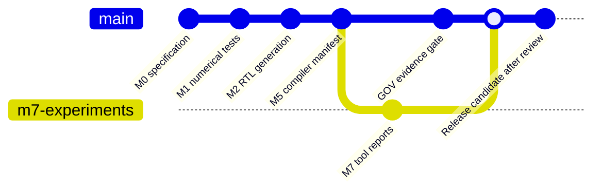
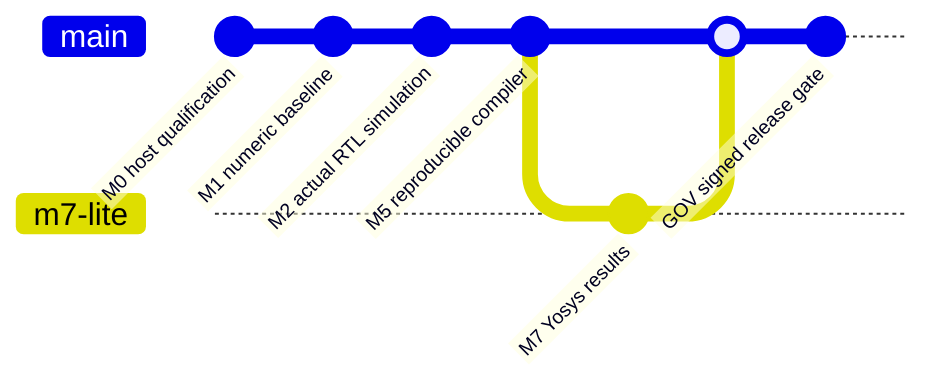
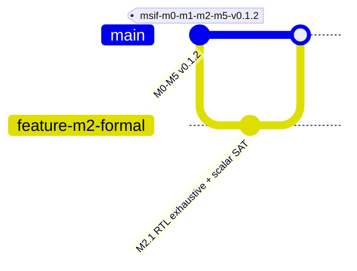
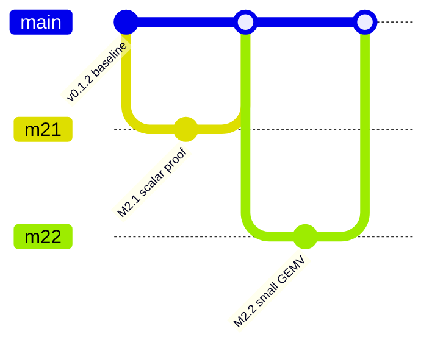

# Hackathon milestones and acceptance gates

| Gate | Deliverable | Criterion | Present state |
|---|---|---|---|
| M0 | Requirements / numeric reference / Node1 dependency audit | Exact contract and host log | Contract implemented; Node1 audit pending |
| M1 | Golden model and multiplier space | 4096 exhaustive coefficient/activation cases | Runnable tests supplied |
| M2 | Three comparison RTL variants | Synthesis, RTL simulation and reference equivalence | RTL generated; cycle simulation/formal equivalence pending |
| M5 | Weight-to-RTL compilation | Same input -> same manifest and RTL hashes | Runnable implementation supplied |
| M7-lite | Three variants through Yosys | Actual logs, normalized conditions | Conditional on installed tool |
| GOV | Signed build manifest | Valid signature and tamper-denial | Adapter supplied; key and runtime integration pending |

## GitHub history proposal

These are proposed milestone markers, not existing Git commits.

## Node1 qualification correction — 25 October 2026

The initial `verify.sh` accepted successful Python tests while printing `SKIP` for unavailable Verilog simulation and synthesis tools. This did **not** satisfy M2 RTL equivalence or M7-lite synthesis acceptance. The revised script **fails closed** (exit code 2) when `iverilog`/`vvp` or `yosys` is missing, runs actual RTL test vectors against the Python oracle and archives per-variant simulation/synthesis logs under ignored `build/demo/`. The initial Node1 log showed `yosys`, `iverilog`, `verilator`, `openroad`, `klayout`, and `ngspice` missing; their installation is not established by the patch. Only Icarus and Yosys are hard requirements for the strict prototype gate. `scripts/install_node1_tools.sh` is dry-run by default; `--install` is an explicit host modification.

**Validity boundary:** Icarus simulations exercise deterministic boundary/random input vectors but are not exhaustive for 16×64 GEMV; formal equivalence, signed rounding/INT8 saturation, mapped Liberty area/STA, parasitics and physical DRC/LVS are not delivered. Generic Yosys `stat` must not be presented as PDK-based area/power/timing. Initial `programmable` weights are initialized registers, not software-loaded runtime-programmable memory; `rom` is an inferred array, not a qualified silicon ROM macro. Signing is optional for research, mandatory for any governed release.

**Traceability:** [README](../README.md) · [Prerequisites](Prerequisites.md) · [Validation](Validation.md) · [Architecture](Architecture.md) · [Milestones](Milestones.md) · [Governance Crosswalk](Governance-Crosswalk.md) · [Deployment](Deployment.md) · [Documentation Audit](Documentation-Audit.md) · [One-shot Deployment](oneshot-deployment.md). Original PAG document links in Governance Crosswalk retain the actual `M2-...` through `M10-...` filenames; no nonexistent aliases are promised.

### Proposed GitHub commit sequence (NOT committed by this patch)

Treat a failing Node1 dependency audit or `verify.sh` as a blocking gate. Keep governance integration scoped to the existing snapshot v0.21.1 and record independent review of signature, approvals and execution-policy restrictions in a later milestone.

## Node1 observed qualification — October 25, 2026 (v0.1.1)

The user-supplied Node1 log confirms seven Python unit tests passed, all three RTL variants passed 28 deterministic vectors each, and Yosys 0.33 completed generic synthesis with zero `check` problems. Host tools: Icarus Verilog 12.0, Verilator 5.020 and Yosys 0.33. OpenROAD, KLayout and ngspice were not installed; they are not mandatory for the M7-lite generic synthesis gate.

| Variant | 28-vector Icarus | Yosys generic cells | Memory objects after synthesis |
|---|---|---:|---:|
| Programmable | PASS | 123,837 | 0 |
| Fixed-weight | PASS | 115,662 | 0 |
| ROM-style | PASS | 123,837 | 0 |

The fixed-weight variant has 8,175 (approximately 6.60%) fewer generic cells than the programmable baseline **for this particular fixture and synthesis flow**. The programmable and ROM-style variants map to identical generic cell counts, so the experiment does not yet differentiate a physical ROM or SRAM macro. These counts are *not* area, energy, timing, clock frequency, routed congestion or manufacturing evidence. The 28 full-matrix vectors are not an exhaustive proof.

`python3 scripts/node1_evidence.py --build build/demo` reads actual simulator/Yosys logs, requires PASS and zero Yosys `check` problems, and emits `build/demo/node1_evidence.json` with tool versions and log hashes. It fails if evidence is missing. This is a local evidence summary, **not** an approval or signature.

Baseline-freeze policy: freeze M0, M1 and the limited M2/M5/M7-lite implementation after reproducing the verification on Node1 and inspecting the local report. Keep formal proofs, technology-mapped PPA, real ROM macro, governance signature/approval and full source-model quantization as open gates. Existing milestones M3/M4/M6/M8–M11 are not completed.

## Planned M2.1 completion gate

M2.1 extends (does not replace) v0.1.2 with exhaustive 4096-pair **RTL** simulation and scalar SAT equivalence. Only tag after Node1 logs satisfy `docs/M2.1-Formal-Equivalence.md`. Full GEMV formal proof is a later gate.

> **M2.1 validation correction (2026-10-25):** M2.1 is pending requalification after false-positive simulation PASS was identified; preserve baseline v0.1.2 unchanged.

## M2.2 small-GEMV verification candidate

The bounded 2×4 GEMV arithmetic miter, generated RTL sequential tests, fail-closed Verilator lint, independent simulator checks, and evidence acceptance criteria are specified in [M2.2 — Small GEMV and Sequential Verification](M2.2-Small-GEMV-and-Sequential-Verification.md). On pages located within `docs/`, use the relative link `M2.2-Small-GEMV-and-Sequential-Verification.md`. Run `./scripts/verify_m22.sh` on Node1 only after M2.1 has been merged and revalidated. This milestone is not automatically accepted on source generation alone.

### M2.2 reset-testbench erratum (2026-10-25)
The first Node1 M2.2 simulation stopped at `async reset failed` because the testbench initialized active-low reset to zero without generating a falling edge. The corrected testbench initializes `rst_n=1`, then explicitly drives `rst_n=0` and waits for nonblocking assignments to settle before checking reset outputs. Repeat all three variant simulations and proof/lint gates; earlier M2.2 evidence is not acceptable. This is a testbench correction, not a change to the accepted M2.1 RTL compiler.

## M5.1 — PyTorch tensor import candidate

[M5.1 Milestone](M5.1-Quantized-Tensor-Ingestion.md) defines deterministic per-tensor signed INT4 quantization, row-major ordering, SHA-256 source provenance, explicit scale and fail-closed overflow. Execute `./scripts/verify_m51.sh` in addition to earlier milestone gates. This candidate is **not yet Node1-qualified** and does not imply production-model quantization accuracy, PDK PPA, or governance approval.

## M5.1 locked dependency qualification

See [PyTorch/NumPy environment qualification](M5.1-PyTorch-Environment-Qualification.md). `pyproject.toml` defines NumPy 2.5.4 and the explicit cu130 PyTorch 2.14.0 GPU group; `uv.lock` must be generated by `uv lock` and verified on Node1. Use `uv sync --locked --group gpu` and `./scripts/validate/pytorch/qualify_project_environment.sh` before `./scripts/verify_m51.sh`. `requirements.txt` is a core-only compatibility manifest and cannot certify CUDA. GPU, sm_120, PTX-JIT-disabled execution and compiled CUDA extension acceptance remain Node1-only gates.
