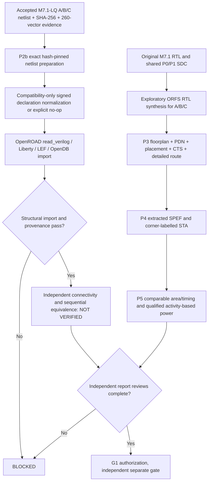

# Validation

## M7.2 evidence and validation — 2 November 2026

Node1 and the supplied P7 snapshot independently reported **110/110 Python unittests passing**. Focused P01–P07 tests and the Node1 EDA research runs are covered in the dated closure runbooks; a unit-test `BLOCKED` printed by an intentional negative fixture is not itself a failing unittest (check exit code and `OK`). Preserve negative controls and their rejected evidence. See [dated milestone matrix](Milestones.md#m72-branch-history-and-release-gates--2-november-2026).

| Receipt | Research observation | Qualification boundary |
|---|---|---|
| C16 final GLS | A/B/C each 260 vectors, authentic SKY130HD wrappers | `BOUNDED_FINAL_GLS_ALL_PASS_NOT_EQUIVALENCE`; no ECO/formal or SDF proof |
| C17 | `GLS_TT_EVIDENCE_CONSISTENT_NOT_SIGNOFF` | Hash consistency, not physical signoff |
| C13b/C14 and C22 TT | TT executions and global reports, independent TT log hashes | `TT_RESEARCH_EXECUTED_REVIEW_REQUIRED`; SS/FF/RC and complete timing coverage open |
| C17/C19/C20 area | SHA-checked exact-LQ ODB, area/classified master ledgers, SDC checks | `AREA_RECONCILED_SDC_REVIEW_REQUIRED`; name-based classification not approved utilization |
| C22 VCD | `MATCHED_BOUNDED_VCD_CAPTURED_NOT_POWER` and matching clk/rst_n/in_valid/activations | No routed-pin annotation coverage, switching/internal/leakage power or energy/op |
| C21 preflight | `RELEASE_BLOCKED_REVIEW_REQUIRED`, `issues=[]` among four historical receipt families | `release_authorized=false`; not an all-gates audit or independent acceptance |

The complete RTL-to-mapped asynchronous sequential proof, mapped-to-ECO functional proof, real SS/FF and calibrated RC, reset recovery/removal/clock/exception review, PWR1/PWR2, macro comparison and independent G1 approval remain **NOT_VERIFIED**. No M7.2 release tag or automatic push is authorized. Generated manifests, VCDs, model wrappers, OpenROAD databases and transcripts remain ignored/off-Git unless separately sanitized, hashed and approved for publication.

Run `./scripts/verify.sh`. Expected: Python exhaustive arithmetic suite passes, deterministic three-variant RTL written, manifest verifies. If Yosys is missing, synthesis is explicitly skipped. Required follow-up before an architecture performance claim: cycle-accurate multi-vector RTL simulation, independent reference equivalence, Yosys mapped library area/timing under equal constraints, and physical PDK-qualified timing. Do not confuse synthesis statistics with post-route PPA.

## Snapshot inspection evidence (October 25, 2026)

In the assistant's isolated inspection environment, the uploaded PAG v0.21.1 repository passed `PYTHONPATH=src pytest -q --disable-warnings --maxfail=1` (full success). The MSIF prototype passed all five Python test methods, including exhaustive 4096 INT4×INT8 scalar cases. A generated MSIF build was signed and verified using *actual* PAG `generate_ed25519_keypair`, `sign_blob` and `verify_blob`, with ephemeral keys outside the repository. This does **not** establish that Node1 has the same dependencies or that Node2 independent verification has happened.

Verilog simulation, formal equivalence, standard-cell area, STA and physically routed PPA **have not** been validated in this inspection environment; neither Yosys nor Icarus was installed. The optional synthesis script fails with an explicit blocked message rather than inventing measurements.


## Node1 qualification correction — 25 October 2026

The initial `verify.sh` accepted successful Python tests while printing `SKIP` for unavailable Verilog simulation and synthesis tools. This did **not** satisfy M2 RTL equivalence or M7-lite synthesis acceptance. The revised script **fails closed** (exit code 2) when `iverilog`/`vvp` or `yosys` is missing, runs actual RTL test vectors against the Python oracle and archives per-variant simulation/synthesis logs under ignored `build/demo/`. The initial Node1 log showed `yosys`, `iverilog`, `verilator`, `openroad`, `klayout`, and `ngspice` missing; their installation is not established by the patch. Only Icarus and Yosys are hard requirements for the strict prototype gate. `scripts/install_node1_tools.sh` is dry-run by default; `--install` is an explicit host modification.

**Validity boundary:** Icarus simulations exercise deterministic boundary/random input vectors but are not exhaustive for 16×64 GEMV; formal equivalence, signed rounding/INT8 saturation, mapped Liberty area/STA, parasitics and physical DRC/LVS are not delivered. Generic Yosys `stat` must not be presented as PDK-based area/power/timing. Initial `programmable` weights are initialized registers, not software-loaded runtime-programmable memory; `rom` is an inferred array, not a qualified silicon ROM macro. Signing is optional for research, mandatory for any governed release.

**Traceability:** [README](../README.md) · [Prerequisites](Prerequisites.md) · [Validation](Validation.md) · [Architecture](Architecture.md) · [Milestones](Milestones.md) · [Governance Crosswalk](Governance-Crosswalk.md) · [Deployment](Deployment.md) · [Documentation Audit](Documentation-Audit.md) · [One-shot Deployment](oneshot-deployment.md). Original PAG document links in Governance Crosswalk retain the actual `M2-...` through `M10-...` filenames; no nonexistent aliases are promised.

### Node1 exit codes and measured evidence

```bash
./scripts/node1_audit.sh
./scripts/install_node1_tools.sh --install  # optional explicit installation
./scripts/verify.sh |& tee logs/node1_verify_full.log
find build/demo -maxdepth 1 -name 'sim_*.log' -o -name 'yosys_*.log'
```

`verify.sh` exits nonzero for missing mandatory tools or a simulator/synthesis failure. A pass demonstrates Python correctness tests, cycle-driven simulations of all three generated variants and generic synthesis completion. Independently review `sim_*.log` and `yosys_*.log`; do not interpret successful process exit as signoff. Gate GOV is distinct; verify a trusted Ed25519 key/signature and an authorized reviewer before release.


## Node1 observed qualification — October 25, 2026 (v0.1.1)

The user-supplied Node1 log confirms seven Python unit tests passed, all three RTL variants passed 28 deterministic vectors each, and Yosys 0.33 completed generic synthesis with zero `check` problems. Host tools: Icarus Verilog 12.0, Verilator 5.020 and Yosys 0.33. OpenROAD, KLayout and ngspice were not installed; they are not mandatory for the M7-lite generic synthesis gate.

| Variant | 28-vector Icarus | Yosys generic cells | Memory objects after synthesis |
|---|---|---:|---:|
| Programmable | PASS | 123,837 | 0 |
| Fixed-weight | PASS | 115,662 | 0 |
| ROM-style | PASS | 123,837 | 0 |

The fixed-weight variant has 8,175 (approximately 6.60%) fewer generic cells than the programmable baseline **for this particular fixture and synthesis flow**. The programmable and ROM-style variants map to identical generic cell counts, so the experiment does not yet differentiate a physical ROM or SRAM macro. These counts are *not* area, energy, timing, clock frequency, routed congestion or manufacturing evidence. The 28 full-matrix vectors are not an exhaustive proof.

`python3 scripts/node1_evidence.py --build build/demo` reads actual simulator/Yosys logs, requires PASS and zero Yosys `check` problems, and emits `build/demo/node1_evidence.json` with tool versions and log hashes. It fails if evidence is missing. This is a local evidence summary, **not** an approval or signature.

Baseline-freeze policy: freeze M0, M1 and the limited M2/M5/M7-lite implementation after reproducing the verification on Node1 and inspecting the local report. Keep formal proofs, technology-mapped PPA, real ROM macro, governance signature/approval and full source-model quantization as open gates. Existing milestones M3/M4/M6/M8–M11 are not completed.

## M2.1 additional strict gate

Run `set -o pipefail; ./scripts/verify_m21.sh 2>&1 | tee logs/m21_node1.log`. Require 4096 scalar RTL pairs and Yosys SAT `SUCCESS!`, in addition to the original `./scripts/verify.sh`. See [M2.1 evidence](M2.1-Formal-Equivalence.md). This has not yet been validated on Node1.


> **M2.1 validation correction (2026-10-25):** M2.1 mandatory: no simulator ERROR/FATAL/FAIL/WARNING lines; one exhaustive PASS marker, fresh evidence JSON, Yosys SAT SUCCESS and independent Verilator lint review. Previous M2.1 evidence is invalid due to Icarus assertion diagnostics.

## M2.2 small-GEMV verification candidate

The bounded 2×4 GEMV arithmetic miter, generated RTL sequential tests, fail-closed Verilator lint, independent simulator checks, and evidence acceptance criteria are specified in [M2.2 — Small GEMV and Sequential Verification](M2.2-Small-GEMV-and-Sequential-Verification.md). On pages located within `docs/`, use the relative link `M2.2-Small-GEMV-and-Sequential-Verification.md`. Run `./scripts/verify_m22.sh` on Node1 only after M2.1 has been merged and revalidated. This milestone is not automatically accepted on source generation alone.


### M2.2 reset-testbench erratum (2026-10-25)
The first Node1 M2.2 simulation stopped at `async reset failed` because the testbench initialized active-low reset to zero without generating a falling edge. The corrected testbench initializes `rst_n=1`, then explicitly drives `rst_n=0` and waits for nonblocking assignments to settle before checking reset outputs. Repeat all three variant simulations and proof/lint gates; earlier M2.2 evidence is not acceptable. This is a testbench correction, not a change to the accepted M2.1 RTL compiler.

## M5.1 — PyTorch tensor import candidate

[M5.1 Validation](M5.1-Quantized-Tensor-Ingestion.md) defines deterministic per-tensor signed INT4 quantization, row-major ordering, SHA-256 source provenance, explicit scale and fail-closed overflow. Execute `./scripts/verify_m51.sh` in addition to earlier milestone gates. This candidate is **not yet Node1-qualified** and does not imply production-model quantization accuracy, PDK PPA, or governance approval.


## M5.1 locked dependency qualification

See [PyTorch/NumPy environment qualification](M5.1-PyTorch-Environment-Qualification.md). `pyproject.toml` defines NumPy 2.5.4 and the explicit cu130 PyTorch 2.14.0 GPU group; `uv.lock` must be generated by `uv lock` and verified on Node1. Use `uv sync --locked --group gpu` and `./scripts/validate/pytorch/qualify_project_environment.sh` before `./scripts/verify_m51.sh`. `requirements.txt` is a core-only compatibility manifest and cannot certify CUDA. GPU, sm_120, PTX-JIT-disabled execution and compiled CUDA extension acceptance remain Node1-only gates.


## M7.1 synthesis comparison candidate

The next prototype gate is [M7.1 controlled A/B/C synthesis](M7.1-Controlled-Synthesis-Comparison.md) (see `docs/M7.1-Controlled-Synthesis-Comparison.md` from documents). Run `./scripts/verify_m71.sh` after all older milestone regressions. Generic cell counts and optional Liberty-mapped cell counts do not establish timing, routed area, power or release approval. PAG EvidenceLedger and human approval integration remain planned.


## M7.1-L — optional standard-cell Liberty mapping qualification (2026-10-26)

**Independent LQ acceptance (PENDING):** export complete mapped Verilog and Yosys JSON, inventory every instantiated cell against the selected Liberty, reject unresolved internal cells/blackboxes, check signed arithmetic and reset/valid behavior against the behavioral RTL, preserve proofs and SHA-256 receipts; fail closed on any missing result. See [LQ verification gates](M7.1-Liberty-Mapping-Qualification.md).

## M7.1-LQ Node1 bounded verification — 26 October 2026

**PASS:** mapped A/B/C standard-cell inventories and 260-vector gate-level regression per architecture on Node1 (746/690/746 mapped cells). See [canonical LQ evidence, incident history and limitations](M7.1-LQ-Mapped-Netlist-Verification.md). Full sequential formal proof, physical PPA and governed release authorization remain **NOT VERIFIED**. Continue with the document-first [M7.2/G1 engineering handoff](M7.2-G1-Engineering-Handoff.md); do not claim those milestones complete or production-qualified.

Run `python3 scripts/m71_lq_audit.py --build build/m71_liberty` to audit saved evidence hashes; also execute Node1 negative configuration tests separately. LQ PASS is bounded simulation, not universal sequential proof.


## M7.2 physical-flow implementation boundary — 26 October 2026

**M7.2 fail-closed validation:** `python3 -m unittest discover -s tests -q`; `./scripts/verify_m72.sh` requires operator-approved ORFS input, matching pinned Liberty/LEF/RCX, complete LQ evidence, common constraint hashes. `--dry-run` and `--execute` do not imply physical PPA approval. [Acceptance criteria](M7.2-Physical-Design-Qualification.md).

M7.2 Node1 dry-run note (28 October 2026): P0/P1 passed, while GNU Make `-n` failed on a missing intermediate floorplan SDC generated by recursive stage recipes. A static no-execution plan replaces this unreliable make dry-run. P2b mapped-netlist import, physical flow and timing/PPA remain pending; see [M7.2 runbook](M7.2-Physical-Design-Qualification.md).

## Node1 M7.2 execution state and evidence boundary

See [M7.2 physical runbook](M7.2-Physical-Design-Qualification.md) for the 28 October 2026 programmable-only completed exploratory route, unresolved P2b–P5, warnings and independent A/B/C audit. Do not represent the programmable Make exit 0 as release authorization.


## M7.2 P2b–P5 implementation continuation (28 October 2026)

This section is additive to the accepted P0/P1 baseline and does not authorize a commit, tag, or release.



### Implementation modules and status

- `scripts/m72_exact_lq_import.py`: hash-pin exact accepted `build/m71_liberty/m71_lq/msif_*_mapped.v` into isolated P2b candidates, preserve raw files, permit only reviewed signed-port compatibility transforms (including explicit no-op) and optionally test import into OpenDB; **does not implement post-import formal equivalence or a complete ORFS place-and-route handoff**.
- `scripts/m72/m72_normalize.py`: previously verified programmable declaration transform, now also emits a fail-closed identity/no-op receipt when no signed declarations exist. Prevents valid fixed/ROM structural netlists from being rejected solely due to absence of signed ports.
- `scripts/m72_report_review.py`: collects A/B/C final ODB/GDS/SPEF/SDC, detailed-route report and finish report, hashes artifacts, extracts labelled timing *observations*, and refuses missing evidence. A report-present result is explicitly not signoff.
- `scripts/m72_physical_audit.py`: retains a conservative three-architecture inventory with no signoff from existence alone.

### Node1 execution sequence

```bash
cd ~/dev/pub/ai-sys1/msif-hack/push/msif_hackathon
source .venv/bin/activate
export MSIF_ORFS="$HOME/eda/qualified-pdks/OpenROAD-flow-scripts"
export PYTHONPATH="$PWD/src:$PWD/scripts"
python3 -m unittest discover -s tests -v
PYTHONPATH="$PWD/scripts/m72" python3 -m unittest discover -s scripts/m72 -p 'test_m72_normalize.py' -v
python3 scripts/m72_exact_lq_import.py --orfs "$MSIF_ORFS" --out build/m72/p2b-exact-lq
# Only after reviewing the manifest and no stale output directory:
# python3 scripts/m72_exact_lq_import.py --orfs "$MSIF_ORFS" --out build/m72/p2b-exact-lq-execute --execute
# Independently perform the normalizer ORFS route on fixed and rom; use separate FLOW_VARIANTs.
python3 scripts/m72_report_review.py --flow "$MSIF_ORFS/flow" --out build/m72/p3p5-report-ledger.json
```

### Outstanding hard gates

- **P2b:** OpenDB import with matching accepted hashes is an *import experiment*. Cell-pin/bit-accurate structural preservation, sequential equivalence, and a fully integrated exact-LQ physical implementation remain separate, unimplemented closure gates.
- **P3:** A is routed experimentally; B/C must be routed. Independently review legal placement, PDN connectivity, detailed-route DRC, antenna checks, macro inclusion, and reproducible ODB/GDS against reports.
- **P4:** Timing reports from a single TT corner and relaxed research SDC cannot establish multi-corner signoff. Review all setup/hold paths, unconstrained endpoints, reset recovery/removal, RCX corner provenance and additional PVT views where available.
- **P5:** Report standard-cell (not die/core) area and distinguish core area, utilization, clock and I/O delay assumptions. Power without explicit VCD/SAIF/activity provenance is an estimate only. A/C arrays are not qualified SRAM/ROM macros.
- **G1:** Release approval and Node2 independent receipts remain `NOT_VERIFIED`.


## M7.2 P5 and pending closure audit (2026-10-28)

See [M7.2 P5 comparison and closure gates](M7.2-P5-Comparison-and-Closure-Gates.md) for the corrected optional-DRC ledger behavior, research comparison, exact-netlist equivalence, multi-corner STA, activity-based power, and memory-macro requirements. A/B/C ORFS flows completed, but P2b–P5 signoff and G1 remain **NOT_VERIFIED**. No Git commit or release tag is authorized by this result.
